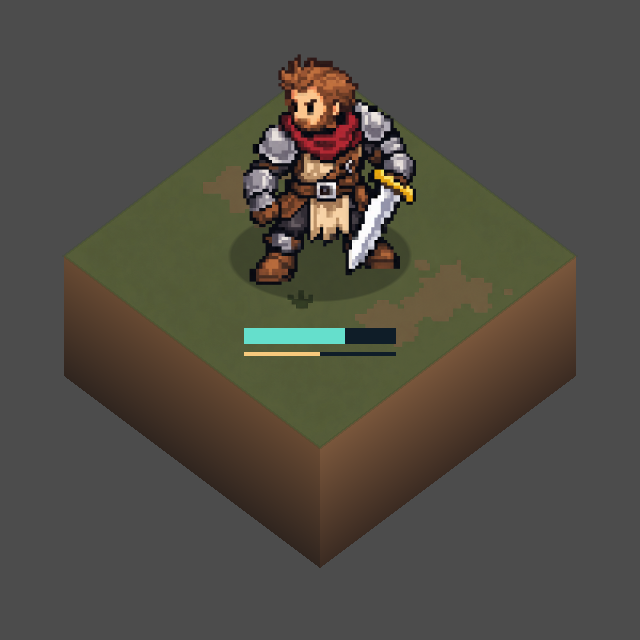

# Новый эталон формата персонажей — 2026-10-23

U: «возьми этого воина как новый эталон, теперь все персонажи будут в таком формате».
Этот набор заменяет `defender_brighter_v1` как ориентир для создания следующих
персонажей. Владелец художественных правил — [ART_DIRECTION](../../../../docs/ART_DIRECTION.md#новый-эталон-формата-всех-персонажей--2026-10-23).

[character.png](character.png) — исходный прозрачный PNG128×128, первый кадр
выбранного PixelLab idle-1. [on-tile.png](on-tile.png) — его игровой рендер
с текущими материалом, отражением и утверждённой посадкой, увеличенный4× для просмотра.
[preset.json](preset.json) хранит SHA, геометрию и ссылки на ресурсы.
Исходники скопированы побайтно, генерации/перерисовки нет.

Ориентиры: чистые пиксельные группы без зерна и размытия; компактный силуэт,
крупная читаемая голова, ясное разделение лица, одежды, металла и оружия;
передний3/4 с видимым лицом в ракурсе нашего поля. Красный шарф, борода и меч
относятся к образу этого воина: класс и экипировка следующих персонажей свои.
Цвет и контраст сравнивать с этим PNG/рендером; старое осветление палитры к
новым исходникам автоматически не добавлять.

Рабочий холст128² RGBA, прозрачный фон без подставки, клетки и встроенной тени.
Первый силуэт54×72px; в игре при ArtRoot0.8 —43,2×57,6px на верхе тайла128×96.
Для этого воина anchor(71,83), still/idle/death используют одну опору; враг зеркален.
У нового класса подбирать опору по его стопам и силуэту, сохраняя относительный
масштаб и пример посадки; не центрировать каждый кадр по меняющемуся bbox.
Тайл и его проекция4:3 этим выбором не меняются.

Выбранные движения: [idle-1 «Тихое дыхание»](../../trials/enemy_warrior_idle_v1/README.md)
и [death-2 «Колено, затем вперёд»](../../trials/enemy_warrior_death_v1/README.md).
Анимация сохраняет лицо/одежду/оружие, пиксельную сетку и общую опору;
движение проверяется на тайле в игровом размере. Число кадров и темп конкретного
клипа не являются обязательными для всех будущих действий.

Выбор формата относится ко всем будущим персонажам; текущая реализация заменяет
только вражеского Защитника. Массовая перерисовка остальных классов в этот этап
не входит. Ручная проверка переходов в игре остаётся отдельной от выбора эталона.
