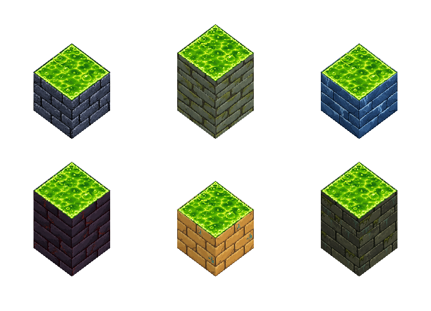

# Кислота05/01 как независимое покрытие тайла

U2026-11-04 выбрал анимацию01 и поручил внедрение в текущую сцену;
дополнительное уточнение — кислота может быть на разных материалах,
каменное основание не должно следовать за эффектом.
Base `55d9605ec0473a99ffa243a521b1239ba1962d29`, main.

В `environment_overlay.tscn` подключена новая сцена кислоты. Она использует
33 исходных кадра256² на10FPS, с прежней палитрой и движением. При отрисовке
виден только ромб128×96 верхней поверхности, остальные пиксели имеют нулевую
alpha. Рисунок пола и боковин под эффектом остаётся своим для каждого биома.
Исходные кадры не ретушировались; atlas — побайтная копия листа PixelLab.

Владелец геометрии/часов/lifecycle — [BATTLE_VISUAL_SCENE_CONTRACT](../../BATTLE_VISUAL_SCENE_CONTRACT.md#анимированная-кислота-без-каменного-основания--2026-11-04).
Правила коррозии — [ENVIRONMENT_HAZARDS_V1](../../ENVIRONMENT_HAZARDS_V1.md).
[Исходная серия](../acid05-animation-20261103/README.md),
[выбранные ресурсы/SHA](../../../assets/art_presets/approved/acid05_selected_v1/README.md).

Новая генерация не выполняется. Контракты core/preview/queue/RNG/save,
состав пяти классов, текущие скины и каталог не меняются.
Ручная оценка F5/движения/zoom/DPI, художественный стык и performance открыты.

## Свидетельства

[Текущая комната](acid-live-current-room.png) · [Цикл без камня](acid-masked.webp).
WebP собран без потерь из33 GPU-кадров; это preview, runtime использует исходный atlas.

PASS: builder `--check`, Python compile, launcher37 тестов; isolated import/startup;
headless acid_tile_animation92/0, visual_scene_contract106/0, acid56/0.
GPU acid_tile_animation194/0, environment_visual_contract32/0,
visual_scene_contract106/0, dungeon_room_comparison1983/0. Все33 маски проверены
по пикселям; контроль без маски обнаруживает исходный камень вне ромба.
Независимое ревью — [APPROVE с ограничениями](review.md).

GPU-suite не полностью зелёный: hazards_ui105/2. Те же две ошибки завершения
показа шипов воспроизведены на base55d9605 и текущем runtime; они не исправлялись
этим визуальным срезом. Headless environment_visual_contract31/1 требует GPU
для существующей проверки пикселей; на GPU32/0. Первый экспорт имел неверное
поле SpriteFrames `_animations`; исправлено на `animations`, результат проверен движком.

Отчёты: `test_reports/acid01-integration-20261104/`, headless
`test_reports/demo-ce9c4ce9228e414693577ee02b06d800/`, GPU
`test_reports/demo-92fd62445c924aeebe5cf35497debee8/`.
Full/core/root import не запускались. Ручной плейтест и художественная приёмка
маскированного результата не подменяются выбором исходного варианта01.
