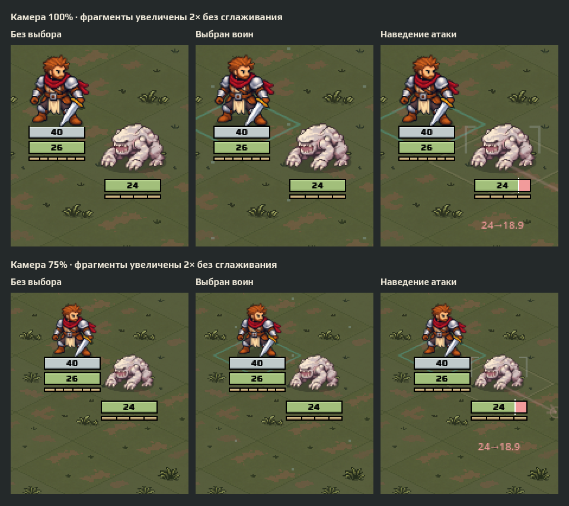

# Полоски двух соседних персонажей — 2026-11-23

По запросу пользователя сняты воин `red_bastion` и Прирученный троглодит
на соседних клетках (3,3) и (4,3): без выбора, с выбранным воином и при
наведении атаки на троглодита. Это текущий runtime, без изменения его кода.



Верхний ряд — камера 100%, нижний — минимальные штатные 75%. Фрагменты
увеличены ровно вдвое NEAREST; внутри каждого ряда координаты вырезки одинаковы.
Модели, позы и геометрия полосок между состояниями не меняются. При наведении
появляется готовый прогноз HP 24 → 18.9, удар не исполняется. Троглодит остаётся
только целью, выбран воин. В этой паре полоски не заходят на соседнюю модель;
кадр не демонстрирует сильного взаимного перекрытия и не подменяет такой тест.
На обоих масштабах земля не закрывает полоски. Художественная приёмка открыта.

## Исходные кадры

| Камера | Без выбора | Выбран воин | Наведение атаки |
|---|---|---|---|
| 100% | [Поле](adjacent-no-selection-100.png) | [Поле](adjacent-selected-100.png) | [Поле](adjacent-attack-hover-100.png) |
| 75% | [Поле](adjacent-no-selection-075.png) | [Поле](adjacent-selected-075.png) | [Поле](adjacent-attack-hover-075.png) |

PNG поля — 1440×1100, файлы `*-crop.png` — вырезки 1:1. Монтаж обрезает
внешнюю карточку прогноза, полные кадры сохраняют её. Ничего внутри поля не дорисовано.

## Воспроизведение и проверки

`capture_field.gd` загружает штатный HeroHubBattleView, создаёт тестовую расстановку
через BattleBoard до baseline, скрывает остальные фигуры и останавливает ambient
анимации для сопоставимости. Выбор и атака проходят через API экрана; прогноз
ожидается до готовности. Подробности и snapshots: [capture-field.json](capture-field.json).

`run_capture.py` сверяет 1685 runtime-файлов текущего checkout с уже импортированной
isolated-копией, копирует только capture/compose-скрипты и запускает GPU Godot без
выноса окна на передний план. Корневой `.godot` не затрагивается. Из корня:

```powershell
python docs/art/adjacent-unit-bars-20261123/run_capture.py --project D:/Games/into-de-dung/test_reports/demo-2f791ac889864e78be19395dfeb22edc/project --godot D:/Downloads/Godot_v4.7.2-stable_win64.exe/Godot_v4.7.2-stable_win64.exe
```

[Проверка](verification.json): 6 кадров / 0 отказов, parse + GPU D3D12 PASS,
core/RNG/counters/revision parity, постоянная геометрия, правильный выбор и
mask count PASS. Вырезки 1:1 и все пиксели увеличенных панелей монтажа сверены
с исходниками: точное NEAREST 2×. [Capture log](capture.log),
[composition log](composition.log), [runtime parity](runtime-check.json).

Свежий import, full/core, ручные F5/Editor/DPI/performance не запускались:
использована проверенная ранее импортированная копия. Этот показ не расширяет
гарантии текущего [контракта полосок](../../BATTLE_PRESENTATION_REWORK.md).
Предыдущие foundation 2 отказа на baseline остаются отдельно от этой проверки.
Независимый read-only review `game_reviewer`: APPROVE для показа; отмечены
постановочная расстановка, отсутствие сильного перекрытия и незакрытая ручная приёмка.
