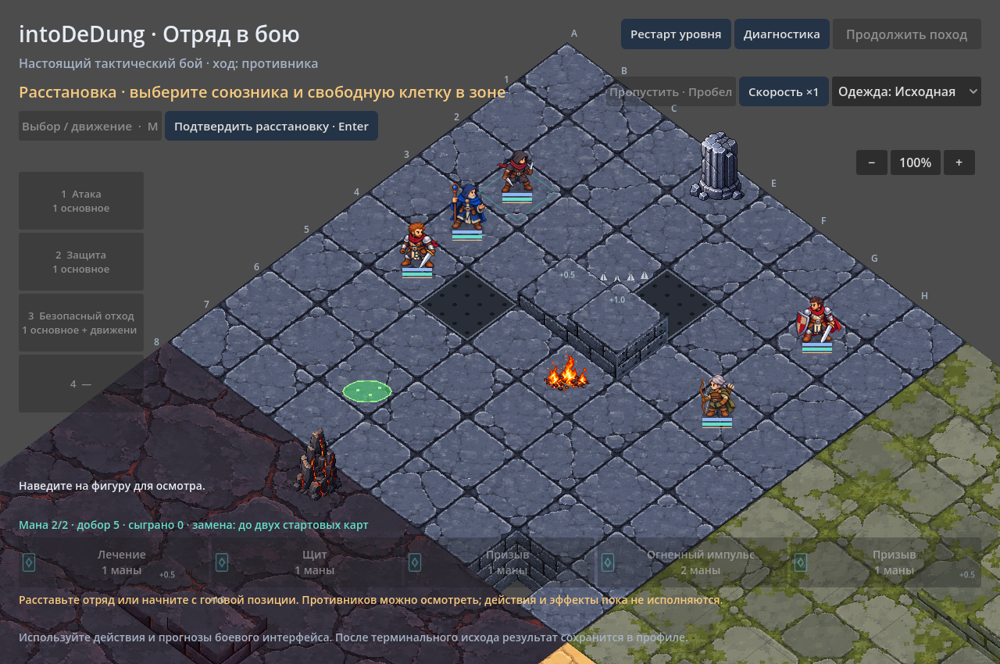

# Лучница14-04 — idle2/4 и уменьшение фигуры

По U основной idle заменён с1 на2 «Перенос веса», дополнительный — с5 на4
«Внимательный взгляд». После отзыва о слишком крупной фигуре её масштаб
уменьшен на10%: ArtRoot0.8→0.72. Смерть3 и способность4 сохранены.
База: `b6c596789288567f989b8e339dd14846c46a4c9f`, ветка `main`.

Источники: [пакет PixelLab](../archer14-04-animation-20261103/README.md).
Листы idle2/4 скопированы побайтно; кадры, опора(128,200), texture_scale0.5,
палитра и полный кадр с покрытием сохранены. Область выбора и привязки эффектов
следуют масштабу фигуры. В обеих командах и всех позах применяется один размер;
legacy-fallback Лучницы, другие классы и портрет хаба не масштабировались.

Владелец поведения и чередования — [CHARACTER_SKINS_V1](../../CHARACTER_SKINS_V1.md).
Дополнительный idle по-прежнему включается после3–6 основных циклов, затем
возвращается основной. Игровые RNG, core, preview, очередь и сохранения не менялись.

## Проверки и приёмка

[Обе команды, способность и смерть](selected-skins.png) ·
[Проверки и SHA](validation.json) · [Независимое ревью](review.md).

PASS isolated import/startup. Headless: character_skins1074/0,
mage_archer_skins415/0. GPU: character_skins1130/0, mage_archer_skins415/0,
current_art_zoom496/0, class_showcase_ui47/0, character_coverage53/0.
Проверены смена обоих idle, возврат после действий, обе команды, zoom,
пикинг и привязки эффектов. Сборщик:43 детерминированных результата,
27 PNG побайтно,693 видимых региона;37 остальных PNG/TRES не изменены.
Корневой проект не импортировался. Логи: test_reports/archer-idle-scale-20261103/;
headless: test_reports/demo-9aafd6ba1ed04ffb9cd25b6ff860fc9f/.

Ручная оценка размера и стыков пользователем остаётся открытой. Новые генерации,
ретушь исходников и full/core в этот этап не входят.
