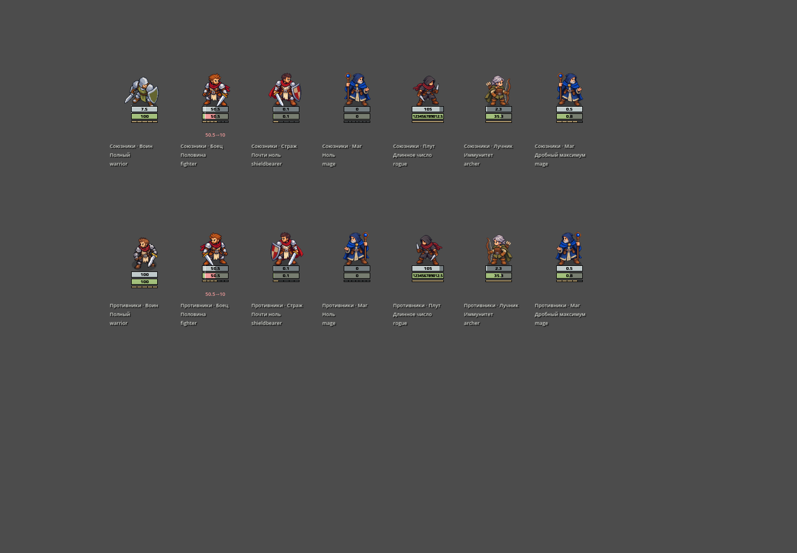
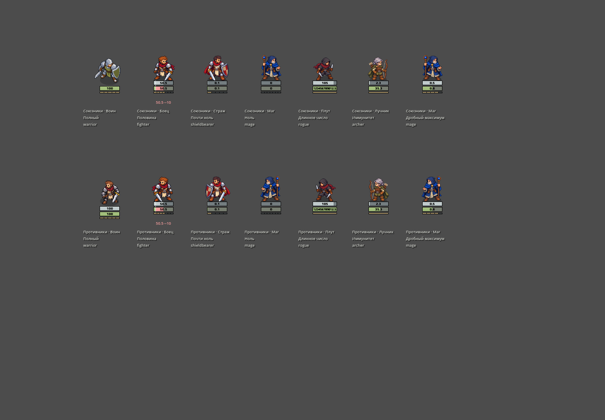

# Полоска брони без исходного запаса — 2026-11-22

У персонажа без штатной брони полоска скрыта. Получение временной/магической брони показывает её до фактического исчерпания; при нуле снова скрываются трек, число и прогноз. У экипированного персонажа пустая полоска остаётся.

Владелец правила — [показ состояния](../../BATTLE_PRESENTATION_REWORK.md). Painter использует опубликованные `ArmorRuntime.totals.maximum/current`: штатная ёмкость не включает временные выдачи, текущий запас включает. Core, гранты, расчёт урона и сохранения не изменены. Чисто временный положительный запас без штатной ёмкости показан полной шкалой и числом; остаток меньше0.1 отображается как `<0.1`, а не нулём.

Изолированный прогон:
`python tools/demo/isolate.py --render-check --only unit_vital_bars presentation_status unit_visual_contract visual_scene_contract --screen 0`.
Отчёт: `test_reports/demo-025837fc8f5d423896a864f0d40207c1/`.
Импорт/запуск и четыре GPU suite PASS: 1884 проверки, 0 ошибок.
Lifecycle проверяет обе стороны: отсутствие/нулевой максимум, выдачу, малую дробь, исчерпание, повторную выдачу и нулевую экипированную броню; HP/равновесие неизменны, прогноз не определяет видимость. Новые GPU-сценарии требуют capture-mode, он включён указанной командой.

Независимое ревью /root/monster_visual_review: APPROVE после добавления `<0.1`. Первый импорт в `demo-20e0b3fcacbd4ce487e7c95e26eee4ae` остановился на ошибке Godot editor teardown `_desired_size_changed` при disconnect кнопки; зависимые тесты тогда не запускались. Новый полный целевой прогон прошёл без фильтрации диагностик.

База main: 435f11a3d6f67c7cbd4b3ddc51dce8071536a0b0.
Чужие main_menu.tscn и battlefield-reference-03-20261017/ не включены.
Full/core, ручной F5/DPI/плейтест и performance не заявлены.
Анимации K1 находятся в отдельном drawing workspace и не интегрированы.
