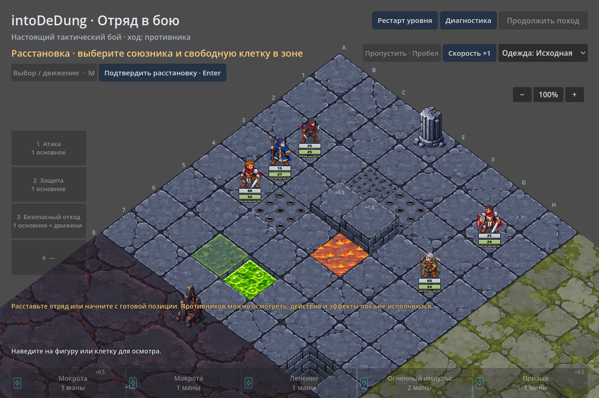

# Равновесие и читаемость полос — 2026-11-15

Позднейшее уточнение U: Выносливость повышает равновесие ступенями по5;
[коррекция формулы и проверки](endurance-step5.md). Ниже сохранён результат
первого этапа7323988f; оформление полос и отсутствие всплывающего текста остаются.

Поручение U: убрать всплывающий текст равновесия, разделить шкалу по одному
очку, установить базу5 с постоянным ростом только от перков; усилить различие
заполненной/пустой части HP и брони, немного увеличить цифры.

База работы `5276e12ba04f1b72485a4bde64325bf7c61414d5`, main.
Параллельный арт-коммит `53396a74f061b8e5ccb2ab274edc656b7a5ee735` сохранён.

## Результат

У героев равновесие5 при любой Выносливости; «Стойкий» даёт7. Противники текущего
каталога4 также получают базу5. Временное удвоение от пут и нулевой иммунитет
сохранены. Старые enemy-пороги каталогов1–3 и формат сохранений не мигрируются.

Удары/пробой/восстановление и остановка цепи больше не создают всплывающую
подпись категории `balance`. События, осмотр, прогнозы, урон и причины столкновения
остаются. Полоска показывает остаток, разделители видны и в пустых секциях.
При техническом/старом пороге, для которого очку достаётся менее2px, сохраняется
сплошная шкала; невосприимчивость также не получает выдуманных секций.

HP/броня48×11 экранных px, цифры с растром до7px вместо5px; по1px свободного
пространства внутри рамки сохранено. Размер не зависит от камеры/canvas.
Заливка стала светлее, подложка сохранила читаемость чёрного нуля:
расчётное отношение яркости заливка/фон HP1,355→2,075, броня1,673→2,517.
Это характеристика палитры, не замер удобства или производительности.

Правила: [характеристики](../../CHARACTER_ATTRIBUTES_V1.md),
[показ](../../BATTLE_PRESENTATION_REWORK.md), [классы](../../CLASS_SHOWCASE_V1.md),
[архитектура](../../ARCHITECTURE.md). Другие срезы не запускались.

## Кадры настоящих сцен Godot

[Галерея полос](vitals-gallery.png): обе команды, полный/частичный/нулевой ресурс,
дроби, длинное число, иммунитет. Это тестовый DTO, не новый игровой ростер.
[Восстановление без подписи](balance-recovery.png): реальный eventless refill
механической fixture; её HP/пороги не являются стартовыми параметрами нового хаба.

## Проверки

Один Godot4.7.2 runner, isolated `demo-447237eb16c7426fb0eaf8af75a19c6d/project`.
Import/startup PASS. Headless: core9424/0, ещё9 адресных suites3473/0.
GPU: unit_vital_bars599/0, presentation_status158/0,
presentation_consequences2217/0, hub_development2609/0,
battle_character_card119/0, class_showcase_ui47/0, battle_presentation_owned64/0.
Итого17 suites18710/0; независимое ревью APPROVE.

Первый прогон имел3 FAIL: недостаточный контраст цифр на затемнённой подложке
и две устаревшие группы ожиданий тестов (подпись цепи, порог13 вместо5).
Исправлены цвета в production и ожидания нового поведения; повторные проверки
прошли без снижения требований. Неудачные логи сохранены.

Отчёт `test_reports/balance-vitals-20261115/`: `iterate.py`, повторные логи/PNG,
`iteration-results.json`, `review.md`, `validation.json`. Первый прогон и полный
manifest — `test_reports/demo-447237eb16c7426fb0eaf8af75a19c6d/`.
[Сверка](validation.json) подтверждает совпадение10 source/test файлов с проверенной
копией и неизменность33 исходных защищённых файлов. Изменения параллельного арта
исключены из пакета; его новый HEAD сохранён.

Full suite, ручные F5/Editor/движение/zoom/OS-DPI, usability/performance не запускались.
Технические GPU кадры и ревью не заменяют отзыв U;60FPS не заявляются.
