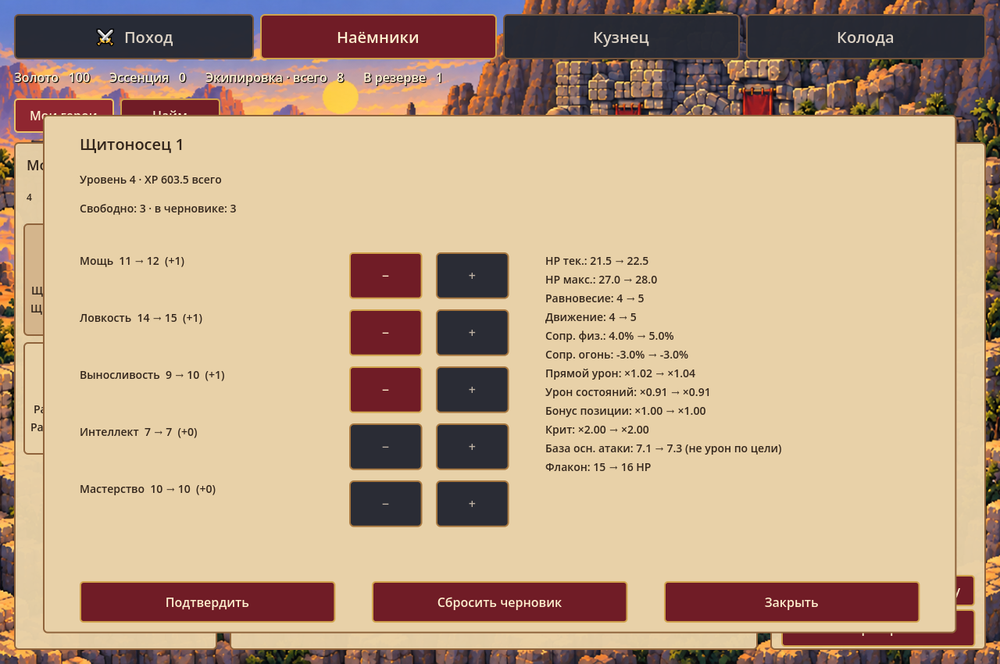

# Ступени Выносливости — уточнение 2026-11-15

После этапа7323988f U уточнил: Выносливость повышает равновесие через пороги
и выбрал10–14→5,15–19→6. Постоянная база, не зависящая от характеристики,
заменена формулой `5 + floor((max(E,0) - 10) / 5)`; `steady` добавляет2 отдельно.

| Выносливость | Равновесие до перка |
|---|---:|
| 0–4 | 3 |
| 5–9 | 4 |
| 10–14 | 5 |
| 15–19 | 6 |
| 20–24 | 7 |
| 25–29 | 8 |

Ниже нейтрали сохранён прежний принцип floor-штрафа. Сам уровень порог
не повышает. Враги каталога4 используют ту же формулу от определения класса;
нынешняя Выносливость10 оставляет5. Старые enemy-пороги1–3 не мигрируются.
Изображение полос, всплывающие подписи, эффекты пут/иммунитет, пробой/refill,
очередь/preview/RNG/save schema/frozen не менялись в этом уточнении.

Владелец правила — [CHARACTER_ATTRIBUTES_V1](../../CHARACTER_ATTRIBUTES_V1.md),
подключение — [ARCHITECTURE](../../ARCHITECTURE.md), команды — [TESTING](../../TESTING.md).
Основа7323988f, параллельный артc4462204 сохранён.

## Проверки

Один свежий isolated Godot4.7.2 runner `demo-a687b7922ac7486c953c16fd33945603`.
Import/startup PASS;7 headless2821/0 +2 GPU2728/0 =5549/0, без повторных попыток.
Наборы: hero_progression 287/0, character_attributes_v1 873/0, class_showcase 262/0,
hero_hub 98/0, current_schema_boundary 592/0, expedition_transitions 190/0,
mage_deck_expedition 519/0, hub_development 2609/0, battle_character_card 119/0.
Проверены границы14/15/19/20, дроби/нижние пределы, allocation14→15,
перки/сброс/roundtrip, реальные сохранения/retry и предпросмотр хаба.

Кадр существующей fixture9→10 подтверждает шаг4→5 в UI. Положительные
пороги14→15 и19→20 проверяются таблицей и HeroProgression allocation.
Независимое ревью APPROVE;5 изменённых source/test файлов совпадают с tested copy,
33 защищённых файла неизменны. [Сверка](endurance-step5-validation.json).
Логи/manifest/timing/PNG — `test_reports/demo-a687b7922ac7486c953c16fd33945603/`;
итог/ревью/аудит — `test_reports/endurance-balance-step5-20261115/`.

Core9424/0 и широкий GPU пакет предыдущего этапа здесь не повторялись.
Full, ручные F5/Editor/движение/zoom/OS-DPI/usability/performance не запускались;
приёмка U открыта,60FPS не заявляются.
