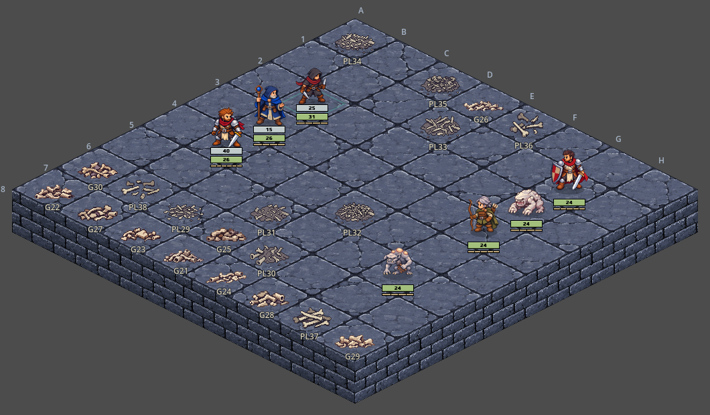

# Кости рядом с воином на настоящем поле — 2026-11-23

По U сначала показаны PL29/PL34, затем все последние 20 вариантов:
G21–G30 и PL29–PL38. Это временная примерка для выбора, без внедрения останков.

[Полный кадр 1440×1100](field-all-100.png),
[отдельное сравнение PL29/PL34](comparison-100.png),
[его полный кадр 1280×720](field-100.png).
Вырезки сохраняют пиксели исходного игрового кадра без ресайза/ретуши.

Настоящий GPU-рендер BattleDemoBoard, стандартное тестовое поле 8×8,
dungeon_comparison_tile, art_trial_unit и dungeon_room_environment.
Камера 100%, тайл 128×64, текущий воин fighter / red_bastion с art_scale 0.8.
PL — исходные PNG 64×64, Sprite2D scale 1 и NEAREST, без сжатия проекцией пола.
G — крупные концепты: регион bbox alpha≥128 уменьшен только при рисовании
до ширины 60 px / высоты не более 32 px через NEAREST. Они не названы
нативными пиксельными спрайтами. Источники RGB/alpha остаются неизменными.

Кучки прикреплены к двадцати безопасным пустым клеткам. Это визуальные Sprite2D,
не трупы EnvironmentCommand: правило старения, gameplay, hover останков и
последний кадр смерти не подключались. Будущий интеграционный размер ещё не выбран.
Серые PL местами малоконтрастны на камне; это свойство рисунка, видимое на пробе.

Проверки:

- Изолированный import/parse и GPU capture PASS; корневой проект не импортировался.
- [capture-all.json](capture-all.json): 20 уникальных клеток, реальные canvas
  bounds/scale, камера/тайл, неизменные state/RNG/counters/revision, 0 отказов.
- [pixel-check-all.json](pixel-check-all.json): все непрозрачные пиксели каждого
  из десяти PL точно совпали с исходным RGB на снимке. Для отдельной пары —
  [pixel-check.json](pixel-check.json), 818/818 и 1080/1080 пикселей.
- До начала последующей UI-задачи сверены 2229 runtime-файлов с manifest копии;
  изменений нет. [Хеши источников](source-hashes.json) сохранены.
- Независимый game_reviewer: APPROVE для обеих примерок. Первая версия меток
  двух вариантов перекрывала несколько пикселей соседей; исправлены размер/позиция
  подписей, полный рендер и точная проверка повторены успешно.

Core/full, игровой lifecycle останков, F5/Editor/DPI/performance не проверялись:
задача ограничена примеркой. Выбор пользователя открыт.

Воспроизведение из корня: `python docs/art/bones-field-comparison-20261123/capture.py prepare`,
затем `capture.py capture` или `capture.py capture-all` с тем же полным путём.
Можно передать `--godot <exe>` / `--out <absolute-dir>`. Изолированные project,
профиль, manifest и логи находятся по [run-location.json](run-location.json).
Исходники захвата — [capture.gd](capture.gd), [capture_all.gd](capture_all.gd).

Основа runtime — cef52767; параллельный 594827fc изменил только документы.
Следующая порученная UI-задача — иконки статусов −10%, гладкие цифры только
статусов и верхний порядок полосок лишь у действительно выбранного персонажа.
Она является отдельным этапом и не входит в свидетельства этой примерки.
