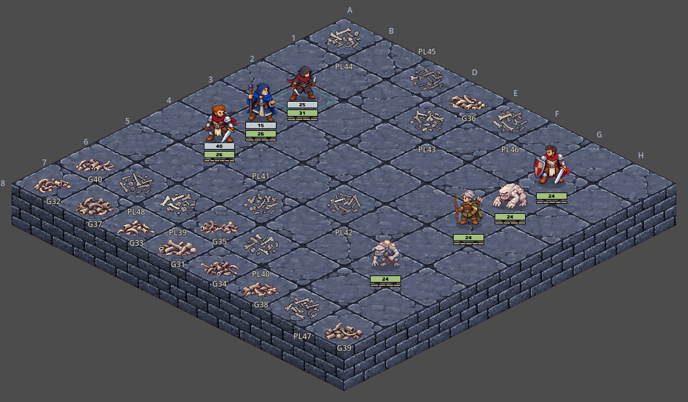

# Новые двадцать костяных кучек на поле — 2026-11-23

По запросу пользователя показаны все последние G31–G40 и PL39–PL48
на настоящем игровом поле рядом с текущими персонажами, включая воина.
Это примерка для выбора, без внедрения останков в игровой lifecycle.



[Полный кадр 1440×1100](field-all-100.png). Основной показ — вырезка 1060×620
из этого кадра, без изменения пикселей или масштаба. Подписи — части захвата.
Источник рисунков и точные выбранные файлы —
[предыдущий пакет](../bones-twenty-next-20261123/README.md) и его selection.json.

Настоящий GPU-рендер BattleDemoBoard: поле 8×8, каменные тайлы 128×64,
камера 100%, воин fighter / red_bastion с art_scale 0.8. Та же расстановка
и масштаб, что в [предыдущем сравнении](../bones-field-comparison-20261123/README.md).
PL показаны исходными PNG 64×64, Sprite2D scale 1, NEAREST.
Для G берётся bbox alpha≥128 и при отрисовке уменьшается до ширины 60px,
высоты не более 32px через NEAREST. Исходные файлы и alpha не редактируются.
Нативность G и окончательный интеграционный размер не утверждены.

Кучки — временные визуальные Sprite2D на двадцати безопасных пустых клетках.
Они не изменяют EnvironmentCommand, сроки свежести, каннибализм, occupancy
или состояние боя. Последний кадр смерти для свежего тела здесь не внедряется.
PL местами малоконтрастны на сером камне; это видно в честном игровом рендере.

Проверки:

- GPU D3D12 capture + parse нового скрипта: 20 вариантов, 0 отказов.
- [capture-all.json](capture-all.json): 20 уникальных безопасных клеток,
  масштаб/границы, неизменные state/RNG/counters/revision.
- [pixel-check-all.json](pixel-check-all.json): каждый непрозрачный пиксель
  всех десяти PL совпал с исходным RGB; вырезка сохраняет масштаб 1:1.
- [runtime-check.json](runtime-check.json): 1685 runtime-файлов из уже
  импортированной isolated-копии побайтно совпали с текущим checkout.
  Свежий import не повторялся, корневой `.godot` не затрагивался.
- [source-hashes.json](source-hashes.json): исходные ассеты сохранены.
- Независимый `game_reviewer`: APPROVE; все двадцать видны, подписи не
  закрывают рисунки. У PL41 и PL45 подпись сверху, связь с кучкой читается.

Core/full, ручные F5/Editor/DPI/performance и lifecycle останков не проверялись.
Художественная приёмка и выбор пользователя открыты.

Воспроизведение из корня:

```powershell
python docs/art/bones-field-next-20261123/capture.py --project D:/Games/into-de-dung/test_reports/demo-2f791ac889864e78be19395dfeb22edc/project --godot D:/Downloads/Godot_v4.7.2-stable_win64.exe/Godot_v4.7.2-stable_win64.exe
```

Runner проверяет runtime, строит manifest по финальному selection.json,
копирует только capture-скрипт в изолированную копию и запускает скрытое
окно GPU с отдельным профилем. Исходник захвата — [capture_all.gd](capture_all.gd).
