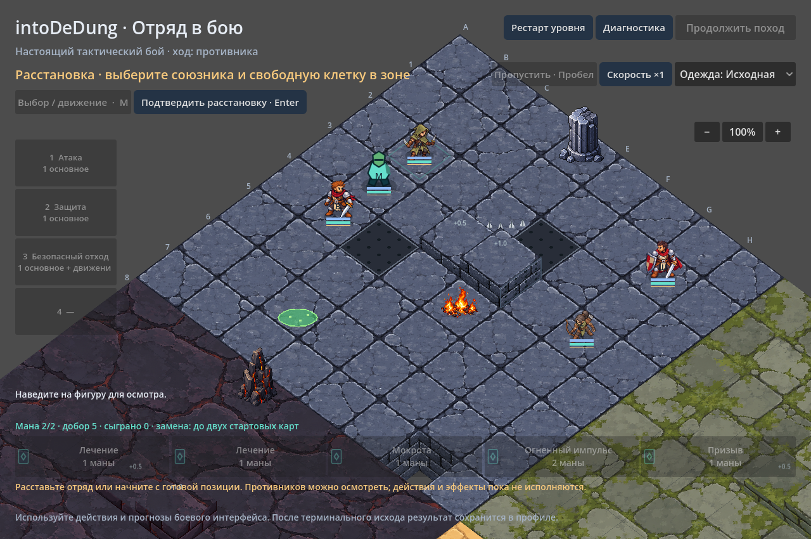
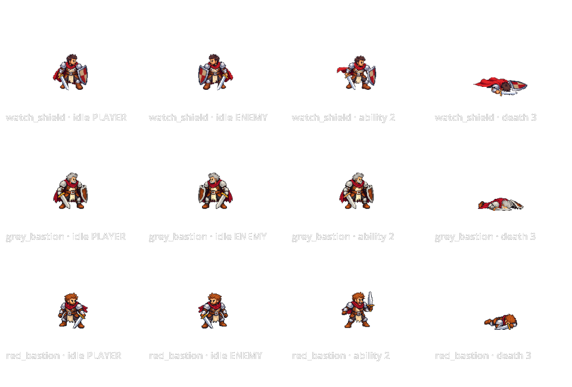

# Только классы и направление команд — 2026-11-01

База `e69239208f6fcb494ca5d48567d8b980791c14cf`, main.
Уточнение пользователя: все классы одновременно на поле, убрать неклассовых
бойцов, отражать модели по команде. Владельцы поведения:
[состав](../../CLASS_SHOWCASE_V1.md), [облики](../../CHARACTER_SKINS_V1.md),
[визуальная сцена](../../BATTLE_VISUAL_SCENE_CONTRACT.md).

Новый обычный F5 создаёт ровно пять бойцов: Разбойник/Маг/Воин у игрока,
Щитоносец/Лучница у противника. Удалена добивка до прежних трёх врагов.
При ручном изменении отряда противник представляет каждый отсутствующий класс
один раз. Старые каталоги1–3 и их сохранения не мигрируют.
Именованный класс без арта не выбирает случайный EnemyPreset: у Мага пока
сохраняется существующая условная фигура «М». Нового арта в этой правке нет.

PLAYER смотрит вправо, ENEMY влево с учётом исходной ориентации02/17/11.
Отражаются выбранные idle/ability/death, без смены кадров, масштаба или опоры.
Атака временно поворачивает к цели, затем восстанавливает направление команды.
Смена фракции того же visual не сбрасывает idle-часы. HUD не отражается.

Снимок GPU1280×850 при масштабе100%; камера центрирована по фигурам.
Здесь обычная расстановка первого боя, команды/HP/клетки камерой не менялись.

## Проверки

Все запуски — последовательно в isolated project, без root import.
Логи, manifests, negative control и review:
`test_reports/class-roster-facing-20261101/` (локальные, не в Git).

| Проверка | Результат |
|---|---|
| Import / startup | PASS |
| class_showcase | 229/0 |
| class_showcase_ui: реальное меню → хаб → поход → поле; Маг у врага | 37/0 headless, 39/0 GPU |
| character_skins: направление/часы/клипы/смена команды | 262/0 headless, 291/0 GPU |
| presentation_attack_styles: реальная атака, направление и точное восстановление | 604/0 headless и GPU |
| unit_visual_contract / visual_scene_contract | 45/0 / 106/0 |
| presentation_contact / battle_motion_pose / battle_pointer_pick | 292/0 / 12/0 / 13/0 |
| hero_hub / mage_deck_expedition | 98/0 / 507/0 |
| Python isolate mocks | 30/0 |
| Независимое read-only ревью production и финальных тестов | APPROVE |

GPU сравнивает зеркальные пары пикселей02/17/11: пространственных отличий нет,
alpha точна, для RGB допуск1/255 (округление шейдера: по одному пикселю у17/11).
Проверяются обе стороны и восстановление после временного разворота.
Смежный attack-test раньше смотрел скрытый EnemyPreset у Mage/future_class;
теперь проверяет видимый BodySprite и учитывает базовый разворот Мага.
Точное равенство исходных трансформаций после атаки сохранено.

Отрицательный контроль в той же isolated копии вернул старые добивку,
team-only mirror без ориентации исходника и anonymous fallback: получены
ожидаемые10 FAIL UI и8 FAIL skins, без script/parse errors. Все временно
изменённые файлы восстановлены побайтно. Это подтверждает обнаружение ошибок.

Full/core в этом исправлении повторно не запускались; core9424/0 относится
к предыдущему этапу (результат e692392). Прежний turn_forecast_ui26/3
не исправлялся. Ручные F5/движение/zoom/DPI, художественная приёмка стыков и
[performance-остаток](../../performance/battle-magic-pacing-20261101.md) открыты.
Автоматический проход меню не объявляется ручным плейтестом или приёмкой FPS.

## Сохранность и передача

Core-команды/preview/queue/игровой RNG/save/frozen не менялись.
33 SHA чужих main_menu.tscn и battlefield-reference-03 сверены; их не включали
в коммит. Прежний HANDOFF сохранён [побайтно](../../CODEX_HANDOFF.history-20261101-5.md).
Размеры входных документов и проверка ссылок — `closeout-validation.json` в отчётах.
PROJECT_CONTEXT не менялся: прежнее превышение3500 сохраняет адресные маршруты;
новых обязательных входных документов эта правка не добавляет.
