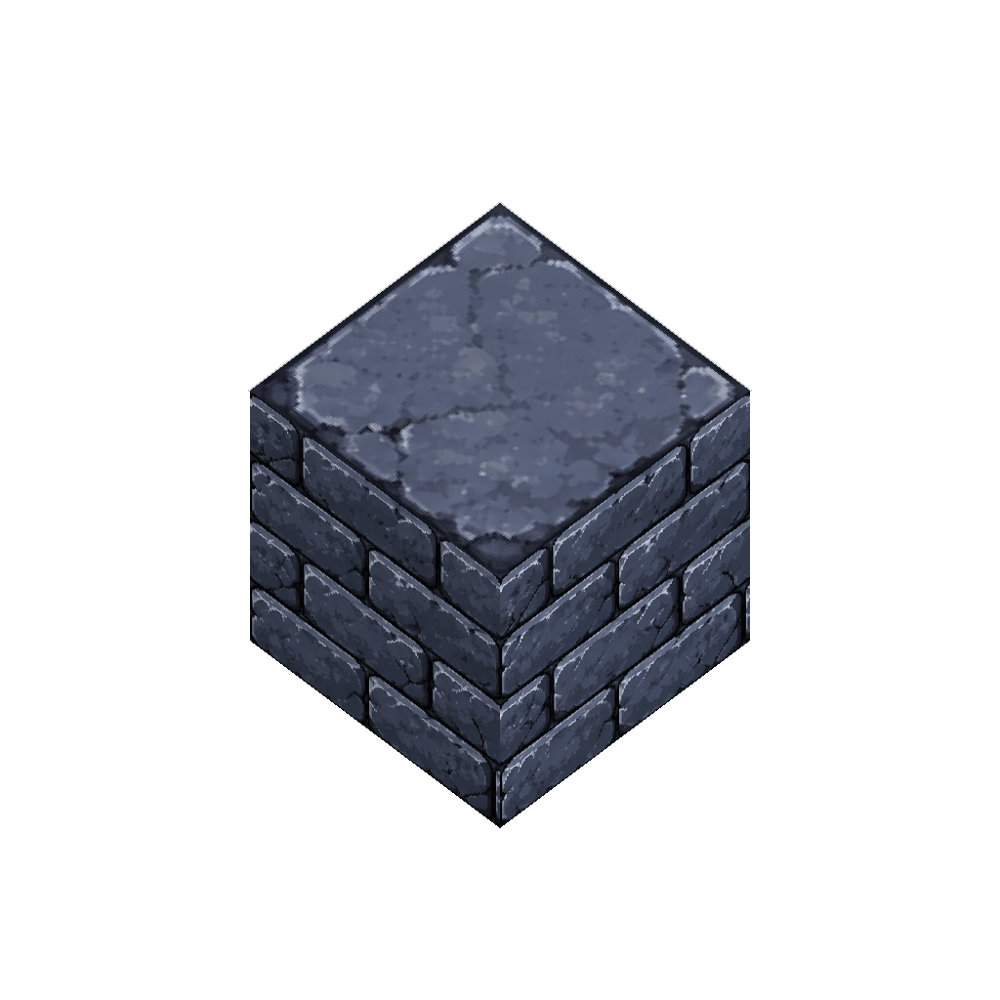

# Текущий каменный тайл — эталон 2026-11-03

По прямому поручению пользователя текущий внедрённый тайл первой комнаты
сохранён как новый эталон для следующих арт-проб. Это реальный рендер сцены
`scenes/demo/visuals/dungeon_comparison_tile.tscn`, а не перерисованный концепт.
База: `4a5ec73361cbd6d6de055d0806708c593c5d4503`, `main`.

[Крупный PNG](tile.png) · [Игровой масштаб](tile-native.png) ·
[Параметры рендера](reference.json) · [Источники и SHA](sources.json)

Выбрана клетка `(0,0)` каменного биома: участок `(0,0)–(156.75,156.75)`
атласа пола8×8. Верх — ромб128×96, вершины `(0,-48),(64,0),(0,48),(-64,0)`;
боковины — штатная кирпичная кладка, глубина64px, левый tint0.78/правый0.95.
Большой PNG1024² показывает сцену при масштабе4; PNG256² — при масштабе1.
Оба имеют настоящий прозрачный фон. Полный блок показывает в том числе боковины,
которые соседние клетки на игровом поле обычно перекрывают.

`floor-source.png` и `masonry-source.png` — побайтные копии действующих атласов.
`sources.json` фиксирует SHA исходных текстур, сцены, наследуемых сцен и скриптов.
При будущей смене источников этот снимок остаётся эталоном; его нельзя незаметно
перегенерировать из изменённого runtime. Для нового выбора создать отдельную версию.

Экспортёр [export_reference.gd](export_reference.gd) создаёт штатный тайл,
публикует FLOOR через `apply_view`, затем сохраняет SubViewport. Нового рисунка
или правки пикселей нет. Требуется GPU, headless отклоняется. Запускать только
в изолированной копии проекта, с абсолютным `--output=...`; корневой проект
не импортировать. Точная выполненная команда — в отчёте серии эффектов.

Утверждён эталон тайла, а не предложенные эффекты:
[пять кальтропов, огней и кислот](../hazard-variants-20261103/README.md).
Игровые сцены и поведение в этом пакете не менялись.
