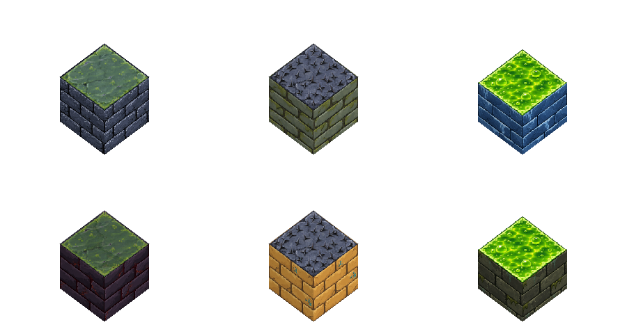

# Глубокая кислота на всём тайле — 2026-11-05

По уточнению пользователя убраны все бортики и вставная рамка.
Сцена `deep_acid_pool.tscn` теперь содержит только прежнюю анимированную
жидкость05/01 в полном размере128×96, на8 native px ниже обычного пола.
BattleTerrainVisual опускает верхнюю кромку кладки до уровня жидкости;
нижняя граница блока прежняя. Обновление заново берёт базовую геометрию,
поэтому смещение не накапливается, а FLOOR восстанавливает исходные стороны.
Снимки старого варианта с рамкой остаются [в первоначальном пакете](../liquid-hazards-integration-20261105/README.md).

Логическая высота, top_polygon/picking, Y-sort, очередь смерти без трупа,
preview/RNG/save и прозрачная мелкая кислота не изменены.
Правило показа — [контракт](../../BATTLE_VISUAL_SCENE_CONTRACT.md#анимированная-кислота-без-каменного-основания--2026-11-04).
Исходные кадры/атласы не редактируются. Ручная приёмка остаётся отдельной.

[Текущий маршрут хаба](acid-live-current-room.png).

PASS: свежий isolated import/startup; GPU acid227/0, environment32/0,
visual106/0, dungeon1983/0, presentation_environment364/0.
Проверены покрытие внешней полосы ромба по пикселям, высота кромки кладки,
повторный sync без накопления, неизменность top_polygon и восстановление FLOOR.
Команда/область — [checks.json](checks.json), полный отчёт —
`test_reports/demo-afe6e9d35e8c4e539b668be43d780bf2/`.
Core/full, ручные F5/движение/zoom/DPI и performance в этом этапе не повторялись.
Независимое ревью: APPROVE.
