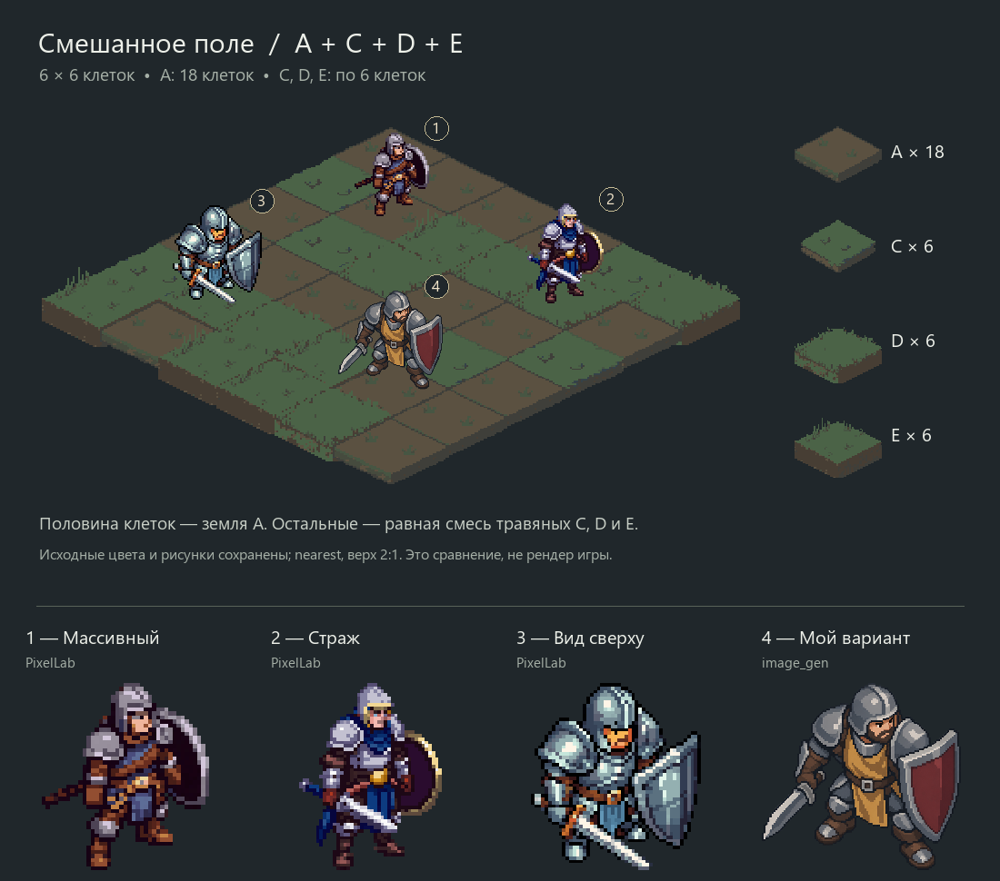

# Защитник: ракурс и силуэт — 2026-10-09

По поручению пользователя персонажи размещаются на его смешанном поле A/C/D/E.
Художественные установки — [ART_DIRECTION](../../ART_DIRECTION.md).
Первые пробы запрошены через PixelLab; затем пользователь прямо разрешил
добавить собственные варианты ведущего. №4 сделан встроенным image_gen.
Текущий класс-преемник Защитника — Щитоносец; механики и сцены не менялись.

| № | Источник | Направление | Одинаковая клетка для отдельного сравнения |
|---|---|---|---|
| 1 | PixelLab Pixflux + Pixen edit | Массивный боец; убрано лишнее пятно под ногами | [поле](defender-1-field.png) |
| 2 | PixelLab Pixflux | Страж; более вертикальный ракурс | [поле](defender-2-field.png) |
| 3 | PixelLab Pixen + Pixen edit | Выраженный вид сверху; убран обрезанный гребень шлема | [поле](defender-3-field.png) |
| 4 | Встроенный image_gen | Приземистый страж, охра/бордовый щит, крупные спокойные формы | [поле](defender-4-field.png) |

Для оценки объёма предложены прежде всего №3 и №4. №1/2 оставлены как сравнение
силуэта. Это рекомендация, не пользовательская приёмка. У генераторов нет
проверенной 3D-камеры: запрос 2:1/примерно 27° и флаг isometric задают направление,
но не доказывают точный угол. Вид сверху оценивается визуально по шлему/плечам,
толщине щита и положению ног. Будущие направления/анимации ещё не проверены.

## Монтаж и оригиналы

`reference-board.png` — побайтная копия пользовательского вложения. Его декодированные
пиксели совпадают с прежним смешанным полем; кодировки PNG/хеши файлов различаются.
`defenders-on-board.png` — четыре персонажа и номера поверх этого фона;
`comparison.png` добавляет нижний ряд увеличенных фигур. Вне наложения персонажей
и номеров пиксели поля проверенно не изменены. Новых теней/опор под фигуры не рисовали.

`defender-N-original.png` сохранены без изменения. У PixelLab №1–3 исходники
64×64 с прозрачным фоном, показ ×2 nearest. У image_gen №4 исходник 1230×1278,
уменьшенный пропорционально nearest до 108 px видимой высоты. Это более крупная
растровая проба с пиксельной стилизацией, не готовый нативный спрайт 64×64.
Размер/опора всех вариантов пока пробные, не настройки Godot.

Для привязки использован нижний центр видимого силуэта (alpha ≥128). Это важно
для №4: в исходнике есть почти прозрачные пиксели вне основного силуэта; они
сохранены, но не влияют на расчёт размера/опоры. В основном монтаже используются
целые исходники, без растяжения по отдельным осям или перекраски. Нижний ряд
сравнения кадрирует видимый силуэт. SHA/размеры/alpha/клетки/масштабы — `checks.json`.

## Происхождение и расход

`defender-N-request.json` — параметры и промпты с указанием провайдера/endpoint;
base64 входных изображений заменён локальной ссылкой. Для №1/3 сохранены также
исходный запрос генерации и PNG до правки. Правки выполнены через PixelLab,
а не локальным дорисовыванием. Первый слишком фронтальный третий результат
не включён в сравнение; он сохранён в локальном отчёте.

PixelLab: 4 генерации и 2 правки, по 1 generation; баланс подписки 4991 → 4985.
image_gen: 1 генерация; отдельный денежный usage инструмент не вернул.
Retro Diffusion не использовался. Секреты/ключи в пакет не входят.
Локальные ответы/usage, проверка фона и скрипты — `test_reports/defender-art-20261009/`.
API сверена по [официальной схеме PixelLab](https://api.pixellab.ai/v2/openapi.json).

Изображения проверены как статические пробы; независимое ревью APPROVE.
Godot/core/full/render/F5 не запускались;
интеграция, анимации и окончательный арт требуют выбора/следующего поручения.
