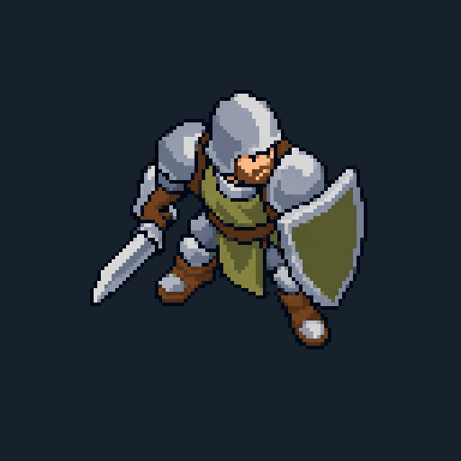

# Борода в анимации смерти — ручная правка, 2026-10-12

U заметил исчезновение бороды в [пробе мимики](../defender-death-expression-20261012/README.md)
и попросил исправить самостоятельно. Ведущий восстановил бороду по оригинальным
кадрам третьего движения. Новых обращений к PixelLab/imagegen не было.

[До/после](before-after.gif), [размер×1](native.gif),
[исходник / мимика / исправление крупно](face-comparison.png), [33 кадра](filmstrip.png).

Причина дефекта: прежняя маска видимой кожи захватила также тёплые коричневые
пиксели бороды. Модель заменила часть из них цветом кожи или расширенным ртом.
`repair-beard.py` возвращает оригинальные тёмные коричневые пиксели в кадрах02–19,
кроме вручную заданного узкого разреза рта высотой один пиксель. Так сохраняются
тёмный подбородок/усы вокруг рта и сжатые зубы с прищуром.

Источники, не изменённые этой правкой:

- Борода: `../defender-death-variants-20261012/03-last-knee/pixellab/frame-*.png`.
- Мимика/движение: `../defender-death-expression-20261012/frames/frame-*.png`.
- Прежняя маска и координаты — `sheet-mask.png`/`request-manifest.json` пакета мимики.

В [validation.json](validation.json) записаны хеши, координаты правки каждого
кадра и ручные разрезы рта. Защищены547 пикселей бороды,436 из них действительно
заменены на оригинальные RGBA. Все остальные пиксели равны предыдущей пробе;
альфа всех33 кадров сохранена. Кадры01 и20–33 скопированы побайтно.
Гримаса, движение, меч/щит/доспехи и порядок кадров прежние.

Все три GIF:33 кадра,60ms×32+900ms=2820ms, повтор для просмотра. Увеличение nearest,
фон превью#16212b; исходные/итоговые PNG128×128 прозрачные. Сборщик использует
только функции превью предыдущего пакета, не запускает его редактирование.

Независимое ревью раскадровки и увеличенных лиц: APPROVE для показа исправления;
борода и контур подбородка возвращены, явных швов/выпадений не замечено.
Известная неоднозначность зубастой гримасы как оскала/улыбки остаётся; эта правка
её не усилила. Ревьюер не просматривал GIF в движении. Приёмка пользователем
и игровое подключение открыты. Godot/F5 не запускались: игра не менялась.
