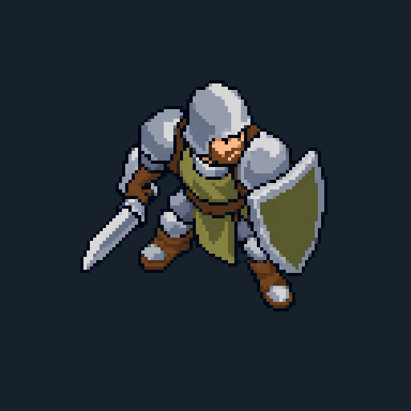

# Гримаса в третьей пробе смерти — 2026-10-12

U предпочёл движение №3 («Последняя опора на меч»), но попросил убрать каменное
выражение лица. Это отдельная доработка мимики, без подключения анимации к игре.
Все три [предыдущих варианта](../defender-death-variants-20261012/README.md) сохранены.

U затем заметил исчезновение бороды; сохранённое здесь превью имеет этот дефект.
Следующая [ручная правка бороды](../defender-death-beard-fix-20261012/README.md)
восстанавливает её по оригиналу и сохраняет гримасу. Этот исходный пакет не заменён.

## Метод и границы

Исходник —33 кадра `../defender-death-variants-20261012/03-last-knee/pixellab/`.
Один запрос PixelLab `inpaint-v3` редактирует только видимую кожу лица на кадрах02–19:
зажмуренные глаза, напряжённый сжатый рот, сдержанная гримаса боли и усилия.
Запрос не задаёт кровь, новые детали, смену позы или перерисовку доспехов.

- [sheet-input.png](sheet-input.png):18 исходных фрагментов64×64, без увеличения,
  в сетке6×3 (384×192); координаты обрезки каждого кадра `[32,24,96,88]`.
- [sheet-mask.png](sheet-mask.png):1269 белых пикселей разрешённой правки лица;
  чёрные пиксели сохраняются. Шлем, оружие, броня и одежда исключены из маски.
- [request-manifest.json](request-manifest.json): происхождение, точные координаты,
  маски и хеши; `prepare-request.py` воспроизводит вход без сетевого вызова.
- `pixellab/request.json` содержит PNG-вход и описание без ключа; `response.json`
  хранит принятый job. Оригинальный ответ модели и его usage сохраняются отдельно.

При сборке берутся только RGB модели внутри сохранённой маски; альфа всего кадра
и каждый пиксель вне неё остаются исходными. Это масочный монтаж результата
PixelLab, не новая генерация движения. Для совершенно одинаковых исходных лиц
используется одна и та же полученная гримаса, чтобы выдержка на колене не мерцала.
Ни один кадр падения не переставляется и не выбрасывается.

Исходный порядок33 кадров и темп прежние:01–32 по60ms, последний900ms, цикл2.82s.
Повтор и финальная пауза относятся только к превью. Игровой темп не утверждён.

## Просмотр и проверка

[До/после в движении](before-after.gif), [исходный размер](native.gif),
[лица крупно и в размере×1](face-comparison.png), [все33 кадра](filmstrip.png).

Задание `2ddaa44b-8594-4535-8637-e6b11dd1b5c1` завершено. На лице появились
прищур и напряжённый рот с видимыми сжатыми зубами. На последних видимых кадрах
рот шире; из-за светлой полосы зубов гримаса местами может читаться как оскал
или ухмылка, а не однозначно боль. Оценка пользователем остаётся открытой.
Принятый `image` и `quantized_image` совпадают побайтно; оба сохранены в `pixellab/`.
Списаны15 generations, `billing_usage.usd=0`. `usage_cost_usd` в ответе сервиса —
отдельное техническое поле, не списание с долларового баланса. Повторных POST нет.

`build-preview.py` собрал [33 кадра](frames/) и [validation.json](validation.json):
1002 изменённых RGB-пикселя строго внутри маски, альфа/пиксели вне маски сохранены.
Кадры01 и20–33 скопированы побайтно; исходные PNG не менялись. Лицо кадра07
повторно используется в07–13,14 — в14–15, поскольку исходные лица соответствующих
групп совпадают точно. Остальные позы используют свои фрагменты ответа.
Все три GIF:33 кадра, длительности60ms×32+900ms. Превью повторяются для сравнения.
Визуальная оценка по раскадровкам не заменяет приёмку плавности пользователем.
Независимое ревью: APPROVE для показа этой пробы; отмечена неоднозначность
зубастой гримасы на07/14/17. Явных границ маски/изменения силуэта не обнаружено.

API сверено с [официальной схемой](https://api.pixellab.ai/v2/openapi.json).
Ключ DPAPI остаётся вне Git и используется только для api.pixellab.ai.
Выбор движения для доработки не означает окончательную приёмку мимики или
разрешение на игровое подключение. Godot/F5 здесь не требуются: игровые ресурсы,
сцены и код не меняются. Следующий шаг — отзыв пользователя о мимике.
