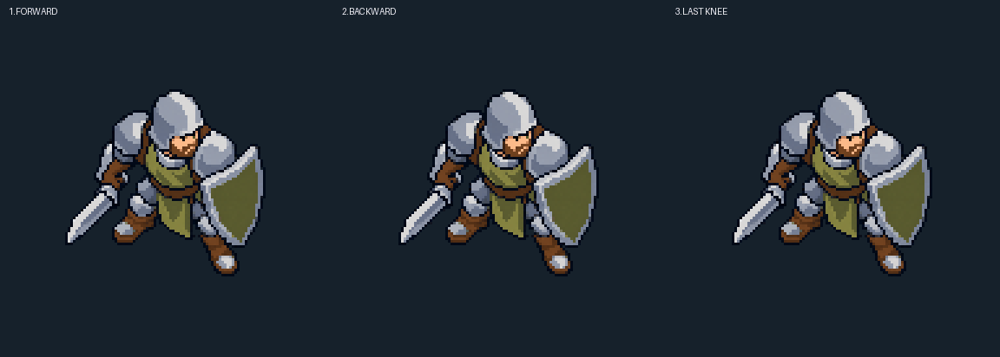

# Три пробы смерти Защитника — 2026-10-12

U попросил несколько вариантов, чтобы выбрать характер падения. Это отдельные
предложения PixelLab на текущем Защитнике в шлеме; к игре они не подключены.
«Ветеран» остаётся отдельным образом на будущее. Выбор и художественная приёмка открыты.

## Просмотр

| № | Вариант | Наблюдаемое движение | Отдельное превью |
|---|---|---|---|
| 1 | Вперёд рядом со щитом | Подламываются ноги, корпус падает вперёд; щит остаётся сбоку перед телом. | [×4](01-forward-shield/preview.gif), [×1](01-forward-shield/native.gif), [все кадры](01-forward-shield/filmstrip.png) |
| 2 | Тяжёлое падение назад | Теряет опору и падает на спину; меч и щит остаются у тела. Есть лишний красный эффект. | [×4](02-backward/preview.gif), [×1](02-backward/native.gif), [все кадры](02-backward/filmstrip.png) |
| 3 | Последняя опора на меч | Проседает на колено, задерживается с опущенной головой, затем срывается вперёд. | [×4](03-last-knee/preview.gif), [×1](03-last-knee/native.gif), [все кадры](03-last-knee/filmstrip.png) |

Это сравнение способов падения, а не три заведомо разные позы трупа. У №1 и №3
конечные силуэты близки. В №1 тело не легло точно на плоский щит, как в запросе;
в №3 не получилось заданное отчётливое падение на бок. Эти расхождения сохранены,
пиксели не дорисовывались. В исходном хвосте есть небольшие изменения отдельных пикселей.

**№2 — сырая проба траектории:** вопреки запросу без крови/эффектов сервис добавил
красную вспышку на груди с кадра04 (особенно04–06), затем след на лежачем бойце.
Для игрового подключения нужна чистая версия. Сейчас этот результат показан
целиком для сравнения движения; новая генерация автоматически не запускалась.

Все превью используют один темп: кадры 01–32 по60ms, последний900ms; цикл2.82s.
Пауза на последнем кадре и повтор нужны для сравнения. Это не утверждённый игровой
тайминг и не игровое «воскрешение»: исходник заканчивается лежачей позой.
Сборка не выбрасывает, не переставляет и не интерполирует позы. Фон превью#16212b,
увеличение nearest-neighbor; исходные PNG прозрачные128×128.

## Происхождение

- Общий [reference-128.png](reference-128.png) побайтно скопирован из
  [принятого buff-пакета](../defender-shield-taunt-fluid-20261011/pixellab/reference-128.png).
- [Манифест](request-manifest.json) хранит намерение, captions, seeds и хеши запросов;
  он не доказывает точное исполнение каждого жеста.
- По одному POST `https://api.pixellab.ai/v2/animate-pixminimax` на вариант;
  `frame_count=32`, `enhance_prompt=false`, `no_background=true`, без `last_frame`.
  Схема сверена с [официальным OpenAPI](https://api.pixellab.ai/v2/openapi.json).
- В каждом `pixellab/`: запрос с исходным изображением, подтверждение принятия,
  статус, метаданные результата и все33 оригинальных PNG в порядке сервиса.
  Ключ/Authorization в пакет не входят; DPAPI вне Git и только для api.pixellab.ai.

| Вариант | Background job | Seed |
|---|---|---|
| 01-forward-shield | `b41f3f12-82e8-4215-9269-791b864c5e33` | 20261020 |
| 02-backward | `84215c5a-644c-48bc-b4fc-1f84392e3774` | 20261021 |
| 03-last-knee | `18302fef-9dc2-4406-a38a-f143de611d9a` | 20261022 |

Все три задания завершились:99 оригинальных PNG, по5 generations на вариант,
всего15; `billing_usage.usd=0` во всех результатах. Повторных POST не было.

`prepare-requests.py` сохраняет запросы без сетевых вызовов. `extract-results.py`
принимает только завершённые ответы совпадающего job, проверяет33 PNG128×128
и отказывается заменять уже сохранённые кадры другими байтами.
`prepare-previews.py` с Pillow собирает GIF/раскадровки из всех99 PNG и пишет
[validation.json](validation.json): хеши, альфу, bbox, совпадение первого кадра
с эталоном и проверку длительностей GIF. Сырой JSON сервиса с base64 и служебные
проверки находятся в `test_reports/defender-death-variants-20261012/` вне Git.

## Границы проверки и следующий шаг

Просмотр раскадровок и независимое ревью относятся к пригодности предложений
для выбора. Они не заменяют оценку плавности пользователем или просмотр в игре.
Все99 PNG прошли проверку128×128/альфы/хешей и границ холста; первые кадры совпали
с reference по RGBA. Все семь GIF содержат33 кадра с общей длительностью2820ms.
Ревью: APPROVE для показа всех трёх проб; №2 требует исправления перед интеграцией.
Оценка движения ревьюером сделана по раскадровкам, не по воспроизведению GIF.
Godot/F5/полный набор не запускались: игровые ресурсы, сцены и скрипты не менялись.

Следующий шаг — выбор или уточнение движения пользователем. Возможное подключение
потребует отдельной проверки жизненного цикла по
[BATTLE_VISUAL_SCENE_CONTRACT](../../BATTLE_VISUAL_SCENE_CONTRACT.md): текущая death-фаза
и постоянный труп имеют разных владельцев; падение в пропасть не следует заменять
обычным падением на землю. Выбор пробы сам по себе не запускает этот этап.
