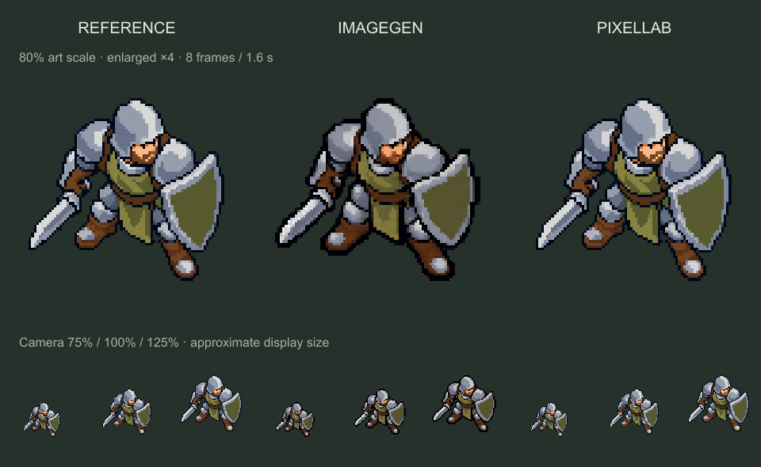

# Idle Защитника — две пробы для оценки

2026-10-10; base `c1b310afecf5ed57522be5a56449155c4915bf3c`, main, без push.
U: «вначале сделай idle анимацию — посмотрим что получится, параллельно дай
такую же задачу PixelLab». Ближний удар отложен; игровой PNG не заменён.

Слева текущий исходник без анимации; в центре imagegen; справа PixelLab.
По восемь кадров, 200ms на кадр, петля1.6s. Сверху масштаб арта80%, увеличенный
×4 для осмотра; снизу приближённый показ при камере75/100/125%. Это техническая
упаковка PNG с nearest, не Godot-рендер, не проверка GPU/DPI или похода.
Текущий игровой размер80%, гаммаА, посадка, PNG и сцены не менялись.

## Общий вход и задание

[reference-96.png](reference-96.png) экспортирован из фактического
`assets/art_presets/trials/defender_field_v1/defender_new.png` по области и сетке
77×72 текущего `art_trial_unit.tscn`/`native_sprite.gdshader`, с порогом alpha128.
Прозрачный холст96×96 добавляет поля для движения. Это не отдельное предложение
`defender-clean-proposal.png`. Геометрия — [reference.json](reference.json),
воспроизводимый экспорт — [export-reference.cjs](export-reference.cjs).

Оба провайдера получили этот же PNG и common_prompt из [request.json](request.json):
спокойное дыхание, немного движения верха корпуса/щита/меча, прежние камера,
поза/гамма/масштаб, стопы на месте, без ходьбы/поворота/атаки/теней.

## Imagegen

Встроенный image_gen, первоначальный лист4×2 и одна адресная коррекция
регистрации стоп/амплитуды. Оба неизменённых ответа сохранены:
[первый лист](imagegen/sheet-original.png), [исправленный лист](imagegen/sheet-corrected.png).
[Запрос коррекции](imagegen/correction-request.json).

Лист нарезан по равным долям размера. Затем применены nearest, общий масштаб
по высоте первого кадра и целочисленное выравнивание каждого кадра по нижнему
сапогу. Для второго ряда потребовался сдвиг вниз5px; X поправки составили1–2px.
Это техническая регистрация, не дорисовка поз. Значения открыты в
[normalization.json](imagegen/normalization.json); исходные ошибки листа не скрыты.
Готовые кадры `imagegen/frame-00..07.png`, [нативная петля](imagegen/idle-native.gif).

Ограничения: образ узнаваем, но пропорции заметно отличаются от игрового
исходника; меняются контуры сапог/оружия. Высота силуэта72–76px после регистрации,
то есть амплитуда больше запрошенных1–2px. Последний кадр не тождествен первому.
Это проба, не принятая анимация и не гарантия неподвижности обеих стоп.

## PixelLab

Один POST `/v2/animate-with-text-v3`; схема сверена с
[официальным OpenAPI](https://api.pixellab.ai/v2/openapi.json).
Общий PNG передан как first_frame и last_frame; `frame_count=8`,
`no_background=true`, `enhance_prompt=false`, seed20261010.
Запрос/ответ/usage без ключа — `pixellab/request.json`, `response.json`,
`result.json`, [metadata.json](pixellab/metadata.json). Списано **2 generations**.

API вернул девять96×96 PNG; все сохранены как `pixellab/frame-01..09.png`.
Для сравнения использованы02..09: первый вводный кадр почти повторяет второй
(14 различающихся видимых пикселей), но не является побайтным дубликатом.
FPS API не задаёт:200ms выбраны для одинаковой длины обеих проб.
Та же регистрация по сапогу дала нулевые смещения во всех восьми кадрах;
[выбор кадров/тайминг](pixellab/preview.json), [нативная петля](pixellab/idle-native.gif).

По просмотренным позам PixelLab ближе к исходному силуэту и удерживает нижнюю
опору без коррекции. Амплитуда корпуса и стабильность отдельных пикселей ещё
требуют оценки; исходный PNG и последний кадр также не тождественны.

## Воспроизведение и границы

`prepare-preview.cjs` собирает кадры/GIF без дорисовки и интерполяции поз.
Нужен Node и sharp; путь к модулю можно передать через `SHARP_MODULE`.
Сначала `node export-reference.cjs`, затем `node prepare-preview.cjs`.
Сравнение не назначает победителя и не интегрирует кандидата в игру.

Проверены размеры/alpha/число кадров/тайминг, наличие различий между кадрами,
отсутствие обрезки на холсте, ссылки и сохранность игрового исходника/сцен.
Отчёт: `test_reports/defender-idle-20261010/`. Godot/игровые тесты/замеры кадров
не запускались: runtime не менялся. Playback/reset/restore и производительность
проверять при отдельном подключении выбранного клипа. Остальные анимации бойца,
тени/динамический свет, прочий финальный арт и баланс остаются вне этой пробы.
Независимое read-only ревью артефактов: APPROVE по воспроизводимости экспорта,
таймингу GIF, сохранности девяти оригиналов PixelLab и отсутствию секретов.
Это не художественная приёмка и не проверка игрового playback.
