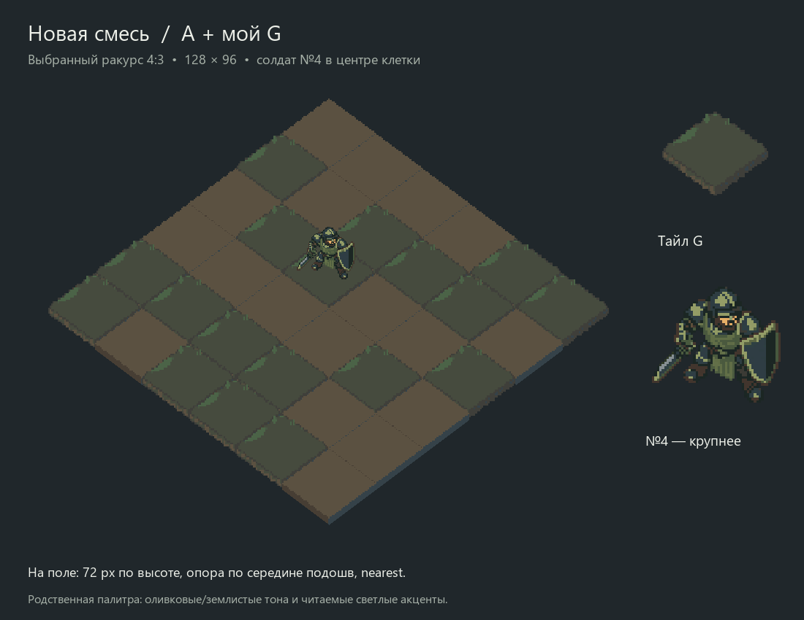

# №4, родственная палитра и собственный тайл G — 2026-10-09

Поручено перекрасить Защитника №4 под тайлы, сделать собственный вариант тайла
и компоновать варианты с №4. Дополнительно: солдат должен быть немного более
пиксельным. Пользователь уточнил, что важна **суть цветовой гаммы, без строгого
совпадения RGB**, и принял ракурс4:3. Владелец установок и точных параметров
ракурса — [ART_DIRECTION](../../ART_DIRECTION.md#выбранный-ракурс-поля).

## Сравнения

- [Все поля A–G и обе смеси](all-fields.png).
- [Прежний цвет, строгая палитра, итоговый пиксельный вариант](soldier-comparison.png).
- [Прежний и новый №4 на одном поле](palette-before-after.png).
- [A](A-field.png), [B](B-field.png), [C](C-field.png), [D](D-field.png),
  [E](E-field.png), [F](F-field.png), [G — мой вариант](G-field.png).
- [Прежняя смесь A18/C6/D6/E6](mixed-ACDE-field.png).
- [Новая смесь A18/G18](mixed-AG-field.png): расположение клеток A сохранено,
  остальные заменены G. Это дополнительная проба смеси, не отмена прежнего выбора.
- [Проверка опоры в центре](placement-check.png).
- [Тёмная проба строго в семи цветах](strict-field.png) — только контроль.

На каждом основном поле одна и та же итоговая фигура №4, клетка(2,2), одинаковая
высота72px, равномерное масштабирование nearest. Увеличенная фигура справа —
образец для деталей, не её размер на поле. A/C/D/E взяты из предыдущего пакета4:3,
B/F — из первой серии, чтобы включить все существовавшие варианты A–F.
Их оригинальные рисунки и цвета не перегенерировались.

## Что изменено

Для №4 image_gen сначала предложил оливково-землистую перекраску исходной фигуры.
По просьбе убрать гладкость PixelLab сделал источник64×64. Строгая проба из семи
цветов земли потеряла контраст. После уточнения пользователя основной вариант
использует родственные приглушённые тона и светлые акценты лица/доспехов.
Промежуточная ограниченная палитра7+4 оттенка также сохранена, но не является
ограничением финального варианта. Светлые акценты не заявлены как RGB из игры.
Лишняя подложка под ногами в последней перерисовке удалена отдельной PixelLab-правкой.
Это генеративная переработка №4: мелкие детали/контуры могут отличаться от исходника.

Собственный G создан через image_gen: тихая оливковая поверхность, небольшая
полоска и пучки травы у задней кромки, свободный центр. PixelLab привёл концепт
к64×64 и точным семи цветам тайлов. Оригинальный крупный концепт сохранён отдельно.
Новый G не является текстурой, скопированной из Into the Breach.

Тайлы в макете нормализованы до128×96, лишняя глубина боковин ограничена8px,
как в предыдущем сравнении. Это производные изображения; исходники сохранены.
Нативная геометрия будущих игровых ассетов ещё требует доводки после выбора.
72px — пробный размер фигур; принята именно проекция4:3, не все параметры арта.

## Происхождение и воспроизводимость

- `defender-4-original.png` — итог PixelLab после удаления подложки;
  `defender-4-final-request.json` — финальная правка, предыдущие запросы рядом.
- `defender-4-recolor-original.png` — исходный крупный результат image_gen;
  `defender-4-strict-original.png` — строгая контрольная палитра;
  `defender-4-readable-original.png` — промежуточная палитра7+4;
  `defender-4-harmony-before-cleanup.png` — перед удалением подложки.
- `tile-G-concept-original.png` — исходный image_gen;
  `tile-G-original.png` — PixelLab64×64; `tile-G-display.png` — форма для монтажа.
- `*-input-64.png` — технические входы API: fit/crop и nearest до нужного размера,
  без ручной дорисовки. Параметры подготовки записаны в запросах.
- `compose.py`, `geometry.json`, `checks.json` — сборка, координаты и проверки.
  Повторная сборка требует Pillow и Windows Segoe UI.

№4 в основном сравнении не ограничен семью цветами. Все семь выбранных тайлов
остаются в исходной семицветной палитре. Точки подошв оценены по рисунку и пикселям;
их середина ставится в центр клетки с округлением≤0.5px по каждой оси.
Это не измерение3D-геометрии. Промпты и безопасные параметры сохранены рядом,
входные base64 заменены ссылками; секретов в пакете нет.

image_gen:2 запроса (перекраска№4, новый G), денежный usage не возвращён.
PixelLab:5 списаний, баланс4973→4968: строгий№4, G, проба7+4, свободная гамма,
удаление подложки. Первый запрос строгого№4 получил422 из-за несовпадающего
размера init_image; после подготовки64×64 исправлен, отдельного списания нет.
Retro Diffusion в этой серии не вызывался.

Проверены PNG/alpha/SHA, палитра тайлов/строгого контроля, размеры/опоры,
раскладка смесей и фон вне наложения персонажа. Независимое ревью APPROVE.
На зелёных C/D/F/G тёмная фигура местами сливается с землёй сильнее прежней;
это оставлено для пользовательской оценки контраста и не считается приёмкой арта.
Godot/core/full/render/F5 не запускались; игра не менялась.
Локальные ответы и проверки — `test_reports/defender-palette-20261009/`.
Финальные рисунки/позы/масштаб ещё требуют оценки; анимации/интеграция не сделаны.
