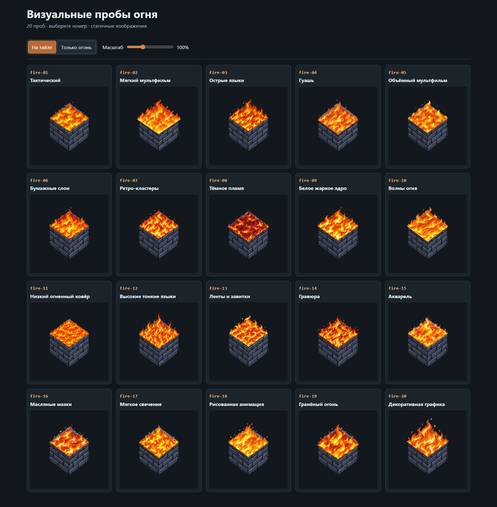

# Двадцать стилей огня — 2026-11-04

По U после интеграции кислоты созданы20 новых статичных вариантов огня.
Base `7742fba5752c7b5fcca651475b9019ffabcdac77`, main.

[Открыть автономную галерею](gallery.html) · [Общий лист на эталоне](comparison.png).

Огонь нарисован отдельно на прозрачном фоне, без каменного основания.
В галерее эталонный тайл — отдельный переключаемый слой. Можно сравнить форму,
характер света и цветовые группы, открыть полный кадр и перелистывать варианты.
Все20 изображения статичны; названия описывают стиль, а не наличие анимации.
Ориентир01 — компактный тактический огонь;07 — намеренно ретро-пиксельная проба.
Стили персонажей этим экспериментом не меняются. Эффект рассчитан на всю
верхнюю грань, но точная посадка/стыки выбранного варианта требуют интеграции.

Источники: встроенный `image_gen`, отдельный вызов на вариант,
[точные промпты](prompts.json), [пути и SHA](sources.json).
Референс размещения — [сохранённый тайл](../current-tile-reference-20261103/README.md).
20 выбранных PNG1254²RGBA побайтно скопированы из результатов провайдера;
последующей ручной ретуши, crop или пикселизации нет. Для19 выполнена отдельная
правка image_gen: удалён посторонний белый фон; исходная попытка сохранена
в `test_reports/fire-styles-20261104/`. У07 повторён один сбой соединения.
Всего22 вызова,21 успешное изображение,20 в итоговой серии — [повторы](retries.json).

[Проверка файлов](validation.json):20 разных SHA, настоящая alpha, видимый рисунок
(alpha>8) целиком в кадре с полями не менее5%. Незначительная исходная alpha1–5
на границах некоторых PNG не удалялась. [Проверка браузера](browser-validation.json):
21 встроенный ассет,20 карточек, оба режима, масштабы70/100/160%, полный кадр,
modal prev/next/Escape,390px и переносимость одного HTML — PASS.
Скриншоты и логи: `test_reports/fire-styles-20261104/`.
[Независимое ревью пакета](review.md) — APPROVE; выбор стиля остаётся за U.

Повторная сборка: `node docs/art/fire-styles-20261104/build_gallery.cjs`.
Проверка: `node docs/art/fire-styles-20261104/check_gallery.cjs` (локальный Playwright/Edge).
Эта серия не меняет runtime; Godot/full/core для неё не запускались.
Дальше — выбор номера пользователем. Анимацию и внедрение огня не начинать автоматически.
