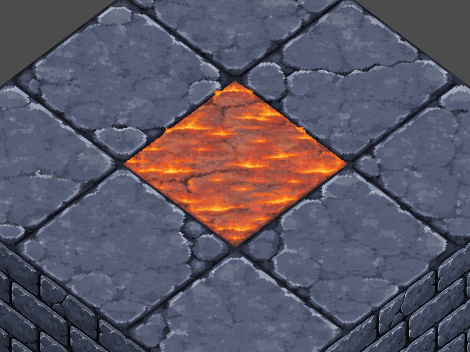
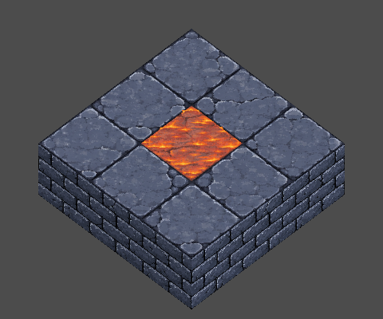

# Огонь29: проба дорисовки низких языков

U отклонил слабое перекрытие и изгиб прежних мазков: кончики должны заметно
нарастать на соседние тайлы, оставаясь низкими, без вспышек. Новые позы поручены
PixelLab. Это кандидат для просмотра; текущий runtime-огонь пока не заменён.

Размер тайла128×96, без увеличения:

## Метод и выбор

Вход — кадр0 текущего выбранного атласа: статическое выделение ромба alpha
и29px прозрачного поля сверху. RGB исходных видимых пикселей не рисовался
и не деформировался. Четыре белых участка маски дают PixelLab место для
дорисовки низких выступов за задними рёбрами; это разрешённые области генерации,
а не нарисованные нами формы языков.

`growth-keypose01` (`inpaint-v3`) добавил1118 видимых пикселей вне исходного
силуэта; вне маски RGBA точно совпали с входом. Затем `growth-motion01`
(`animate-pixminimax`,16 запрошенных/17 полученных кадров) дал нарастание
от короткой позы к дорисованной. Выбраны неизменённые raw1–7: площадь нового
видимого пламени монотонно растёт61→1120px. Это рост площади, не строгое
добавление пикселей: отдельные точки контура тоже исчезают/меняются.
Raw0 исключён из-за скачка палитры
между входом и generated frames; более поздние позы перестают последовательно расти.

`growth-motion02` пытался сгладить переход между двумя уже полученными позами
(32 запрошенных/33 PNG), но резко изменил палитру и дал лишнее дрожание контура.
Он отклонён, ни один его кадр не участвует в показе.

[Отбор](selection.json):7 разных PNG, прямой и обратный показ тех же кадров,
12 слотов×120мс =1,44с. Нет локальной интерполяции, дорисовки, деформации,
правки цвета или масочного исправления ответа. Обратный ход — повтор PNG.
Равенство цвета/фактуры исходному атласу не заявляется: PixelLab нормализовал
палитру всего кадра. Четыре участка растут синхронно, семь поз могут читаться
ступенчато; оценка естественности и окончательный выбор остаются за U.

## Происхождение и воспроизведение

Схема сверена с [официальным OpenAPI](https://api.pixellab.ai/v2/openapi.json)
перед каждым POST; [срез схемы](schema-slice.json). Три запроса без повторных
отправок и51 raw PNG сохранены. Usage10+2+5=17 генераций, баланс4359→4342;
все три jobs completed. Исходные ответы и барьеры POST — вне Git:
`C:/Users/Aston/.codex/generated_images/fire29-growth-20261107/`.
DPAPI ключ передавался только официальному API в Authorization, в пакете его нет.

`provider.ps1` сохраняет/проверяет SHA запроса и не допускает повторный POST
того же ключа. `extract.py` извлекает PNG побайтно, API не вызывает.
Не запускать Submit повторно для уже завершённых ключей.

`capture_preview.gd` запускается только в уже импортированной isolated-копии:
три на три текущих каменных тайла, обычный Y-sort, фиксированная проекция128×96,
видимый размер384×288; `--tile-px=128` даёт номинальный128×96 в окне480×400.
Полный raw PNG рисуется поверх среднего тайла без маски.
Это визуальная примерка кандидата, а не новое поведение игрового огня.
Снимки семи поз: `test_reports/fire29-growth-hud-20261107/preview/frames/`.
`encode_preview.py` собирает lossless WebP; декодированные12 кадров точно
совпадают с этими GPU PNG в обоих масштабах. [Проверка экспорта](preview-validation.json).

`validate.py` сверяет запросы/входы/raw, отбор и PNG, масочную сохранность
статической позы, монотонный рост выбранного участка и temporal-метрики.
Новая художественная приёмка, ручные F5/zoom/DPI/performance не проведены.
Full/core не запускались. Технический обзор пакета не означает принятие движения.
Независимое техническое ревью кандидата APPROVE; в номинальном масштабе
выразительность небольших кончиков всё ещё требует оценки U.

Параллельная правка HUD описана в [контракте](../../BATTLE_HUD_SCENES_V1.md#нижняя-граница-руки--2026-11-07).
Общий отчёт: `test_reports/fire29-growth-hud-20261107/`.
