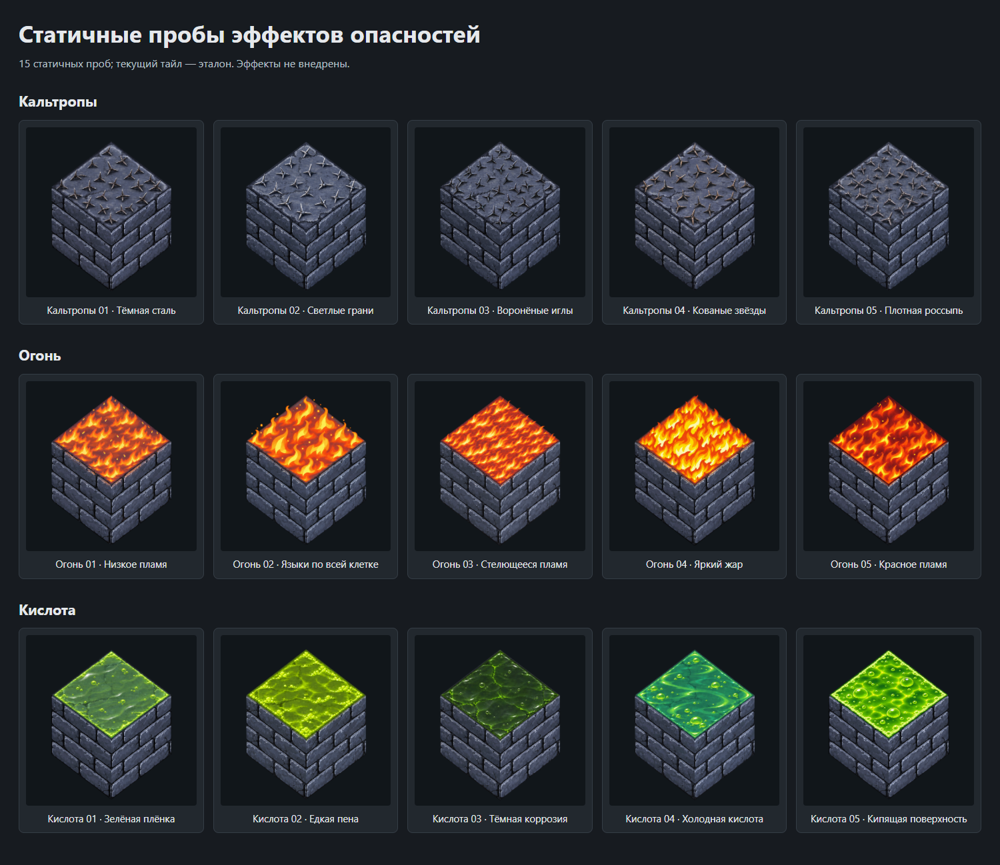

# Кальтропы, огонь и кислота — по пять вариантов

По U2026-11-03 создано15 статичных проб: пять россыпей кальтропов,
пять огней с ориентиром на Into the Breach и пять кислотных покрытий.
Все занимают всю верхнюю грань тайла; кальтропы лежат отдельными предметами
на поверхности. Пользователь уточнил взять именно уже внедрённый тайл
и сохранить его новым эталоном: [реальный рендер и источники](../current-tile-reference-20261103/README.md).
База: `4a5ec73361cbd6d6de055d0806708c593c5d4503`, `main`.

[Галерея с увеличением](gallery.html) · [Общий лист](comparison.png) ·
[Точные промпты](prompts.json) · [Источники и SHA](sources.json)



| № | Кальтропы | Огонь | Кислота |
|---|---|---|---|
|01|[Тёмная сталь](caltrops-01.png)|[Низкое пламя](fire-01.png)|[Зелёная плёнка](acid-01.png)|
|02|[Светлые грани](caltrops-02.png)|[Языки по всей клетке](fire-02.png)|[Едкая пена](acid-02.png)|
|03|[Воронёные иглы](caltrops-03.png)|[Стелющееся пламя](fire-03.png)|[Тёмная коррозия](acid-03.png)|
|04|[Кованые звёзды](caltrops-04.png)|[Яркий жар](fire-04.png)|[Холодная кислота](acid-04.png)|
|05|[Плотная россыпь](caltrops-05.png)|[Красное пламя](fire-05.png)|[Кипящая поверхность](acid-05.png)|

## Происхождение и границы

Встроенный image_gen, отдельные вызовы на варианты; единственный графический
вход — `../current-tile-reference-20261103/tile.png`. Исходные выдачи сохранены
побайтно, без ручной растровой ретуши, дополнительной пикселизации или перекраски.
Всего20 вызовов: первые5 кальтропов отклонены на ревью за слишком регулярные
ряды и заменены новой россыпью с длинными разнонаправленными лапами.
[Промпты/происхождение отклонённых проб](rejected-attempts.json) сохранены отдельно;
в основной галерее только15 итоговых вариантов.
Названия описывают направление; точное число/ориентации шипов из промптов
не являются гарантией результата. Между кальтропами остаётся виден камень:
покрытие всей клетки означает распределение предметов по всей её площади.

Это цельные концепты «тайл + эффект» с прозрачным внешним фоном, не отдельные
готовые накладки эффекта. Сходство каменной основы визуальное: AI-выдачи
не доказывают побайтное сохранение исходного тайла. Точный эталон хранится
отдельно как рендер Godot. У AI-выдач встречаются почти невидимые фоновые пиксели
alpha1/255, в том числе у края холста; они сохранены вместе с оригиналами.
Видимый силуэт (alpha>8) полностью помещается в кадр. Отделение накладок, анимация, посадка в runtime,
слои рядом с персонажами и художественный выбор остаются открытыми.
Выдвижные напольные/настенные ловушки и их правила не менялись.

## Просмотр и проверки

```powershell
node docs/art/hazard-variants-20261103/build_gallery.cjs
node docs/art/hazard-variants-20261103/build_gallery.cjs --verify-originals
```

Сборка читает15 PNG и соседний PNG эталона, проверяет размеры/SHA и создаёт
автономный HTML со встроенными изображениями. Для обычной сборки локальные
выдачи генератора не нужны; `--verify-originals` проверяет их побайтно.
HTML исключён из Git как воспроизводимый дубликат. Листы сравнения — снимки
браузерной разметки с одинаковой шириной кадров и общим увеличением1.4 внутри
превью (за счёт прозрачных полей); обычная фильтрация, без ретуши.

PASS15 уникальных PNG1254²/исходных байтов, два рендера и две копии атласов,
галерея/390px/переносимость, сборка без локальных выдач и отказ при порче PNG.
Независимое [ревью: APPROVE](review.md); художественный выбор остаётся за U.
Сводка: [validation.json](validation.json), [браузер](gallery-validation.json).
Логи: `test_reports/hazard-variants-20261103/`. Из Godot выполнен только
экспорт эталона в изолированной копии, один GPU runner; корень не импортировался.
Full/core и ручные F5/zoom/DPI не запускались. Эффекты не внедрены.
Следующий шаг — выбор пользователя; новые генерации и интеграция автоматически
не начинаются.
