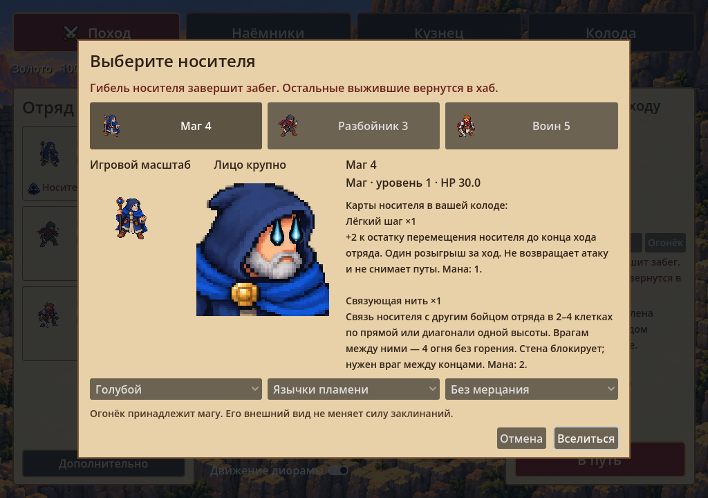

# Обводка огонька носителя — 2026-11-23

По отзыву U пламя терялось на лице. Добавлена тёмная пиксельная обводка
в общем HostGlowAppearance: текущий кадр рисуется со смещением1 пиксель
в координатах рисунка героя, затем поверх него — исходное цветное пламя.
Обводка масштабируется с фигурой/предпросмотром и повторяет все17 кадров.
Она применяется только к язычкам пламени, для всех четырёх цветов.
Палитры, исходные атласы, якоря, значок носителя и тайминг не менялись.
Правила принадлежат [HOST_POSSESSION_V1](../../HOST_POSSESSION_V1.md).

[Позы шести обликов и отражение](poses-outlined.png). PNG сохранены без ретуши
из настоящего Godot-рендера. [Исходники кадров и проверка](verification.json).
Прежний [снимок без обводки](../host-possession-runtime-20261123/possession-with-cards-1024x720.png)
получен отдельным прогоном; это сравнение вида огонька, а не попиксельный diff всего UI.

Импорт/разбор и запуск PASS; GPU host_ui44/0, host_glow1036/0.
Проверены движение пикселей языка пламени, неподвижный режим, привязка
к живым кадрам, отражение, скрытие после смерти и reuse узла.
Независимое ревью APPROVE. Первая попытка импорта выявила неверный метод Rect2;
он заменён конструктором, после чего весь адресный набор прошёл повторно.
Отчёты: test_reports/host-flame-outline-20261123/; один isolated runner.
33 чужих файла и24 файла источников/атласов/значка сохранили SHA256.
Core/full/F5/Editor GUI/DPI/performance/баланс не повторялись для этой
локальной правки представления. Прежний full остаётся незелёным;
[его разбор](../host-possession-runtime-20261123/verification.json) не заменён новой оценкой.
Художественная приёмка обводки остаётся у U. Новых генераций PixelLab не было.
