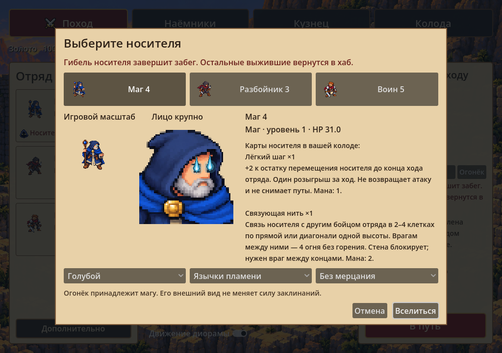
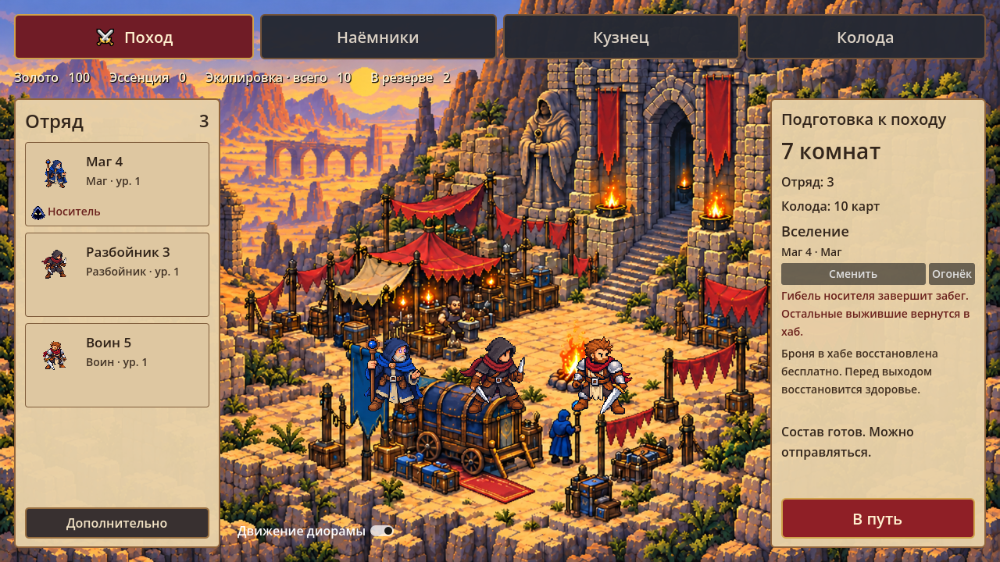

# Носитель, две карты и огонёк — рабочий срез 2026-11-23

Реализованы выбор носителя перед походом, сохранение выбора и внешнего вида,
«Лёгкий шаг», «Связующая нить», поражение после очереди при смерти носителя
и возвращение всех вещей/добычи с фактически выжившими. Правила принадлежат
[HOST_POSSESSION_V1](../../HOST_POSSESSION_V1.md); стандартная база10 не заменена.

Окно вселения показывает текущий отряд, выбранные в базе карты и два масштаба
огонька. Знак — капюшон индиго с тёмным лицом и жёлтыми глазами; контраст усилен
по последнему отзыву U. [PixelLab: исходники, варианты, анимация и расход](../mage-host-flame-pixellab-20261122/README.md).
Новые концепты боевого HUD, подачи гибели и собственного тела мага здесь не реализованы.

## Снимки настоящего рендера

[Без выбранного носителя](hub-unselected.png), [заблокированный выход1024×720](preparation-blocked-1024x720.png),
[носитель в бою](host-in-battle.png), [живые позы и отражение](host-glow-poses.png),
[огонёк в рендере](host-flame-game-render.png).
Это неизменённые PNG Godot; [источники и SHA-256](captures.json).
Шесть обликов на листе включают два облика защитника; состав пяти классов F5 не изменён.

## Проверки

Godot4.7.2, единственный isolated runner, D3D12/RTX3050 для GPU-проверок.
Root import, фокус ОС, службы/драйверы и push не использовались.

- Импорт/запуск PASS. Повторный core: **9428/0**.
- Карты114/0: геометрия, оплата, реакции, очередь смерти, preview/worker/live,
  отказ без мутации; отдельный регресс сохраняет terminal до mulligan без добора/RNG.
- Host UI44/0; glow1036/0, включая изменение пикселей языка пламени во времени
  и неподвижность still. Детерминированные сборщики17 кадров/4 палитр/495 якорей PASS.
- Выбор/поход/модели/колода/полный игровой маршрут и hazards UI PASS.
- Финальная компоновка: **7 suites PASS**, включая import/startup, host_ui,
  hub_approved_ui, hub_dashboard, hub_scene_authoring, battle_panels.
- Независимое ревью core/model/UI/art и финального layout delta: **APPROVE**.

Сырые отчёты: `test_reports/mage-host-cards-20261122/`; full —
`test_reports/demo-c0368ae4d0444362be1a378c7531c286/`, финальные GPU/core —
`test_reports/demo-5b2560331fd24903af90b6870a2b8120/`, layout —
`test_reports/demo-3084abf396cf4f92b2fb81186b29061a/`.
Первый full:200 PASS,29 FAIL,1 TIMEOUT; он не объявляется зелёным.
[Сопоставление и итог](verification.json):19/19 выбранных отказов имеют те же
сообщения на чистом `7347102e` в `D:/Games/host-baseline-20261123`.
Из30 проблем full12 закрыты последующими targeted/GPU-проверками,
18 остаются воспроизводимыми на базе (включая один timeout guard_forecast_ui).
Они относятся к старым ожиданиям снимков/останков и существующим UI-сценариям.
Полный набор после исправлений заново не запускался; это сверка конкретных отказов,
а не новый full PASS. Позднейший `07b6d8ac` добавил только отдельный арт/документы.

## Ограничения

Старый вложенный MageDeckProfile1, включая сохранения хаба с колодой,
и старые run/checkpoint формы отклоняются без изменения файла; автоматической
миграции нет. Каталоги героев1–3 не мигрировались. [Save contract](../../SAVE_FORMAT_CURRENT.md).
Ручной бой/F5/Editor/DPI, баланс карт, итоговая художественная приёмка и60FPS
этими проверками не подтверждены. Плейтест баланса — только по отдельному поручению.
