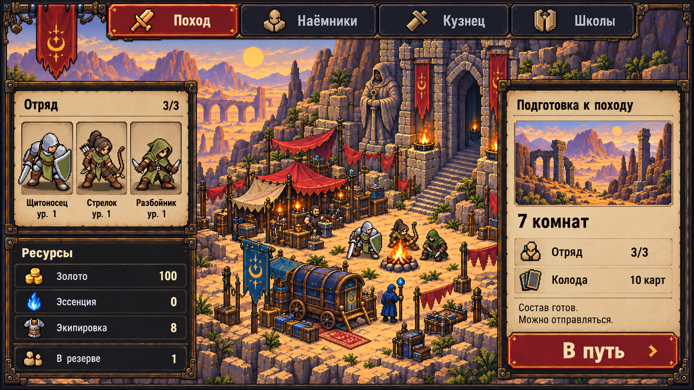

# Макет экрана «Поход» — 2026-10-24

U приложил референс четырёх экранов меню и согласился начать с одного макета
«Поход» с персонажами и данными игры. Это **отдельный статичный концепт**;
выбор внешнего вида и внедрение в Godot остаются открытыми.
Base `92f53cc2cd36144bd37bf8577a7102f1c5fe248e`, ветка `main`.

По следующему поручению U добавлены [ещё два варианта](variants/README.md):
V2 с компактными боковыми панелями и V3 с отрядом снизу. Первый PNG сохранён.
Три концепта ждут выбора; сведения и проверки ниже относятся к исходному V1.

[PNG1672×941](expedition-mockup-v1.png) — исходный результат встроенного
`image_gen`, один вызов, без последующей обработки. Запрашивался16:9/1920×1080;
провайдер вернул1672×941. [Точный промпт](prompt.txt),
[исходный референс U](references/user-menu-reference.png),
[SHA/размеры/источники/проверки](validation.json).

## Композиция

Верхние вкладки «Поход», «Наёмники», «Кузнец», «Школы»; активный поход выделен
бордовым. Слева три карточки отряда и ресурсы, справа подготовка и «В путь».
В центре видна крепость с рынком, костром и обозом. Дерево/тёмный металл,
пергамент, красная ткань и золотистые края следуют референсу U.
Кузнец/школы — части предлагаемой навигации; этот пакет не реализует их механики.
Названия вкладок и сокращённая кнопка — предложение представления, не новый API.

## Данные макета

Показан **свежий профиль в режиме колоды**, не прочитанное сохранение пользователя.
Числа сверены scout по текущему коду; RNG-зависимые HP/атака/перки не показаны.

| На макете | Основание в коде |
|---|---|
| Отряд3/3: Щитоносец, Стрелок, Разбойник; все ур.1 | [HeroHubState.create](../../../scripts/core/hub/hero_hub_state.gd), [HeroCatalog.class_ids(2)](../../../scripts/core/hub/hero_catalog.gd): первые три героя выбраны |
| Золото100, эссенция0 | [HeroHubState](../../../scripts/core/hub/hero_hub_state.gd), [HeroHubStore](../../../scripts/demo/hero_hub_store.gd): свежий профиль |
| Экипировка8 | [HeroHubState._starter_gear](../../../scripts/core/hub/hero_hub_state.gd): четыре героя по два предмета; включает надетые вещи, не восемь свободных слотов |
| В резерве1 | Маг4 не входит в первые три выбранных героя |
| Колода10 карт | [MageDeckProfile.initial](../../../scripts/core/abilities/mage_deck_profile.gd): стартовая колода |
| 7 комнат | [HeroHubScreen](../../../scripts/demo/hero_hub_screen.gd): «Начать поход · 7 комнат»; это длина маршрута, не общее число узлов графа |

Еда, заряды лагеря, очки знаний, шкала сложности и имя «Песчаные арки»
из пользовательского референса не переносились: они не подтверждены этими данными.
Готовность относится к выбранному свежему профилю; это не работающая UI-проверка.

## Персонажи и сохранность

В `references/` сохранены побайтно пять входов в порядке из [промпта](prompt.txt):
референс U, [нынешний образ Щитоносца](references/shieldbearer-current.png),
[первый idle-кадр Стрелка](references/archer-idle-frame-01.png),
[выбранный Разбойник](references/rogue-selected-v1.png),
[warrior_format_v1](references/warrior-format-v1.png).
Последний передан только как ориентир формата/пиксельных групп; мечник с красным
шарфом не подменяет нынешнего Щитоносца в отряде. Исходные пути/SHA — в validation.json.

**Персонажи внутри макета перерисованы генератором.** Узнаваемы щит/шлем,
лук/хвост и зелёный капюшон/два кинжала; точные пиксели, лицо, пропорции и поза
исходных спрайтов не сохранены. Особенно у разбойника меняются лицо и положение
кинжалов. Это материал для оценки интерфейса, не новый утверждённый набор героев.
PNG содержит один сведённый экран: отдельных готовых слоёв интерфейса нет.
Предыдущие четыре диорамы хаба сохранены, их выбор этот концепт не отменяет.

## Проверки и границы

- PNG: CRC всех chunks и распаковка IDAT; шесть PNG читаются.
- SHA: пять входов и результат совпали с источниками побайтно.
- 33 защищённых файла и их набор сохранены; игровые assets/scenes/scripts/tools
  не менялись, кроме существовавшей до задачи чужой правки main_menu.tscn.
- Визуальный просмотр ведущим: один экран, читаемые подписи, три героя,
  все перечисленные числа совпадают с заданием; обрезанных панелей нет.
- Первая попытка проверки PNG системным Python не нашла Pillow; успешная
  проверка выполнена стандартной библиотекой, без установки зависимостей.
- Независимый game_reviewer: [APPROVE](review.md) для статичного концепта.
- Проверки передачи/ссылок/объёмов: [отчёт завершения](closeout.json).

Godot/import/full/core/F5/editor/DPI/GPU не запускались: runtime не изменён.
Кнопки макета не работают. Приёмка U открыта: оценить общий вид, плотность,
размер панелей/карточек и видимость окружения. Автоматического следующего этапа нет.
