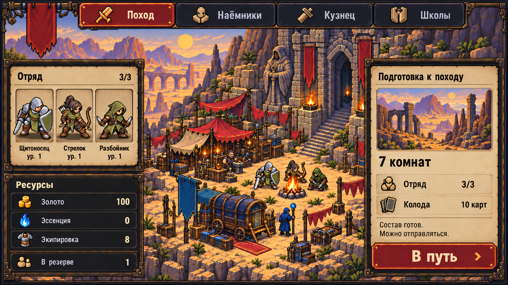

# Предпочтённый V1: флаги без знаков — 2026-10-24

U вновь приложил V1 со словами «Вот это получше» и поручил убрать все знаки
с флагов. V1 теперь предпочтённое направление; это не поручение на внедрение.
Base `bf7736a0283e0152d0c613f3febe65cdfd70270b`, main.

[Результат](expedition-v1-plain-flags.png),
[приложенный U исходник](user-selected-v1.png), [точный промпт](prompt.txt).
Один edit встроенным image_gen. Сняты эмблемы, крестики/звёздочки и другие
печатные отметки с большого красного полотнища слева сверху, красных знамён
крепости и синего флага у повозки. Цвет ткани, складки и расположение сохранены.
Функциональные UI-иконки, названия, числа и общая композиция остаются.

Это генеративная правка: побайтное/пиксельное совпадение вне флагов не заявлено.
Есть небольшое переосмысление фактуры сцены и ткани; у красного коврика возле
повозки исчезла часть жёлтого узора. Старый V1 не перезаписан.
Персонажи не становятся новыми игровыми спрайтами. Предыдущие V1/V2/V3 и все
исходники сохранены. В Godot не внедрено, кнопки не действуют.

Данные свежего профиля прежние: три героя ур.1, отряд3/3, золото100,
эссенция0, экипировка8, резерв1, колода10, маршрут7комнат.
Исходное обоснование данных — [основной пакет](../README.md#данные-макета).

Размеры1672×941, SHA, побайтность копий и сохранность прежних файлов —
[validation.json](validation.json). Независимый reviewer: [APPROVE](review.md)
для статичного preview. [Проверки завершения](closeout.json). Godot/import/full/core/
F5/editor/DPI/GPU не запускались. Приёмка исправленного PNG остаётся за U;
новую работу автоматически не начинать.
