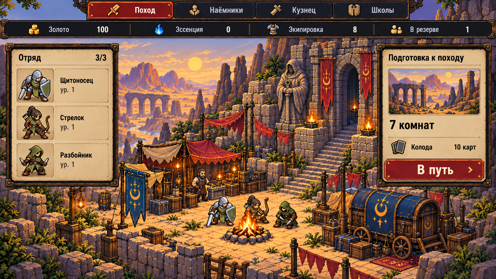
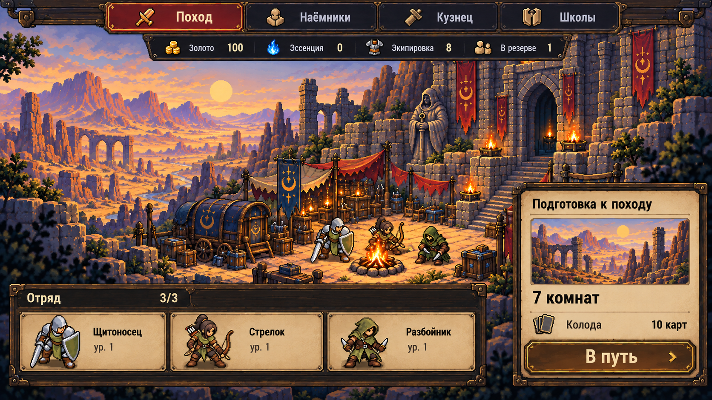

# Ещё два варианта экрана «Поход» — 2026-10-24

U: «Сделай еще пару вариантов». Base `7bbadc959c99ded47030fbf11671cc8ebb0b7baa`,
main. Два дополнительных самостоятельных PNG встроенным image_gen, по одному
вызову на вариант. [Первый вариант и данные](../README.md) сохранены.
Позже U предпочёл V1: [актуальная правка флагов](../plain-flags/README.md).
Эти альтернативы сохранены; внедрение в Godot не поручено.

## Вариант2 — открытый двор

[PNG](expedition-mockup-v2.png), [точный промпт](prompt-v2.txt).
Ресурсы вынесены в верхнюю строку, герои показаны тремя вертикальными рядами
в левой панели, подготовка справа стала короче. Нижняя часть двора открыта:
лучше видны костёр, группа и обоз. Тёплая палитра и красная кнопка сохранены.

## Вариант3 — отряд снизу

[PNG](expedition-mockup-v3.png), [точный промпт](prompt-v3.txt).
Широкая нижняя панель отряда, подготовка справа снизу, ресурсы сверху.
Верхняя и средняя части почти полностью отданы крепости/долине.
Тени глубже и прохладнее, главная кнопка янтарная; общая палитра осталась
достаточно тёплой, полное приглушение из промпта не достигнуто.

## Общие данные и границы

Во всех трёх вариантах один свежий профиль: Щитоносец/Стрелок/Разбойник ур.1,
отряд3/3, золото100, эссенция0, экипировка8, резерв1, колода10, маршрут7комнат.
Источники кода перечислены у [первого варианта](../README.md#данные-макета).
В обоих запросах одинаковые пять входов в таком порядке: первый макет,
референс U, Щитоносец, Стрелок, выбранный Разбойник. Входы не перекодированы.
Пути и SHA — [validation.json](validation.json).

Это генеративные цельные изображения: исходные пиксели персонажей, детали
фона и точные размеры панелей не сохраняются. В V3 края переднего плана местами
смягчены. Нет отдельных UI-слоёв и работающих кнопок; кузнец/школы остаются
вкладками концепта. Арт-приёмка U открыта. Новый этап автоматически не начинать.

## Проверки

Оба результата1672×941 сохранены побайтно, CRC PNG/IDAT и SHA проверены.
33защищённых файла и шесть прежних PNG пакета неизменны; runtime не менялся.
Ведущий визуально сверил все подписи/числа/три карточки и различие композиций.
Godot/import/full/core/F5/editor/DPI/GPU не запускались.
Независимое ревью: [APPROVE](review.md) для статичных концептов.
Проверки передачи, ссылок и объёмов: [closeout.json](closeout.json).
