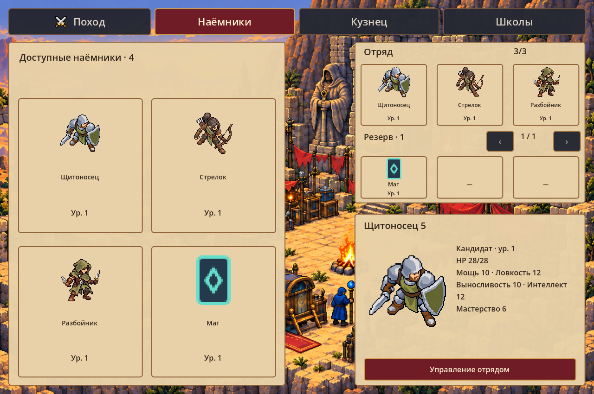
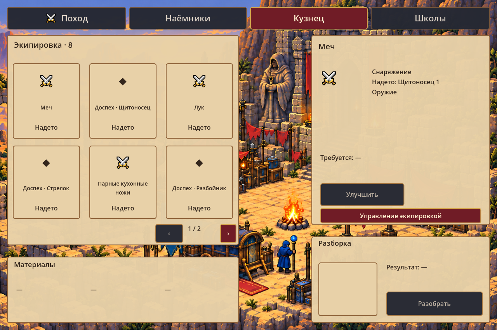
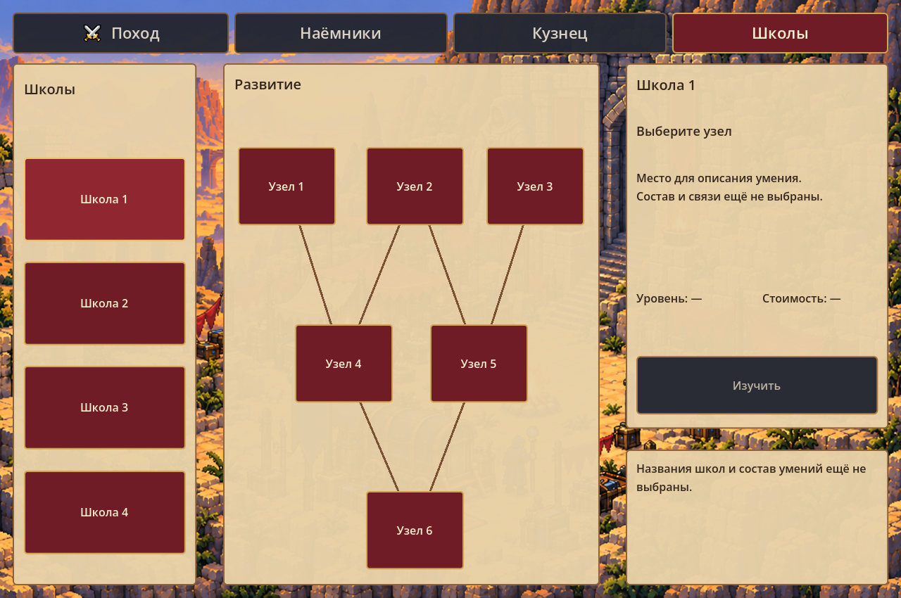

# Независимые каркасы вкладок хаба — 2026-10-24

По поручению U проработаны **скелеты** «Наёмники», «Кузнец», «Школы» с независимыми
элементами. Ветка main; base `42dddb9e1e976905193e48c42668ef77ebae4788`.
Это рабочие сцены Godot; финальное оформление и новые игровые механики не заявлены.

## Результат

- Три страницы, одиннадцать модулей и два шаблона карточек — 16 отдельных .tscn.
- Панели, карточки, портреты, подписи, кнопки и линии — отдельные узлы, без
  автоматической перестановки соседей контейнерами. Обновление данных сохраняет
  перемещение, скрытие, переименование, перенос между родителями и удаление.
- Привязки через metadata; отсутствующие элементы пропускаются, не создаются заново.
- Наёмники: текущие кандидаты, состав/резерв, локальный выбор героя и осмотр.
- Кузнец: реальные вещи, страницы склада, владелец/прочность. Материалы и стоимость
  пока прочерки, «Улучшить»/«Разобрать» отключены.
- Школы: нейтральные школы/узлы, локальный выбор, отдельные перемещаемые связи.
  «Изучить» отключено; каталог и правила развития не придуманы.
- Управление отрядом/экипировкой ведёт в прежнюю BasePage с существующими действиями.

Владелец поведения, карта файлов и инструкция редактирования —
[HUB_SCENES_V1](../../HUB_SCENES_V1.md#независимые-каркасы-вкладок--2026-10-24).
Открыть `scenes/demo/hub/sections/*_page.tscn` в Godot 2D.
Общую компоновку менять в странице, детали — в исходной сцене модуля или локальном
override экземпляра. Сохранять значения metadata при смене имён/родителей.
Эти гарантии относятся к новым страницам и общим вкладкам; прежние экраны
управления/похода/отчётов не переведены на свободное удаление любых узлов.

## Снимки из Godot

| Экран | 1024×720 | 1280×850 | 1920×1080 |
|---|---|---|---|
| Наёмники | [PNG](screenshots/mercenaries-1024x720.png) | [PNG](screenshots/mercenaries-1280x850.png) | [PNG](screenshots/mercenaries-1920x1080.png) |
| Кузнец | [PNG](screenshots/smith-1024x720.png) | [PNG](screenshots/smith-1280x850.png) | [PNG](screenshots/smith-1920x1080.png) |
| Школы | [PNG](screenshots/schools-1024x720.png) | [PNG](screenshots/schools-1280x850.png) | [PNG](screenshots/schools-1920x1080.png) |





Используются прежняя диорама с однотонными флагами и прежние портреты. Новый арт
не генерировался, растровые исходники не редактировались. Маг и значки предметов —
заполнители. Панели/рамки/текст — нативный UI, не впечатаны в фон.

## Проверки

Финальный изолированный прогон `demo-9615cc76be784c50a09f881607c05425`:

```text
python tools/demo/isolate.py --render-check --only hub_sections hub_dashboard hub_scene_authoring hero_hub_ui expedition_ui mage_deck_ui --screen 0
SUMMARY: 8 passed, 0 failed, 0 timed out
```

| Проверка | Итог |
|---|---|
| Godot 4.7.2 import/startup | PASS / PASS |
| hub_sections | 556/0 |
| hub_scene_authoring | 307/0 |
| hub_dashboard | 82/0 |
| hero_hub_ui | 44/0 |
| expedition_ui | 58/0 |
| mage_deck_ui | 131/0 |
| `python tools/demo/test_isolate.py` | 30 tests, OK |
| Независимое game_reviewer | APPROVE, включая финальную дельту |

Новый тест выполняет реальные клики/перелистывание и проверяет выбор, открытие
прежнего управления, изменённый/пустой состав, резерв на двух страницах и его
сокращение, пустой склад. Авторские move/hide/delete/rename/reparent проверяются
на панелях, карточках, полях и узлах/линиях школы. Соседи сохраняют identity и
положение; render не накапливает обработчики и не меняет профиль/RNG/байты файла.
Остальные тесты сохраняют прежние маршруты H1/U14/колоды, сохранение/retry и отчёты.

Первый прогон `demo-60a29be0caa7435888bd90684dc30238`: **7 PASS / 1 FAIL / 0 timeout**.
В новом тесте был неверный NodePath `Tree` вместо `SchoolTree`; engine errors
сделали весь пункт FAIL, несмотря на внутренний счётчик 534/0. Этот запуск
не считается итоговым PASS. [Исходный лог](checks/initial-hub-sections-failure.log)
и [итог](checks/initial-timing.json) сохранены. Путь исправлен в тесте.
Следующий полный адресный прогон прошёл 8/0/0, hub_sections540/0.
После визуальной проверки подписи компактных карточек перенесены под портрет;
добавлены граничные сценарии состава/резерва/склада. Финальные результаты — выше.
Ни одна первоначальная ошибка не скрыта и не выдана за успешный запуск.

[Ревью](review.md), [финальный итог](checks/final-timing.json),
[SHA кода и снимков](validation.json), [закрытие этапа](closeout.json).
Полные локальные копии/manifest/логи — в соответствующих `test_reports/demo-*/`.
Изменённые runtime/test/launcher-файлы сверены с финальным manifest по байтам.

Full/core, ручные F5/editor/DPI/GPU, финальная художественная и балансная приёмка
не заявлены. Автоматический рендер не заменяет проверку пользователя в редакторе.
Остаток — отзыв U о размещении модулей и отдельный выбор следующего этапа;
новые механики и финальную отделку автоматически не начинать.

## Завершение

33 защищённых файла проверены по SHA и составу; прежние фон/портреты неизменны.
Предыдущий HANDOFF сохранён побайтно в [отдельном архиве](../../CODEX_HANDOFF.history-20261024-5.md),
ссылка добавлена в [HISTORY](../../HISTORY.md). Короткая передача обновлена.
Чужие `scenes/demo/main_menu.tscn` и `docs/art/battlefield-reference-03-20261017/`
не входят в коммит. Core/preview/live/worker/queue/RNG/save/frozen сохранены.
Локальный Conventional Commit, без push/sidebar tasks/расписаний.
