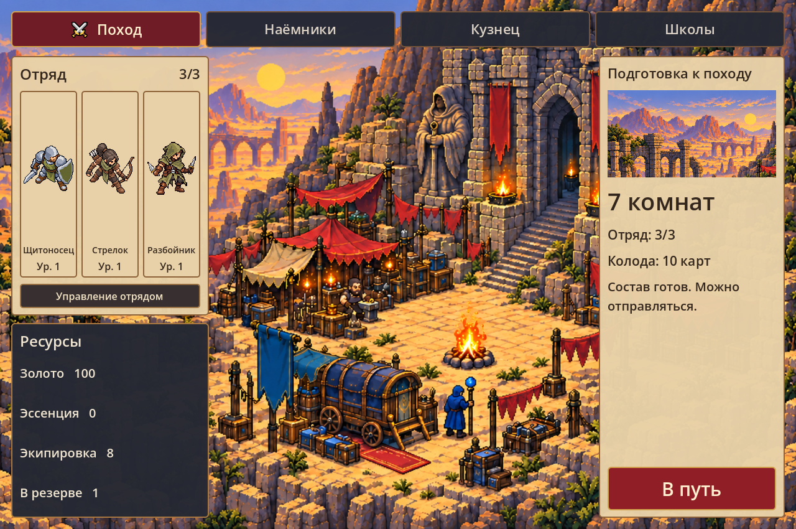

# Первый рабочий каркас хаба — 2026-10-24

По «Для первичного скелета пойдет» и последующему «Давай» реализована главная
страница Godot по [выбранному V1 без знаков](../hub-expedition-mockup-20261024/plain-flags/README.md).
Ветка main; base `9c7ad7d885ef473bdd0a3e84089a032b76da6061`. Локально, без push.



## Результат

- Верхние вкладки «Поход», «Наёмники», «Кузнец», «Школы»; однотонные флаги.
- Живые состав/классы/уровни, золото, эссенция, экипировка, резерв и размер колоды.
- «В путь» вызывает существующий запуск H1/похода через сохранение.
- «Управление отрядом» сохраняет доступ к найму, экипировке, характеристикам,
  колоде и достижениям. Возврат не теряет черновик; несохранённая колода блокирует выход.
- После боя/похода и закрытия отчёта открывается «Поход». Ошибка записи сохраняет
  прежний приоритет, повтор публикует тот же candidate.
- «Кузнец»/«Школы» — заглушки. Это первый рабочий каркас, декоративные рамки
  концепта и финальная художественная приёмка остаются открытыми.

Владелец поведения и карта сцен — [HUB_SCENES_V1](../../HUB_SCENES_V1.md).
Запуск: `project.godot`, F5 → «Начать тест» → «В путь».
Геймплей, core/preview/live/worker/queue/RNG/save/frozen и боевые модели не менялись.

## Происхождение изображений

Встроенный image_gen удалил UI из выбранного PNG и восстановил диораму.
Вход: `docs/art/hub-expedition-mockup-20261024/plain-flags/expedition-v1-plain-flags.png`.
[Точный промпт](background-prompt.txt). Запрошено 1920×1080; фактический результат
1672×941 сохранён побайтно в [runtime PNG](../../../assets/ui/hub/fortress_plain.png).
Фон статичен; три героя у костра удалены, чтобы он не подменял изменяемый состав.
Кузнец и синий NPC остаются декорацией. Панели, цифры и кнопки — Control-узлы.

Портреты используют прежние PNG Щитоносца, Стрелка, Разбойника и Воина.
Четыре AtlasTexture в assets/ui/hub/ обрезают прозрачные поля только при показе;
PNG и параметры боевого отображения не менялись. Маг использует прежний SVG-заполнитель.
Правая иллюстрация — фрагмент диорамы, без данных о будущих комнатах.
Происхождение, размеры и SHA — [validation.json](validation.json).

## Проверки

Финальный изолированный прогон `demo-e2c659315f454a7c8e2769e5df8b3afd`:

```text
python tools/demo/isolate.py --render-check --only hub_dashboard hub_scene_authoring hero_hub_ui expedition_ui mage_deck_ui --screen 0
SUMMARY: 7 passed, 0 failed, 0 timed out
```

| Проверка | Итог |
|---|---|
| Godot 4.7.2 import/startup | PASS / PASS |
| hub_scene_authoring | 307/0 |
| hub_dashboard | 82/0 |
| hero_hub_ui | 44/0 |
| expedition_ui | 58/0 |
| mage_deck_ui | 134/0 |
| `python tools/demo/test_isolate.py` | 30 tests, OK |
| Независимое game_reviewer | APPROVE после исправления возврата |

Дашборд проверяет реальный ввод, неизменность профиля/RNG/файла при навигации,
черновик/отмену, частичный и пустой состав, мага, повторный render/обработчики,
запуск и сохранение; остальные UI-тесты сохраняют прежние сценарии управления,
H1/U14/колоды, отказа записи/retry, checkpoint/reload и отчётов.
Рендеры: [1024×720](screenshots/dashboard-1024x720.png),
[1280×850](screenshots/dashboard-1280x850.png), [1920×1080](screenshots/dashboard-1920x1080.png),
[Наёмники](screenshots/TabMercenaries.png), [Кузнец](screenshots/TabSmith.png),
[Школы](screenshots/TabSchools.png), [частичный отряд](screenshots/partial-party.png).
Полные локальные логи/manifest: `test_reports/demo-e2c659315f454a7c8e2769e5df8b3afd/`;
итоги и небольшие логи сохранены в [checks](checks/final-timing.json).

Первый прогон: 6 PASS / 1 FAIL / 0 timeout. Старый expedition_ui искал достижения
сразу после возвращения, хотя теперь они доступны через управление отрядом.
Тест дополнен реальным нажатием ManageParty, прежняя проверка сохранена:
[исходный сбой](checks/initial-expedition-ui-failure.log), [исходный итог](checks/initial-timing.json).
Также по первому снимку увеличены портреты и исправлены пропорции карточек.
Второй прогон: 7/0/0; затем reviewer нашёл возврат на BasePage после H1,
запущенного из управления. Исправление и регрессионная проверка вошли в финальный
полный адресный прогон выше. [Оба результата ревью](review.md).

Full/core и ручные F5/editor/DPI/GPU, финальная арт-/баланс-приёмка не заявлены.
Автоматические рендеры Godot не заменяют ручную приёмку. Следующий шаг — отзыв U
о рабочем каркасе; новый этап автоматически не начинать.

## Завершение

33 защищённых файла и исходники прежних портретов/выбранного макета проверены по SHA.
Точный архив предыдущей передачи — [HANDOFF](../../CODEX_HANDOFF.history-20261024-4.md),
ссылка добавлена в [HISTORY](../../HISTORY.md). Scope, ссылки, объёмы входных
документов и побайтность архива — [closeout.json](closeout.json).
Изменения пользователя `scenes/demo/main_menu.tscn` и
`docs/art/battlefield-reference-03-20261017/` сохранены вне коммита.
