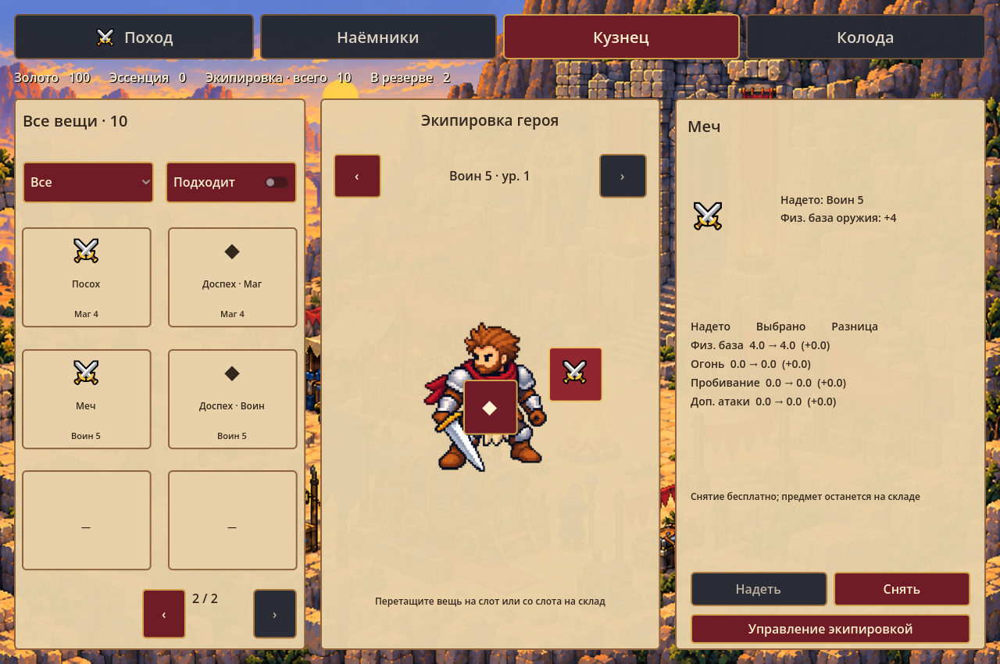

# Кузнец и восстановление брони — 2026-11-15

Реализация по отдельному поручению U после принятого [макета](../hub-smith-drag-20261115/README.md).
База работы `a94bdbce973a92a35d0d544cc1ef206b31e280f9`, main;
параллельный арт-коммит `924723a2e143413691dbd3751b2f0e75837442f2` сохранён.

Слева инвентарь 2×3, тип/совместимость/владелец и пагинация; в центре герой
с двумя значками слотов поверх фигуры; справа свойства, сравнение и действия.
Нативное перетаскивание надевает, заменяет и снимает вещи; кнопки остаются.
Пустой слот обозначен `+`. Чужую вещь сначала снимают у владельца.
Новых артов, классов, услуг кузни, рецептов и правил экономики нет.

Вся сохранившаяся обычная броня бесплатно восстанавливается при возврате в хаб,
в том числе склад/резерв; старый hub save проходит атомарное восстановление.
Походный износ и промежуточная починка сохранены. В хабе нет предупреждений
о повреждениях и платной починки в финальном отчёте.
Владельцы: [сцены](../../HUB_SCENES_V1.md#экипировка-кузнеца--2026-11-15),
[восстановление](../../POST_BATTLE_V1.md#автовосстановление-брони-в-хабе--принято-u-2026-11-15),
[план](../../HUB_DESIGN_PLAN.md), [архитектура](../../ARCHITECTURE.md).

## Игровые кадры

Это GPU-снимки настоящих сцен Godot, не HTML. Каталог4, пять классов:
[1024×720](catalog4-1024x720.png), [1280×850](catalog4-1280x850.png),
[1920×1080](catalog4-1920x1080.png). Тексты, фигуры и вещи — из текущих ресурсов.
[Замена брони](armor-replacement-1280x850.png) и [ножи](rogue-knives-1024x720.png)
используют дополнительную fixture каталога2; остаток10,5 в ней введён только
для проверки точного переноса вещи и не изображает обычное состояние нового хаба.
15 кадров кузнеца в трёх размерах сохранены в отчёте, пять выбраны для Git.

## Проверки

Один Godot4.7.2 runner, изолированный проект
`test_reports/demo-e97ca62b21e749a4bdfea56f11cd0aac/project/`;
логи, manifests, `iterate.py`, результаты и остальные PNG —
`test_reports/hub-smith-implementation-20261115/`.
Команды воспроизведения — [TESTING](../../TESTING.md).

| Набор | PASS / FAIL |
|---|---:|
| Import / startup | PASS |
| Headless: hero_hub, expedition_transitions, expedition_postbattle, mage_deck_expedition, warrior_recovery | 1030 / 0 |
| GPU: hub_smith | 2140 / 0 |
| GPU: hero_hub_ui, hub_approved_ui, hub_sections, hub_scene_authoring, hub_dashboard | 1345 / 0 |
| GPU: expedition_ui (промежуточная починка и отчёт) | 58 / 0 |

Итого 12 адресных suites: 4573 / 0 (5 headless, 7 GPU).

Native pointer input проверяет оба направления, замену, drop над фоном/карточкой/
фильтром, Escape/outside, отсутствие клика после drag, пустой/неверный слот,
класс/чужого владельца/устаревшие снимки, перенос панели, ошибку записи/retry.
Кнопки, точность ownership/остатка, reload, пять текущих классов и старые каталоги
сохранены. Автовосстановление проверено в H1, финале/раннем выходе/поражении
обоих походов; старый hub save — с отказом записи, retry и повторным открытием.

Первый import launcher завершился раньше конца без сообщения GDScript; повторный
импорт runtime.exe в той же изолированной копии прошёл. Затем исправлены ошибка
типизации нового обработчика, доставка drop поверх дочерних кнопок, тесные карточки
1024 и ошибка теста reload (сериализованный массив был принят за словарь ID).
Ни одна из этих неудач не считается успешным gate.

Независимое ревью ARMOR и SMITH — APPROVE; подробности в отчёте.
Пользовательская приёмка реального удобства/читаемости остаётся открытой.
Full/core, ручные F5/движение/zoom/OS-DPI и performance не запускались;
прежние hub/бой/огонь/шипы/launcher gates не объявляются повторёнными.
Стабильные60FPS не заявляются. Другие H2–H5 этим поручением не запускаются.
