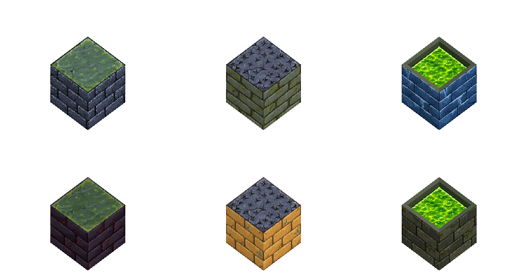

# Кислотная плёнка, глубокая кислота и кальтропы — 2026-11-05

По поручению пользователя внедрены выбранные PixelLab-клипы `acidfilm-05`
«Рассеянная рябь» и `caltrops03-01` «Редкие блики» из
[исходного набора](../hazard-animations-20261104/README.md).
Сборщик `tools/art/build_hazard_surface_animations.py --check` проверяет
66 ячеек двух атласов против raw PNG; входные изображения неизменны.

Прозрачная плёнка ограничена верхним ромбом128×96 и зелёной компонентой;
alpha не выше0.58, поэтому виден настоящий материал пола. Кальтропы используют
весь исходный верх с камнем между предметами; это ещё не независимая россыпь
на произвольном материале. Боковины источников скрыты, боковины тайла прежние.
Оба цикла33 кадра256²,10FPS. Выдвижные ловушки этим выбором не меняются.

Прежняя кислота05/01 сохранена побайтно и показана в глубокой кислоте,
на8 native px ниже края. Новый `DEEP_ACID=4` добавлен после прежних terrain ID;
вход/толчок смертелен без трупа. Слой первой комнаты добавляет D7, если свободен;
C7 остаётся мелкой кислотой. Каталоги/seed/профиль не мигрируют.

Поведение: [ENVIRONMENT_HAZARDS_V1](../../ENVIRONMENT_HAZARDS_V1.md).
Показ/жизненный цикл: [BATTLE_VISUAL_SCENE_CONTRACT](../../BATTLE_VISUAL_SCENE_CONTRACT.md#анимированная-кислота-без-каменного-основания--2026-11-04).
Снимки: [BATTLE_SNAPSHOT_CURRENT](../../BATTLE_SNAPSHOT_CURRENT.md).

Слева — прозрачная плёнка, в центре — кальтропы, справа — глубокая кислота:

[Плёнка на шести биомах](acid-six-biomes.png),
[настоящий маршрут HeroHub→бой](acid-live-current-room.png).
Снимки сохраняются напрямую из GPU viewport; сравнение включает две настоящие
глубокие поверхности после проверки их пиксельной видимости.

PASS: импорт/запуск; hazards165/0; move_forecast547/0, включая глубокую кислоту
в worker; push_chain636/0; GPU acid_tile_animation217/0 (все33 кадра маски),
environment_visual_contract32/0, visual_scene_contract106/0,
presentation_environment364/0 (в том числе смерть в глубокой кислоте),
dungeon_room_comparison1983/0. Core9424/0, core_reactions419/0; независимое runtime-ревью APPROVE.
По ревью BT дополнительно исключает глубокую кислоту из маршрута целиком;
проверены закрытый коридор, отказ без мутаций и доступный безопасный обход.
`hazards_ui91/2`: два прежних сбоя втягивания/очистки hold воспроизведены
на baseline84957c6b в той же isolated-копии, затем текущие файлы восстановлены.
Полный `--full` набор не запускался. Прежние APPROVE/F5 не считаются повторёнными.
Отчёт: `test_reports/liquid-hazards-20261105/`.
Первый стандартный import в `demo-61a4221c21ca478faa96b89691ed7e6e` достиг
лимита120с при импорте большого архива арт-проб; зависимые тесты не начались.
Импорт продолжен тем же единственным Godot runner в той же isolated-копии
с лимитом600с. Там обнаружен неподдержанный Godot архивный animated WebP.
Добавлен `docs/.gdignore`: документы/пробы исключены из ресурсного импорта;
ссылок `res://docs/` в scripts/scenes/tests нет. Рабочие атласы остаются в assets.
После этого import PASS; source checkout не импортировался.
Первый прогон также выявил два неверных новых утверждения о пустом общем списке
тел (fixtures уже содержали прежние трупы): теперь проверяется неизменность
старых тел, единственная смерть и её bodyless запись. Старый negative core
пример перенесён с ID4 на неизвестный ID5; frozen-контракты неизменны.
Ручные F5/движение/zoom/DPI, посадка/стыки, качество и performance отдельно открыты.
