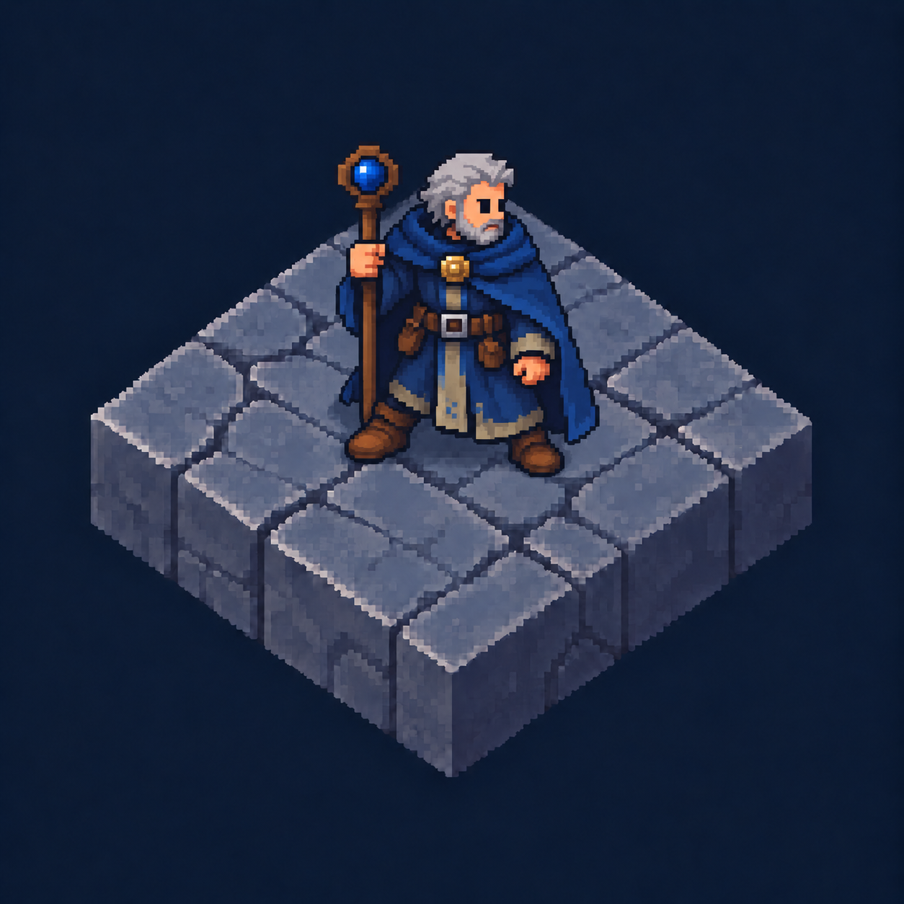
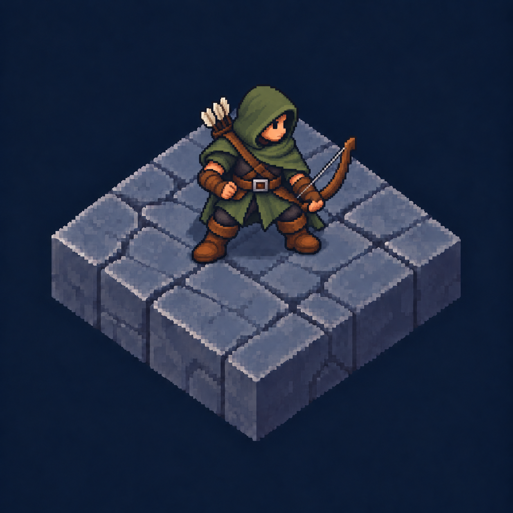
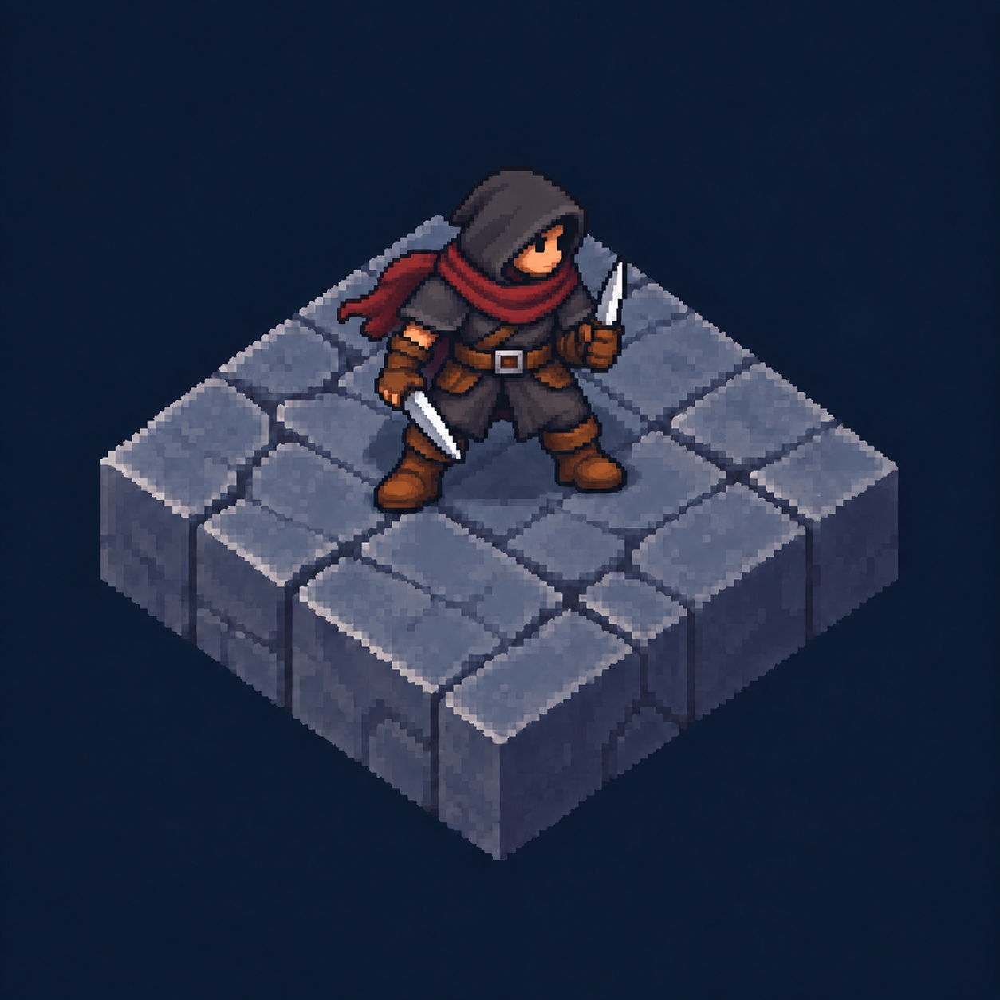

# Маг и лучник — первые концепты, 2026-11-01

U выбрал [Разбойника02](../rogue-variants-20261101/rogue-02.png) и поручил
сделать мага и лучника. Встроенным ImageGen созданы по одной пробе каждого.
База main: `2fb90186efa534ce5f1c3828ca3a06e5d309cba7`; `integration=false`.
Выбор Разбойника02 относится к статичному образу, не к анимациям или внедрению.

| Маг | Лучник | Выбранный разбойник02 |
|---|---|---|
|  |  |  |

Общий [референс U](../rogue-variants-20261101/user-reference.png) задаёт
синего седого мага с посохом и лучника в оливковом капюшоне с луком/колчаном.
Разбойник02 задаёт компактность, масштаб относительно тайла, посадку и плотность
пиксельных пятен. Персонажи смотрят вправо; тайл изометрический. Это концептная
композиция, а не проверка точной игровой опоры. Название «лучник» следует запросу
U; существующий игровой класс «Лучница» и его модель не изменялись.

Оба PNG скопированы побайтно из выдачи, без ретуши. Точные промпты и исходные
пути — [prompts.json](prompts.json), SHA/размеры/сохранность — [sources.json](sources.json).
Ведущий и read-only game_scout просмотрели изображения: классы читаются,
масштаб сопоставим с Разбойником02, явных дефектов кистей/посоха не обнаружено.
Нижняя часть лука частично сливается с рукой — учитывать при отзыве/доработке.
Это визуальная проверка, не художественная приёмка и не готовые игровые спрайты.

Runtime, сцены, ресурсы, скины и клипы не менялись; Godot/import/full/core/F5
не запускались. Проверены PNG, исходные SHA, ссылки Markdown и diff документов.
Далее — отзыв U о двух пробах. Без поручения не создавать новую серию,
анимации, прозрачные версии и не интегрировать модели.
