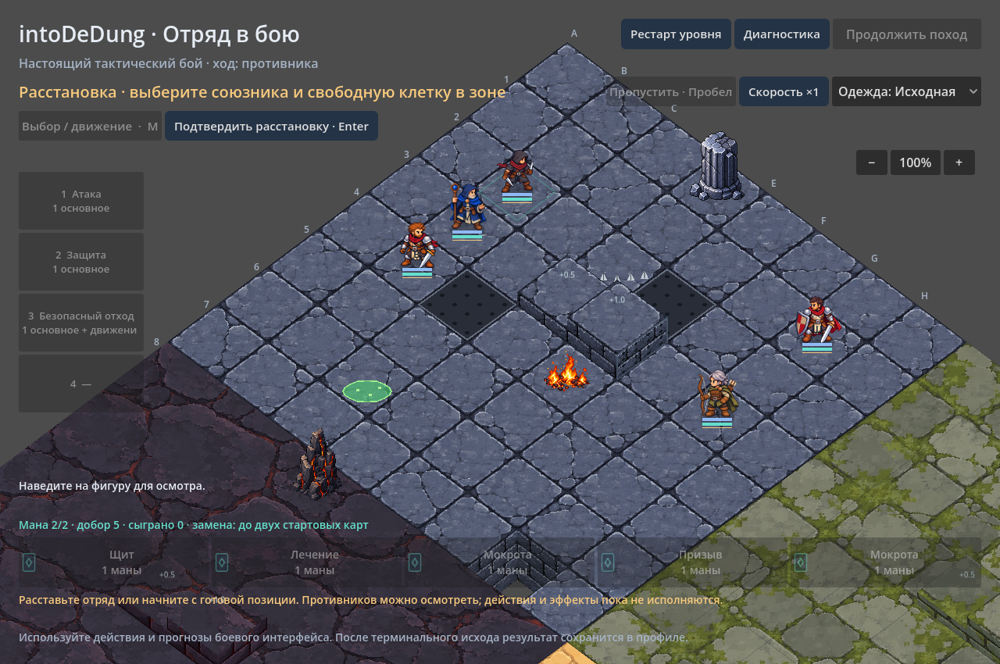

# Маг02 и Лучница14-04 — внедрение выбранных клипов

По поручению U в игру подключены Маг02 «Капюшон звёзд» и Лучница14-04.
У обоих основной idle1, дополнительный idle5 и смерть3; у Мага способность5,
у Лучницы способность4. Владелец поведения — [CHARACTER_SKINS_V1](../../CHARACTER_SKINS_V1.md).
База: `f74a863f086861e00a89d8136235246d94620ced`, ветка `main`.

[Облики на обеих сторонах, способность и смерть](selected-skins.png) ·
[Проверки и SHA снимков](validation.json) · [Независимое ревью](review.md)

## Подключение

Runtime-пакет — [character_skins_v1](../../../assets/art_presets/approved/character_skins_v1/README.md).
Источники: [Маг](../mage02-animation-20261103/README.md) и
[Лучница](../archer14-04-animation-20261103/README.md). Новые листы и still
скопированы побайтно, без дорисовки, изменения кадров или повторной генерации.
Весь пакет теперь содержит6 скинов,21 клип,27 PNG и693 AtlasTexture-ячейки.
Все25 прежних PNG/TRES сохранены побайтно относительно базы.

Выбор по умолчанию работает для обеих команд, старых профилей и портретов хаба.
Полный кадр256², texture_scale0.5 и ArtRoot0.8 дают одинаковый формат новых
фигур с Воином; Разбойник сохраняет0.72. Idle5 включается после3–6 циклов idle1
через частные визуальные часы. Палитры исходников и направление команд сохранены.

Лучница воспроизводит выбранный клип при обычном/опутывающем выстреле.
Маг использует свой при огненной атаке и elemental_cast. Штатный снаряд
летит от момента выпуска; возвращение фигуры продолжается при попадании.
After ждёт окончания клипа и смерти цели. Внешняя магия колоды с actor0
сохраняет отдельный показ. Core, очередь, preview, RNG и формат сохранений
не изменялись; это не новый набор способностей.

## Проверки

Изолированные import/startup PASS. Адресные результаты без GPU / с GPU:

| Набор | Headless | GPU |
|---|---:|---:|
| mage_archer_skins | 415/0 | 415/0 |
| character_skins | 1074/0 | 1130/0 |
| character_skins_hub | 33/0 | 34/0 |
| class_showcase_ui | 45/0 | 47/0 |
| class_showcase | 229/0 | — |

GPU coverage53/0, zoom496/0, attack styles611/0; все30 заказанных GPU-наборов
прошли, включая contact/ranged/mage/status, lifecycle и legacy fallback.
Полные результаты и команды — validation.json. Python launcher35/0;
детерминированная сборка43 выходов,27 побайтных PNG,693 проверенные ячейки.
Новые тесты используют настоящие factory loadouts и receipts, проверяют
preview/live parity, обычный и летальный выстрел, летальный elemental_cast,
полёт/контакт/after, смерть короткого generic-клипа, resize/speed/skip/cancel.
Отсутствующий обязательный idle5 отклоняется; тестовые ресурсы восстановлены.

Логи: `test_reports/mage-archer-integration-20261103/`.
Первичный свежий импорт завершился без диагностики; повторный и финальный
импорт прошли. Первые неудачные проверки выявили ошибки новых фикстур и
двух алиасов локального runner; исправленные проверки прошли без script errors.
Неудачные логи сохранены. Godot запускался последовательно в одной изолированной
копии; рабочий проект не импортировался. Ни служб, ни драйверов, ни фокуса не меняли.

## Открытая приёмка

Full/core, ручные F5/движение/zoom/DPI и performance на этом этапе не выполнялись.
Художественная приёмка масштаба и стыков остаётся за пользователем. У выбранной
Лучницы4 исходная стрела достигает правого края; она сохранена в кадрах вместе
с прочими исходными эффектами. Автоматическая ретушь или регенерация не поручена.
Прежние presentation_foundation141/2, turn_forecast_ui26/3 и остаток HUD/Колода
этим этапом не закрываются. После завершения — отзыв пользователя.

Чужие main_menu.tscn и battlefield-reference-03-20261017 сохранены (33 SHA).
HANDOFF2292 LF-символа; прежний2358. Остальные входные документы не менялись;
PROJECT_CONTEXT3652 — прежнее превышение ориентира, без роста.
Прежняя передача сохранена побайтно в
[отдельном архиве](../../CODEX_HANDOFF.history-20261103-3.md), ссылка добавлена в HISTORY.
