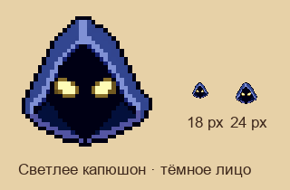
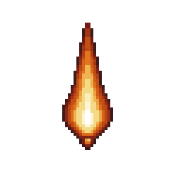

# Огонёк и знак носителя — PixelLab, 2026-11-22/23

U поручил анимированный язычок пламени вверх и варианты постоянного значка.
После первых вариантов U предложил голову в капюшоне: лицо в тени, жёлтые глаза
с небольшим ореолом вокруг глаз, капюшон индиго. Последняя правка усилила
отличие светлой ткани от чёрного лица. Runtime использует точный PNG варианта10;
знак пламени снят. Оценка вида непосредственно в игре остаётся отдельной приёмкой.

## Происхождение

Запросы и сырые ответы PixelLab сохранены рядом без секретов. Source — Pixen,
анимация — PixMiniMax16, фактически17 PNG64×64 с прозрачностью. Runtime играет
все17 исходных кадров по80мс; базовая точка(31,40), масштаб0.25 относительно
исходного кадра персонажа. Движение генерировал PixelLab, новые позы локально
не рисовались. Первый/последний RGBA не идентичны; это не математически точный
шов, цикл просмотрен отдельно. WebP lossless сохраняет сырые кадры, enlarged
preview — nearest×4, contact — раскладка без ретуши.

В `icons/` — первые четыре предложения; `mystic-icons/05–07` — сигилы,
08 — исходный капюшон,09 — индиго/жёлтые глаза,10 — усиленный контраст.
08–09 заменены уточнениями U. Они и первые варианты остаются историей поиска,
а не дополнительными значками игры. Preview-панели используют исходные PNG
на светлом фоне и явное nearest-масштабирование для сравнения18/24px.

[Provenance и фактический расход](provenance.json): суммарно13 generations.
Поля сверены с [официальной схемой API](https://api.pixellab.ai/v2/openapi.json).
Новых серий повторов без поручения не запускалось: два уточнения капюшона
следуют отдельным отзывам U.

## Сборка и границы

`python tools/art/build_host_flame.py --check` проверяет17 raw SHA-256,
порядок и все RGBA атласов. Янтарный — точные исходные пиксели. Голубой,
фиолетовый и белый меняют только H/S, сохраняя V/alpha/геометрию.
`build_host_glow_anchors.py --check` воспроизводит495 якорей живых анимационных
кадров шести человеческих обликов. Исходные рисунки персонажей неизменны.
Огонёк рисуется поверх глаз, следует позиции/отражению и выключается при смерти.
Спокойная настройка показывает первый кадр, мягкая — живой цикл.

Правила, UI и проверочные маршруты — [HOST_POSSESSION_V1](../../HOST_POSSESSION_V1.md)
и [TESTING](../../TESTING.md). Это художественный пакет для среза носителя,
не подтверждение баланса карт, ручного F5/DPI или60FPS.
