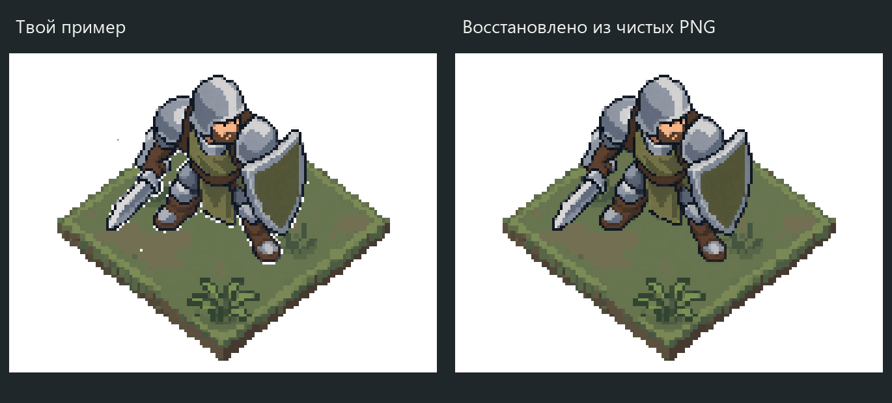

# Посадка из пользовательского Paint-эталона — 2026-10-09

Пользователь отверг прежнее размещение, сам совместил выданные PNG и поручил
запомнить результат, затем воспроизвести его и попробовать ранние тайлы.
Владелец установки — [ART_DIRECTION](../../ART_DIRECTION.md).

- [Оригинал пользователя, без обработки](user-reference.png).
- [Чистое восстановление](clean-reconstruction.png), [прозрачный PNG](clean-reconstruction-transparent.png).
- [Ранняя смесь A18/C6/D6/E6](mixed-early.png).
- [Все первые A–F по отдельности](early-fields.png).
- [Нынешние K/L/M и их смесь](current-fields.png), [сама смесь](mixed-current.png).

## Что запомнить

Авторитетен визуальный пример пользователя: размер и расположение фигуры на
тайле. Белый фон, белые дырки, случайные точки и кривой край вырезки не переносятся.
Отвергнутый сдвиг(4,24) из предыдущего пакета не является целевой посадкой.
Эталон не выбирает окончательный рисунок травы, анимации или игровой anchor.

`user-reference.png` — побайтная копия вложения657×491.
`paint-tile.png`(512×408) и `paint-warrior.png`(312×292) — те самые выданные
PNG в масштабе×4, также сохранены без изменений. Их начала в эталоне —(73,65)
и(149,33). Размеры при переносе не меняются; чистая сборка убирает дефекты вырезки.

`measure_reference.py` находит перевод координат по RGB почти непрозрачных
пикселей с учётом белого фона Paint: alpha≥240, допуск3 на канал.
Оба лучших положения единственны; все47136 проверенных пикселей воина совпадают
в этом допуске. Тайл частично закрыт воином. Это регистрация положения существующих
PNG, не реконструкция модели камеры. Результат — `reference-measurements.json`.

В масштабе поля верх128×96; обрезанный спрайт78×73 имеет72px видимой высоты
при alpha≥128. Его начало —(19,-8) относительно габарита верхней грани тайла.
На клетке(2,2) начало обрезанного спрайта(405,319), полного PNG(396,301).
Средняя опора(447.95,385.17) при центре клетки(450,375). Эти числа описывают
только данный спрайт и позу; для новых фигур главный ориентир — визуальный эталон.

## Ранние и нынешние тайлы

Ранние A–F читаются из самых первых `../tiles-20261009/*-original.png`,
**не** из позднее перегенерированного набора `projection-4x3-20261009`.
A — Retro Diffusion, B–F — PixelLab. Их прежние измеренные верхние грани
нормализованы до принятого4:3 через nearest; боковины ограничены8px в монтаже.
Это производный показ исходных рисунков, не изменение их PNG и не новый ракурс
нативной генерации. Смесь использует прежние18A и по6C/D/E, без новых случайных
поворотов/подкраски. Дополнительно показаны нынешние K2/L2/M3 и смесь по12 каждого.

`compose.py` повторяет сборку; Pillow/NumPy и Windows Segoe UI.
`checks.json` содержит хеши исходников, нормализацию, раскладки и размещения.
Воин не перерисован; источник — `../quiet-clusters-20261009/defender-soft-original.png`.
Собраны11 полей:9 однородных и2 смешанных. На каждом одинаковая постановка.

Новых вызовов image_gen/PixelLab/Retro Diffusion нет. PNG/хеши/масштаб/положение/
раскладки/фон проверены; картинки просмотрены. Независимое ревью APPROVE. Отчёт —
`test_reports/placement-reference-20261009/`. Godot/core/full/render/F5 не запускались.
Игра остаётся2:1; игровая интеграция и финальный выбор тайлов открыты.
