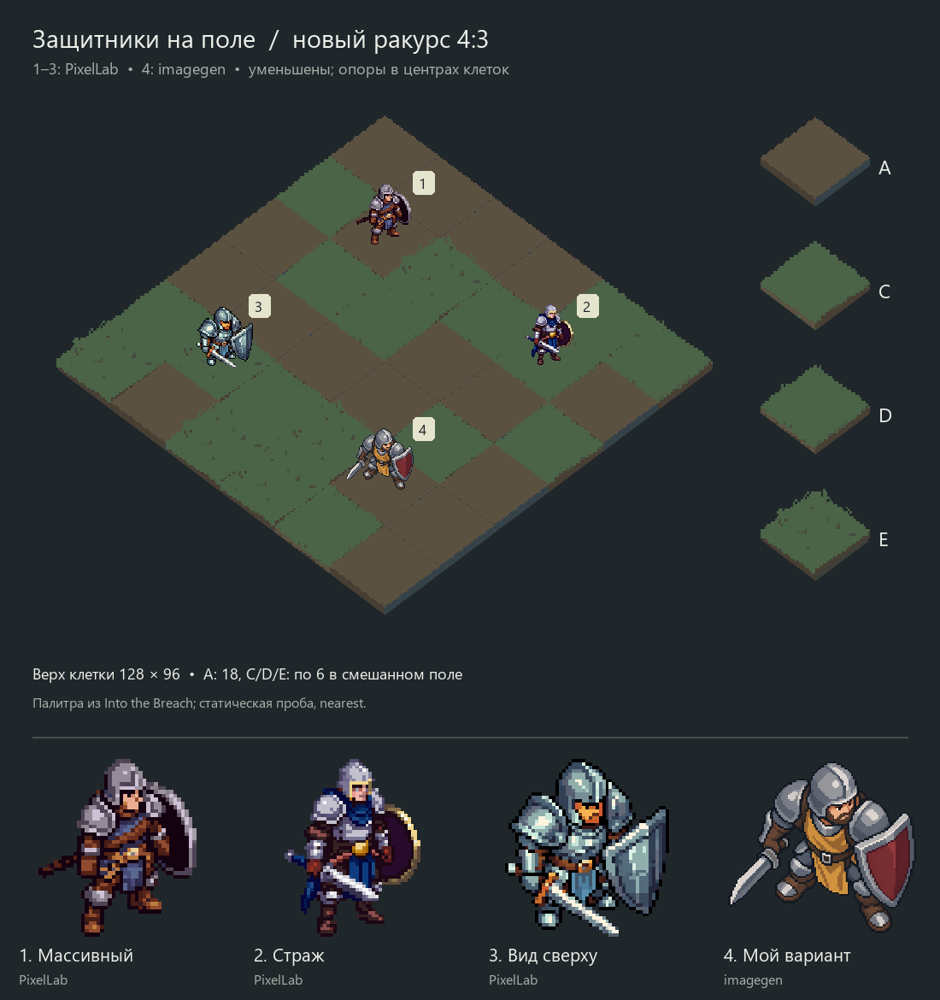

# Поле 4:3 и уменьшенные защитники — 2026-10-09

По уточнению пользователя наклон поля должен соответствовать Into the Breach.
Основные установки — [ART_DIRECTION](../../ART_DIRECTION.md).
Верх исходного игрового тайла примерно 56×42; боковины не входят в эти размеры.
Макет использует верх 128×96 и шаги сетки (64,48)/(-64,48).
Это статические пробы: геометрия и сцены самой intoDeDung не менялись.

## Изображения

- [Смешанное поле с четырьмя защитниками](defenders-on-board.png).
- [Поле без персонажей](mixed-field.png): прежняя раскладка 6×6, A×18, C/D/E×6.
- [Все четыре типа тайлов](tile-comparison.png): [A](tile-A-field.png),
  [C](tile-C-field.png), [D](tile-D-field.png), [E](tile-E-field.png).
- Каждый защитник на одинаковой клетке (2,2): [1](defender-1-field.png),
  [2](defender-2-field.png), [3](defender-3-field.png), [4](defender-4-field.png).
- [Прежний арт: 2:1 против 4:3](angle-comparison.png). Одинаковый старый рисунок
  персонажа №4, одинаковая высота 72 px; меняется только монтаж поля.
- [Проверка центров клеток](placement-check.png): ромб клетки и крест в центре.

Новые №1–3 — PixelLab Pixen edit прежних персонажей, №4 — image_gen edit.
Все перерисованы с запросом более высокого ракурса. Подпись «Вид сверху» обозначает
направление варианта, не измеренный угол. Флаг/промпт не доказывает 3D-точность.

## Размер и центр

По дополнительному поручению солдаты уменьшены до 72 px видимой высоты:
примерно на треть относительно прежних 92–110 px. Прозрачные поля не влияют
на размер; bbox определяется по alpha ≥128. Меч/щит не задают точку опоры.
Контакты двух подошв оценены по рисунку; их середина привязана к центру клетки
с погрешностью округления не более 0.5 экранного пикселя по каждой оси.
Координаты и масштаб — `geometry.json` и `checks.json`; масштаб фигур равномерный.
У №4 крупный исходник 1230×1278 с пиксельной стилизацией, не native64.
PixelLab №1–3 — 64×64. Нижние портреты в сравнении увеличены для просмотра деталей.

## Генерация тайлов и монтаж

Все четыре выбранных тайла — новые PixelLab Pixflux, 64×64, прозрачный фон.
A — почти пустая земля; C — спокойная трава; D — лёгкая кромка; E — более заметная
трава. C/D различаются слабо, E заметно плотнее; приёмка стиля остаётся открытой.
Все непрозрачные пиксели оригиналов входят в семь точных RGB из игры, без перекраски.

У A выбран `tile-A-guided-request.json`: геометрическая заготовка помогла получить
высокий ромб. У C/D/E выбраны `tile-X-free-request.json`: без init_image, с isometric.
Первый A был округлым; C/D/E с сильной заготовкой вышли пустыми и почти одинаковыми;
дополнительная попытка C с меньшей силой тоже не дала достаточной травы.
После двух неудач влияния заготовки пакет перепроверен и init_image убран.
Отклонённые исходники/полные ответы остаются в локальном отчёте.

**Точность 4:3 обеспечена монтажом**, а не всеми нативными генерациями: измеренные
верхние грани C/D/E нормализованы до 128×96 через nearest. В макете лишняя толщина
блоков отсечена до 8 экранных px ниже передних граней. Это явно производные
`tile-X-display.png`; `tile-X-original.png` сохранены побайтно. Не выдавать эти
превью за готовый финальный набор: пиксельные ступени/нативную геометрию ещё нужно
довести после выбора. Геометрическая заготовка — собственная простая схема;
оригинальную текстуру Into the Breach провайдерам не отправляли.

Повторная сборка: `compose.py` рядом с изображениями, Pillow и Windows Segoe UI.
Контрольные `previous-art-64/96.png` собраны из прежних исходников без генерации;
их боковины масштабированы вместе с тайлом, поэтому это сравнение силуэта поля.

## Расход и проверки

PixelLab: 9 генераций тайлов (4 выбраны, 5 отклонены) + 3 правки персонажей =
12 generations, баланс 4985 → 4973. image_gen: 1 правка, денежный usage не возвращён.
Retro Diffusion: только бесплатная оценка $0.18 при остатке $0.14; платного вызова нет.
Промпты и безопасные параметры рядом; base64 заменён ссылками на изображения.
`generation-usage.json` — сводка фактических ответов, без ключей.

Проверены палитра, alpha, SHA, количество/раскладка клеток, размеры, точки опоры,
неизменность фона вне наложений. PNG просмотрены; независимое ревью APPROVE.
Godot/core/full/render/F5 не запускались: игра не менялась.
Отчёт: `test_reports/art-angle-20261009/`.

Позднее пожелание пользователя про динамику, угрозу и харизму записано в
ART_DIRECTION для следующих генераций; эта серия после него не перерисовывалась.
Арт, размер и поза ещё требуют пользовательского выбора; анимации/интеграция
не поручены этим статическим сравнением.
