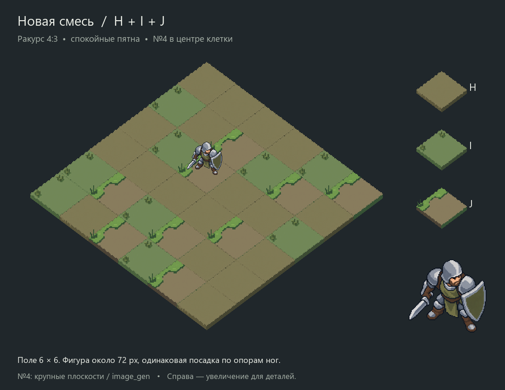

# Спокойные кластеры: H/I/J и Защитник №4

Поручение 2026-10-09: попробовать тайлы по пользовательской методичке,
сохраняя принятый ракурс4:3; убрать чрезмерную пикселизацию и плохо читаемый
шум солдата. Цель — спокойная картинка. Владелец установок —
[ART_DIRECTION](../../ART_DIRECTION.md#текущая-корректировка-спокойные-формы).

## Что смотреть

- [Все три поля и смесь](all-fields.png).
- [H — земля](field-H.png), [I — два пучка](field-I.png),
  [J — трава у края](field-J.png): одна и та же новая версия №4.
- [Три солдата крупно и около72px](soldier-comparison.png): прежний64,
  новый PixelLab96 и мой вариант через image_gen с крупными плоскостями.
- Одинаковая новая смесь с [крупными плоскостями](mixed-soft.png),
  [PixelLab96](mixed-pixellab.png), [прежним солдатом](mixed-old.png).
- [Проверка центра опор](placement-check.png).

Предложение ведущего — вариант с крупными плоскостями: светлая сталь и простые
массы шлема/щита/плеч читаются спокойнее. PixelLab96 остаётся альтернативой,
но часть мелких штрихов сохранилась. Это оценка пробы, не приёмка пользователем.

## Как применена методичка

[Прикреплённая пользователем методичка](user-cluster-guide.png) — визуальный
референс группировки деталей. Её плотность и указанные пиксельные размеры
не переносились буквально: наш угол и масштаб иные, а пользователь просит
меньше шума. Авторство методички не установлено; она хранится как входной референс.

Дополнительно прочитаны материалы Saint11 о кластерах, светотени, масштабировании
и согласованности графики, а также разбор шума Arne Niklas Jansson.
Ключевые моменты со ссылками и способы применения вынесены по поручению
пользователя в отдельную [памятку](../../PIXEL_ART_GUIDE.md).

Наше применение: свободная земля H, редкие два пучка I, одно связное пятно
у края J. Три тайла имеют спокойный центр. В смешанном поле18H/9I/9J сохранены
позиции прежних18 клеток A; остальные поочерёдно заменены I/J. Ни вращения,
ни случайной подкраски для сокрытия повторения нет. J намеренно более заметен;
ритм его повторения остаётся предметом выбора.

№4 упрощён двумя способами: PixelLab перерисовал64×64 в96×96; image_gen взял
прежний крупный №4 и сократил внутренние линии/формы, осветлив основные плоскости.
Последний исходник1230×1278 — крупный стилизованный растр, не native96 sprite.
Ни размытие, ни локальный фильтр уменьшения шума не применялись. Уменьшенные
фигуры и монтаж — nearest; увеличение разрешения не выдаётся за уменьшение деталей.

## Источники, обработка и границы

`*-request.json` — безопасные запросы PixelLab со ссылками вместо base64;
`defender-soft-prompt.txt` — художественное задание для image_gen,
`defender-soft-request.json` — фактически переданный промпт и ссылки.
Все ответы провайдеров сохранены как исходники. У H/I отдельные промежуточные
варианты сохраняют неудачное симметричное размещение деталей для аудита.
У H после первой правки осталась слишком заметная линия; задание пересмотрено
до полностью чистой верхней плоскости. Никакой тихой подмены старым A нет.

`geometry.json` задаёт измеренные опоры, `compose.py` собирает сравнения,
`checks.json` содержит SHA/размеры/раскладку/постановку. Верх исходных тайлов
почти4:3 и нормализован до128×96; шаги(64,48)/(-64,48), боковины ограничены8px.
Изначальный PNG не изменяется. Рисованные края имеют пиксельные ступени;
математически точная3D-камера генераций не заявляется.

Фигура одна на клетке(2,2), опора — середина двух подошв, округление≤0.5px
по каждой оси. Целевая высота72px; фактическая после округления PNG указана
в checks. Правая колонка и верхний ряд сравнения — увеличения для деталей.
Родственная приглушённая гамма, без требования точного совпадения семи RGB.

PixelLab:7 генераций, баланс4968→4961 (три тайла, солдат, две правки H, одна I).
image_gen:1 вызов; денежный usage не возвращён. Retro Diffusion не вызывался.
Фактические ответы/usage — `test_reports/quiet-clusters-20261009/`.

PNG/alpha/SHA/раскладка/опоры/фон вне фигуры проверены, поля просмотрены.
Независимое ревью APPROVE. Игровой код/сцены не менялись,
Godot/core/full/render/F5 не запускались. Принят только ракурс4:3;
финальный арт, масштаб, характер позы, анимация и интеграция остаются открыты.
