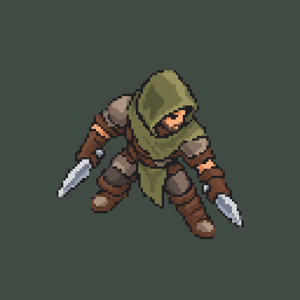

# Разбойник — правка усиления B1, 2026-10-12

U выбрал [B1 из шести вариантов](../rogue-buff-death-variants-20261012/README.md)
для способности: добавить резкости и убрать удвоение кинжалов при скрещивании.
**D3 — смерть на бок принята**; её кадры не меняются. Игровой интеграции нет.
Base main `a3ed01be6f26d8ce56796b9c01f85c00c41adc92`.

## Задание PixelLab

Один запрос `animate-with-text-v3`, 8 кадров, first/last — исходная стойка
`reference-128.png` (128×128), SHA256:
`ccf04fbb0c7b73fce0eba232ce5e595c7c2d037b7a9a8eaa176309e6ad11dbb5`.
Seed `2026101231`, enhance_prompt=false, no_background=true.
Job `ff7d4e3b-6973-4aff-98a8-f3261962fa78`.
Задание: резко поднять два кинжала, скрестить с чёткой остановкой, быстро вернуть
в исходную стойку. В каждой руке один односторонний кинжал; рукояти/кисти ниже
пересечения, только два острия сверху, без лезвий под кистями/копий/шлейфов.
Лицо/капюшон/гамма/масштаб и опора должны сохраняться.

Новые позы генерирует только PixelLab. Локальный экспорт сохраняет исходные PNG,
порядок, пиксели и прозрачность. Ритм можно изменить длительностью кадров;
дорисовки, промежуточных кадров и интерполяции нет. Прежний B1 не перезаписывается.

Запрос/схема/происхождение — `request-manifest.json`, `api-schema.json`,
`buff-01-cross-fixed/pixellab/`. Генерация completed: 9 исходных PNG, 2 generations.
Ускоренный показ — 1180 ms, диагностический равномерный — 1800 ms.
Исходные кадры/порядок сохранены; native GIF совпадает с видимыми RGBA PNG.
Но в кадрах 4–6 скрещивания осталась неправильная геометрия клинков;
эту первую попытку нельзя считать исправлением дефекта.

## Точечная правка клинков

После осмотра трёх плохих кадров выбран `edit-animation-v2`, который редактирует
существующие позы вместе. При размере 128×128 API допускает до четырёх кадров;
переданы именно 4, 5, 6 (три кадра), без повторной генерации всего движения.
Job `42518d5b-de5d-4508-a3a8-d61d5eaff7ed`, seed `2026101232`.
Запрос/схема/входные SHA — `knife-edit/`; `prepare-knife-edit.cjs` воспроизводит
подготовку запроса и отказывается перезаписывать уже отправленный запрос.
Задание — исправить только два кинжала, сохранив тело/лицо/позу каждого кадра.
Факт выполнения оценивается по ответу, а не по тексту задания.

Правка completed: три PNG, 10 generations; вместе с анимацией расход 12.
Ведущий осмотрел все исправленные позы: в кресте читаются два кинжала,
прежних дополнительных лезвий нет. В `corrected/` собраны девять кадров:
1–3 и 7–9 — исходные PNG, 4–6 — целые PNG редактора PixelLab.
Каждый файл скопирован побайтно; части изображения локально не дорисовывались.
`corrected/provenance.json` задаёт соответствие кадров и SHA.
Вариант `quantized_images`, дополнительно возвращённый провайдером, сохранён
отдельно как `knife-edit/quantized-frame-*.png`; в сборке используются `images`.

## Показ для приёмки

Основной показ: `corrected/preview.gif`, 512×512 nearest×4;
`corrected/native.gif` — прозрачный 128×128.
Длительности: 200, 80, 80, 120, 240, 80, 80, 100, 200 ms, цикл **1.18 s**
вместо прежних 2.6 s B1. Короткие переходы и задержка в кресте дают акцент,
промежуточных кадров/сглаживания нет. `corrected/uniform-preview.gif` показывает
те же кадры по 200 ms для диагностики, `corrected/filmstrip.png` — все позы.

Экспорт/PNG parity/alpha/границы/GIF/native visible RGBA проверены;
`validation.json` относится к первой попытке, `corrected-validation.json` — к правке.
Возврат не побайтно замкнут: между первым и последним кадрами 87 видимых
различающихся пикселей; шов с принятым idle в игре ещё не проверен.
Редактор получил требование сохранить тело/лицо, но побайтная неизменность
этих областей в трёх отредактированных кадрах не заявляется.

Независимое ревью — **APPROVE экспорту и показу**: девять PNG сверены с ответами
PixelLab, три GIF — по кадрам/пикселям/таймингу; все кадры непустые и не обрезаны.
Ревью подтверждает два кинжала в кадрах 4–6, без прежнего удвоения.
Замечание P2 (арт): в переходах 3→4 и 6→7 смещается опорная нога/ботинок,
несмотря на требование неподвижной опоры; может читаться как скачок стойки.
Это остаётся предметом пользовательской оценки, не скрывается техническим PASS.

Приёмка нового B1 остаётся за пользователем. D3 принята и сохранена без изменений.
Следующим отзывом U потребовал убрать уменьшение кинжалов и сделать начало
разъединения резким с усилием, затем небольшим затуханием;
[следующий пакет](../rogue-buff-release-20261012/README.md). Эта версия не принята.
Runtime/механики прежние; Godot/full/core/F5/editor/GPU не запускались.
Отчёт: `test_reports/rogue-buff-cross-fix-20261012/REPORT.md` (из корня проекта).
