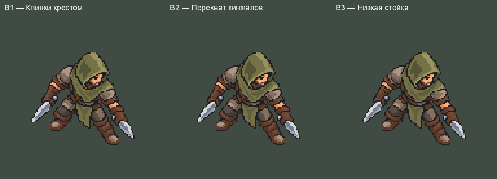
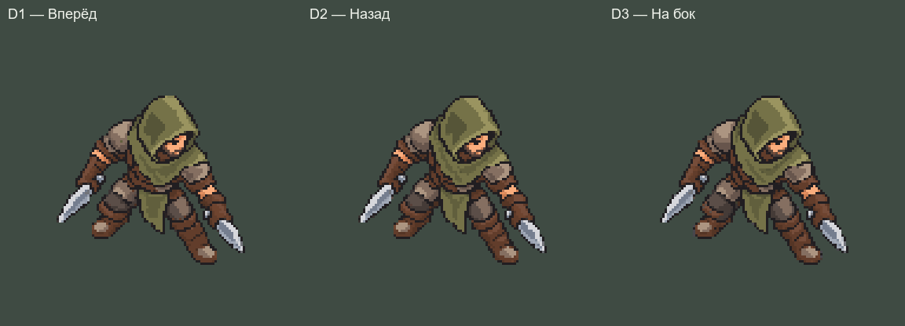

# Разбойник — три усиления и три смерти, 2026-10-12

U принял [idle с ритмом эталона](../rogue-idle-cadence-20261012/README.md)
и поручил по три варианта применения усиливающей способности и смерти для выбора.
Это шесть явно запрошенных проб PixelLab; по одному запросу на вариант,
без автоматической серии повторов и без игровой интеграции.
Base main `21481904e2dcc51ffdcba56badbc870bd37ad73d`.

## Общая основа

`reference-128.png` — неизменённый исходный кадр принятого idle, прозрачный PNG128×128.
SHA256: `ccf04fbb0c7b73fce0eba232ce5e595c7c2d037b7a9a8eaa176309e6ad11dbb5`.
Новые позы создаёт только PixelLab, `animate-with-text-v3`, запрос 12 кадров.
Каждый API-ответ добавил исходную позу и вернул 13 кадров; все они сохранены.
В превью дискретные кадры по 200 ms, без интерполяции: усиление длится 2.6 s,
смерть с финальной паузой — 3.4 s.
Для усиления конечная поза задана исходным PNG. Для смерти конечное тело
генерируется провайдером, без ручной дорисовки и без возврата в стойку.
В превью смерти финальный кадр удерживается дополнительно 800 ms для сравнения.

В текущем коде разбойник получает пассивный `sneak_attack`, отдельного активного
self-buff в проверенном каталоге нет. Поэтому три жеста усиления — визуальные
предложения готовности/сосредоточения, без новой механики, яда или эффекта оружия.
Смерть — обычное падение с остающимся телом; VOID/HAZARD/fall вне задачи.

| Вариант | Задуманное движение |
|---|---|
| B1 — Клинки крестом | Поднять кинжалы крестом к груди, короткая фиксация, возврат |
| B2 — Перехват кинжалов | Собранный перехват у корпуса без броска оружия, возврат |
| B3 — Низкая стойка | Опуститься ниже, собрать руки у пояса, вернуться |
| D1 — Вперёд | Подломить колени и рухнуть лицом вниз |
| D2 — Назад | Потерять опору и упасть на спину |
| D3 — На бок | Осесть на колено и завалиться на бок |

Содержание таблицы — задания провайдеру; выполнение оценивается по кадрам.
Запросы/seed — `request-manifest.json`, схема — `api-schema.json`,
вход/принятие/результат каждого job — `<variant>/pixellab/`.
Все шесть job completed; исходные 78 PNG извлечены без изменения пикселей.
Расход — 3 generations на вариант, всего 18; ID и ledger — `generation-summary.json`.

## Сравнение

В каждом каталоге варианта — отдельные `preview.gif`, прозрачный `native.gif`,
лента всех кадров `filmstrip.png`; у смертей также `final-corpse.png`.
PNG сохраняют порядок ответа, без дорисовки/перестановки/обратного движения.
Сравнения синхронизированы по кадрам и показывают B1–B3/D1–D3 слева направо.
Повтор GIF после паузы — только показ выбора, не игровое оживление персонажа.

Проверки — `validation.json`; скрипты `extract-results.py` и `prepare-previews.py`
воспроизводят извлечение и показ с bundled Python/Pillow.
Первый кадр провайдер может слегка перерисовать: совпадение с исходником не
заявляется. Различия в полностью прозрачном RGB отделены от видимых в диагностике.
У D2 раскрывается лицо при падении на спину; выражение нужно оценить отдельно.
Шов с принятым idle и показ тела в бою пока не проверены.

## Проверка и независимое ревью

Python syntax, 78 PNG/ответы API, порядок кадров, alpha/границы и GIF-тайминги PASS.
Независимое ревью — **APPROVE для экспорта и показа вариантов**, не приёмка арта.
Проверены исходники всех запросов, соответствие всех PNG ответам провайдера,
цвета/прозрачность native GIF, порядок панелей и видимость финальных тел.

Замечания к результату PixelLab для выбора:

- B1: крест клинков ниже груди, а не под подбородком; жест читается слабее задания.
- B3: руки/кинжалы расходятся в стороны; получилось раскрытие боевой стойки,
  а не заданный сбор локтей у пояса. Название в сравнении отражает исходное задание.
- D2: раскрытое лицо меняет выражение при падении, несмотря на ограничение запроса.
- У B1/B2/B3 между первым и последним кадрами 142/224/248 видимых различающихся
  пикселей. Возврат не побайтно точен; шов с idle не считается готовым к интеграции.

Отчёт: `test_reports/rogue-buff-death-variants-20261012/REPORT.md` (из корня проекта).

Новые варианты ещё не выбраны/не приняты пользователем. Игра не менялась;
Godot/full/core/F5/editor/GPU не запускались. `main_menu.tscn` не трогать.
