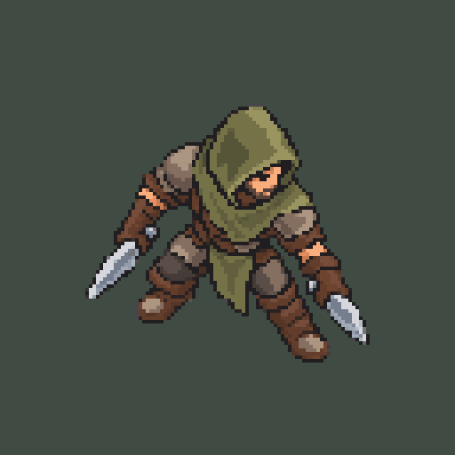

# Разбойник B1 — исправленный цвет контура, 2026-10-12

U попросил убрать чёрную обводку в
[последнем усилении](../rogue-buff-release-20261012/README.md).
После трёх неполных правок PixelLab U явно разрешил:
**«Да, исправь только цвета локально»**. Это разрешение на коррекцию палитры
готового B1, не на ручное создание анимационных поз.
Base main `6bca61de324fd07da7cfe06d8576d37b21c627ad`.

## Итоговый показ

[Манифест](final/manifest.json), [native GIF](final/native.gif),
[равномерный диагностический показ](final/uniform-preview.gif),
[раскадровка](final/filmstrip.png), [проверка экспорта](final/validation.json).
Пять кадров, прежние **200,350,60,120,240 ms**, всего **0.97 s**; nearest ×4.
Первый/последний кадр — исходный PNG побайтно.

Итог использует три **прежние позы B1** из `inputs/`, а не новые пробы провайдера.
Самый тёмный цвет исходника — RGB(33,30,33), #211e21. Новые почти чёрные цвета,
которые отсутствуют в палитре исходника и темнее её минимума, заменены на #211e21.
Остальные пиксели RGBA сохранены точно. Координаты пикселей, alpha, силуэт,
форма обоих кинжалов, позы и тайминг не менялись; локальных сдвигов нет.
Замена палитры применяется везде, где используется выбранный слишком тёмный цвет,
включая внутренние линии, а не только по внешнему краю.

`correct-palette.py` воспроизводит правку; [таблица замен](palette-correction.json)
содержит точные цвета/числа пикселей/SHA. Изменены только RGB **670/896/221** пикселей;
различий alpha **0/0/0**, все прочие RGBA неизменны. Нормальный тёмно-серый контур
исходного стиля сохранён; добавленная почти чёрная линия устранена.

[Проверка внешнего контура](outline-boundary.json) считает видимые пиксели
с прозрачным соседом по четырём направлениям. Почти чёрный — max(RGB)<28.
Было **208/218, 366/379, 98/357**, стало **0/218, 0/379, 0/357**;
эталон **0/357**. Метрика дополняет визуальный осмотр, не заменяет приёмку U.

## Сохранённые пробы PixelLab

Все три job completed, всего **30 generations**. Их изображения не входят
в итоговый показ. Запросы/входные SHA/статусы без ключа сохранены рядом с PNG.
[Схема API](api-schema.json) сверена с
[официальным OpenAPI](https://api.pixellab.ai/v2/openapi.json) перед работой.

| Каталог / job | Метод / seed | Результат |
|---|---|---|
| `edit/`, `81162c49-02ab-4e6e-907f-e10d210b73ac` | `edit_with_reference`, 2026101245 | 3 PNG, 10 generations; контур только смягчён |
| `refine/`, `c6232829-a000-4507-9e93-9406da27ec67` | `edit_with_text`, 2026101246 | 3 PNG, 10 generations; крест лучше, раскрытие ещё тёмное |
| `release-only/`, `dc4c7f97-4e67-44ac-8177-3e94902c3716` | `edit_with_text`, 2026101247 | 1 PNG, 10 generations; тёмный контур остался, блики клинков изменились |

Первая сборка получила REQUEST_CHANGES независимого ревью; две последующие
отклонены ведущим. После двух неудач проверен результат по отдельным позам:
последняя проба изолировала раскрытие вместо повторения общей правки.
Предыдущие сборки сохранены в `rejected-first-edit/`, `rejected-second-edit/`,
`rejected-third-edit/`. Их пути `final/...` в manifest/validation относятся
к соответствующему снимку до перемещения. Там применялась проверенная регистрация
целых PNG после сдвигов провайдера; в **итоговой локальной правке сдвигов нет**.
`provider-trial-tools/` хранит снимки скриптов и диагностик этих неиспользованных проб.

## Проверки и границы

Python/Node syntax, PNG/SHA/alpha/границы/GIF/native RGBA, точная таблица замен,
неизменность всех остальных пикселей и тайминга проверены.
Независимое ревью итоговой локальной коррекции — **APPROVE**: чёрная вспышка
контура устранена, формы двух кинжалов/движение сохранены. Только разрешённые
цветовые замены, alpha/прочие RGBA/GIF и 28 файлов D3/idle проверены независимо.

Принятые D3 и idle сохранены. Игра/runtime/механики не менялись;
интеграция не поручена. Godot/full/core/F5/editor/GPU не запускались.
Приёмка контура остаётся за U; шов с живым idle в игре не проверен.
Отчёт из корня: `test_reports/rogue-buff-outline-20261012/REPORT.md`.
