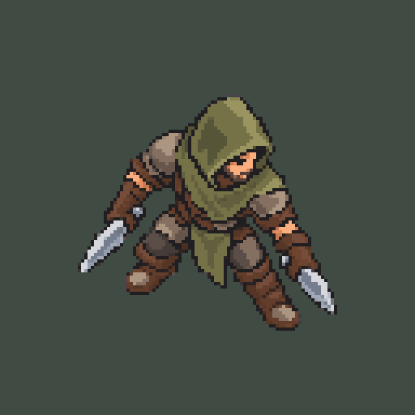

# Разбойник B1 — размер кинжалов и резкое раскрытие, 2026-10-12

U потребовал убрать уменьшение кинжалов в
[прошлой версии](../rogue-buff-cross-fix-20261012/README.md) и разъединять клинки
резко, с усилием и небольшим затуханием. Base main
`7e13c96fb8b1b7169a89fda74fb21ca01598593e`.
Это отдельная проба: принятые idle и D3 смерти не меняются, интеграция не поручена.

## Текущий показ

[Манифест](final/manifest.json) задаёт пять целых PNG с SHA и происхождением:
исходная стойка → крест → раскрытие → завершение → исходная стойка.
Крест и раскрытие исправлены PixelLab с отдельно переданной картинкой-эталоном.
Цикл **0.97 s**, выдержки **200, 350, 60, 120, 240 ms**.
После удержания креста сразу показана раскрытая поза; следующий показ длиннее.
Отбор поз и длительности дают резкое начало без интерполяции.
Первый и последний кадры — один исходный PNG побайтно; это ещё не проверка
перехода между усилением и живым idle в игре.

Рядом [native.gif](final/native.gif) 128×128 с прозрачностью,
[uniform-preview.gif](final/uniform-preview.gif) по 200 ms (1 s) для диагностики,
[раскадровка](final/filmstrip.png) и [проверка экспорта](final/validation.json).
Основной показ — nearest ×4 на фоне #3f4b43.
`assemble.cjs` сверяет completed job и SHA; `prepare-preview.py` собирает GIF.

## Происхождение и отвергнутые пробы

Все новые позы рисовал **PixelLab**. Локально выполнены извлечение целых PNG,
выбор кадров, тайминг и nearest-превью; части тела/оружия не дорисовывались,
не переклеивались и не интерполировались. Запросы без секретов, входные SHA,
ответы и фактический расход сохранены в каждом каталоге. Живые схемы API —
`api-schema.json` и `weapon-reference-edit/api-schema.json`.

| Каталог / job | Режим / seed | Результат / расход |
|---|---|---|
| `blade-size-edit/`, `54cfa391-32d3-48a2-bbb1-0824360628a7` | `edit-animation-v2`, 2026101241 | 4 PNG, 10 generations; чрезмерно длинные клинки |
| `blade-size-refine/`, `01adab57-f705-44ee-b424-a9c072cd55e2` | `edit-animation-v2`, 2026101242 | 4 PNG, 10 generations; размер всё ещё непостоянен |
| `release/`, `cb5b79af-540d-40d8-8e99-9aed78674083` | `animate-with-text-v3`, 2026101243 | запрошено 4, получено 5 PNG, 1 generation |
| `weapon-reference-edit/`, `e4e68a59-1c3c-4fef-b9d5-65c2c3b3733e` | `edit-images-v2`, `edit_with_reference`, 2026101244 | 3 PNG, 10 generations; отдельный исходный reference |

Все четыре job completed, всего **31 generation**. Первые две правки подавали
эталон как один из кадров. Независимое ревью семикадровой сборки вернуло
REQUEST_CHANGES: клинки в кресте длиннее исходных, при раскрытии опять короче.
Эта сборка побайтно сохранена в
[rejected-seven-frames/](rejected-seven-frames/manifest.json).

После двух неудачных размерных правок повторно проверены возможности API.
Последняя правка использует исходную стойку именно в `reference_image`;
три редактируемых входа — подготовка, крест и раскрытие. В запросе требуется
одинаковый короткий клинок, две гарды/рукояти и два острия, без лишних лезвий.
Ориентир около 20 px от гарды до острия — указание провайдеру, не гарантия.
Повторное ревью подтвердило улучшение креста/раскрытия, но нашло слишком короткий
левый клинок в подготовке. Шестикадровая сборка сохранена в
[rejected-six-frames/](rejected-six-frames/manifest.json); подготовка исключена
целиком. Поэтому вход в крест более рубленый, без промежуточной позы.
Оба архивных `validation.json` содержат старое имя `final/manifest.json` как
снимок до перемещения; технический PASS не означает пригодность арта.

Сырые постепенные позы выхода 2–3 пропущены, а поза 4 заменена новой правкой;
все оригиналы и причины отбора сохранены. Использованные PNG не изменены.

## Проверки и границы

Экспорт проверяет SHA, PNG 128×128, непустоту, границы/alpha, фактические кадры
и длительности GIF, RGBA каждого видимого пикселя native GIF. Первый/последний
PNG совпадают. Python/Node syntax PASS. Независимое ревью последней пятикадровой
сборки — **APPROVE**: в оставшихся позах размер клинков визуально близок к исходному,
в кресте два острия и две рукояти; основное раскрытие сразу, затем малая доводка.
Прямой вход в крест резкий, но читаемый. Точное физическое равенство длин при
повороте/перекрытии не измерено; существенных остаточных дефектов ревью не нашло.
Побайтовое совпадение новых PNG с raw API, SHA/GIF/native RGBA и неизменность
22 файлов D3 проверены независимо, только на чтение.

Отчёт: `test_reports/rogue-buff-release-20261012/REPORT.md` из корня проекта.
Кодер написал основу извлечения/превью, затем сервис модели вернул 403;
ведущий сообщил о замене и завершил экспорт локально.
Приёмка размера и движения остаётся за U. Технический PASS её не заменяет.
Следующим отзывом U попросил убрать появившуюся чёрную обводку;
[отдельный пакет коррекции](../rogue-buff-outline-20261012/README.md) сохраняет
эту сборку как исходник. Этот отзыв не означает полной приёмки B1.
D3 и idle приняты раньше и сохранены. Игровые ассеты/runtime/механики прежние;
Godot/full/core/F5/editor/GPU не запускались для этого пакета артефактов.
