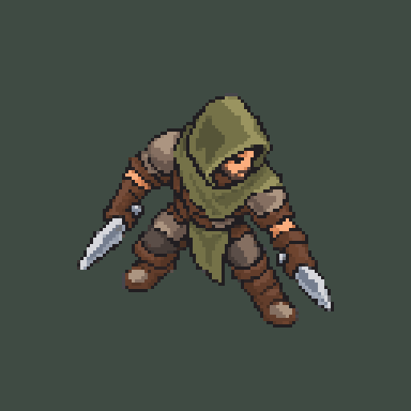

# Разбойник — ритм idle по эталону Защитника, 2026-10-12

U приложил GIF: «вот так», но движение слишком плавное/много кадров,
нужно свериться с эталоном. Это выбор движения для коррекции ритма,
а не окончательная художественная приёмка или разрешение интеграции.
Base main `b20340af002dc7b512430ef18da6050188ccd4ac`.

## Источник и эталон

`user-reference.gif` — побайтная копия вложения пользователя, SHA256:
`9604a22eacb6c5ac4c9bf55b8d9db2ad6f0f33059149c1f96961c09308f39fa9`.
Она побайтно совпадает с [прежней ручной пробой](../rogue-idle-layered-20261012/README.md)
`preview.gif`: 48 кадров по 50 ms, цикл 2.4 s. Последняя проба PixelLab с
33 кадрами не является источником этой правки. Последний выбор U уточняет
предыдущий отказ: использовать приложенное движение, изменив ритм.

Принятый основной idle Защитника — [vertical](../../../assets/art_presets/trials/defender_idle_v1/README.md):
12 кадров, 5 fps, 200 ms на кадр, цикл 2.4 s, без интерполяции.
Фактический runtime — `DefenderIdleClock`/`BattleDefenderIdleVisual`;
владелец lifecycle — [контракт](../../BATTLE_VISUAL_SCENE_CONTRACT.md#idle-союзного-защитника).

## Изменение

Оставлен каждый четвёртый кадр вложения: 1, 5, 9, 13, 17, 21, 25, 29, 33,
37, 41, 45. Каждому назначено 200 ms: всего 12 кадров и прежние 2.4 s.
Частота смены поз стала ниже, общая скорость дыхания не изменилась.
Повторяющиеся позы сохранены отдельными кадровыми слотами.
Каждый декодированный RGBA-пиксель совпадает с соответствующим кадром вложения;
нет дорисовки, смешивания, интерполяции, нового движения слоёв или API-вызовов.
Исходные GIF/PNG всех прежних проб сохранены.

[Лента кадров](filmstrip.png), [покадровое соответствие и проверки](validation.json).
`prepare-preview.cjs` воспроизводит результат с bundled Sharp в `SHARP_MODULE`.
Node syntax/export PASS: источник проверен по SHA, GIF 12×200 ms, infinite loop,
длительность 2.4 s, все пиксели выбранных кадров сохранены точно.
Независимое ревью APPROVE: декодирование подтвердило соответствие пикселей,
порядка и тайминга. Техническая проверка не подтверждает художественную приёмку.

Игра не менялась; Godot/full/core/F5/editor/GPU не запускались.
Следующий шаг — отзыв U о ритме. Интеграция и новые работы без поручения не начаты.
