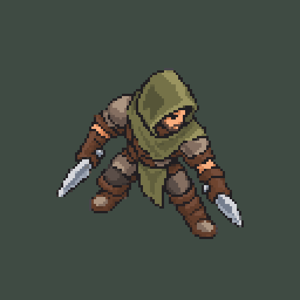

# Разбойник — ручная связка головы и груди, 2026-10-12

**Отклонено пользователем:** «очень плохо»; то же движение поручено PixelLab.
Проба сохранена для истории; [следующий пакет](../rogue-idle-pixellab-follow-20261012/README.md).
Позднее U снова приложил именно этот GIF и выбрал движение для
[уменьшения плавности по эталону](../rogue-idle-cadence-20261012/README.md).
Это новое поручение на ритм, окончательная приёмка ещё открыта.

U: сделать самому; голова с капюшоном слегка движется вместе с грудью,
немного запаздывая. Для этой правки это прямое разрешение локальной анимации
слоями после прежнего выбора PixelLab. Новых генераций/API-вызовов нет.
Base main `1f5b12d226ea8e1f8090ecfcd21a26e5e83b3cdb`.

## Исходник и движение

`source.png` — точная копия первого PNG из
[предыдущего набора PixelLab](../rogue-idle-face-stable-20261012/README.md).
Обе прежние пробы и исходный пользовательский рисунок сохранены.
`rig.json` задаёт маски трёх слоёв: ноги/низ, грудь с руками/кинжалами,
голова с капюшоном и лицом. Голова — цельная группа, черты не перерисовываются.

Грудь и руки поднимаются/опускаются на 1.5 пикселя исходника; голова повторяет
ту же волну с задержкой 100 ms. Стопы остаются опорой. Цикл 2.4 s, 48×50 ms.
Для малой плавной амплитуды слои сначала увеличены nearest×4; перемещение
целочисленное на выходном холсте 512×512 (шаг 0.25 исходного пикселя).
Это кадровый экспорт отдельной пробы, не изменение native-сетки/шейдера игры.
Внутри слоя нет поворота, растяжения, смены палитры или сглаживания.

Под перекрытыми швами повторяются ближайшие цвета нижнего слоя в пределах 3 px;
подкладка закрыта при исходной позе. Нейтральная сборка должна точно совпадать
с исходником. Статичные маски и параметры сохранены, результат воспроизводим
через `render-rig.cjs` с bundled Sharp в `SHARP_MODULE`.

## Просмотр и проверки

[Прозрачный GIF](idle-transparent.gif), [лента фаз](filmstrip.png),
[маски слоёв](mask-preview.png), [результаты проверок](rig-validation.json).
PNG-кадры находятся в `frames/`; оба GIF содержат 48 кадров по 50 ms.

Node syntax/export PASS. Нейтральная сборка совпадает с исходником;
все пиксели исходной маски головы и область лица совпадают после её сдвига
в каждом из 48 PNG. Обе области стоп неподвижны, обрезки на краю нет.
Декодированные GIF также сохраняют лицо; первый/последний кадры совпадают.
Промежуточные одинаковые позы сохранены намеренно. Покадровая лента просмотрена.
Независимое ревью APPROVE для показа кандидата: в осмотренных фазах швы цельны.
P3: округление даёт 18 уникальных поз на 48 кадров; ритм может казаться ступенчатым.
Техническая проверка не подтверждает художественную приёмку или плавность в игре.

Игровые ассеты/сцены/runtime не меняются. Ручной F5, Godot/full/core/editor/GPU
не запускались. Художественная приёмка и подключение остаются за U.
