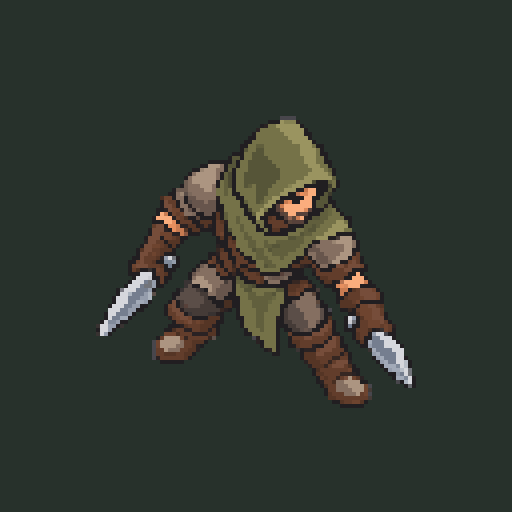

# Разбойник — дыхание с запаздыванием головы, PixelLab, 2026-10-12

U отклонил ручную связку слоёв и поручил передать то же задание PixelLab.
Требование: грудь слегка поднимается/опускается, голова с капюшоном следует
за ней с небольшой задержкой; черты лица сохраняются, стопы неподвижны.
Прежние пробы сохранены. Base main `56f99ce2cb2c944a81733e04446435ef19b52de4`.

## Задание провайдеру

Один `POST /v2/animate-pixminimax`, job `4811a2d7-cf5e-4aa6-bd62-51f892bdae1d`.
Источник — первый кадр предыдущей [пробы PixelLab](../rogue-idle-face-stable-20261012/README.md),
без локальной дорисовки. Он передан как начальная и конечная поза.
Запрошены 32 кадра; prompt задаёт тихий цикл, вертикальную амплитуду 1–2 px,
задержку головы около 0.1 s, сохранение лица и позы, неподвижные стопы/камеру.
Все четыре caption-поля заданы явно, `enhance_prompt=false`, прозрачный фон.
Это требования запроса, а не гарантия их выполнения генератором.

Запрос без секрета, актуальная схема, исходный PNG и ответ принятия — в `pixellab/`.
Читаемый промпт/хеш источника — `request-manifest.json`.
Job завершён (`status=completed` внешнего ответа); возвращено 33 PNG 128×128,
включая исходную позу. Фактический расход — 5 generations, 0 USD.
Вложенный `last_response.status` остался `initializing`, хотя внешняя задача
завершена, progress=1, action=`smoothing frames`, изображения получены полностью.
Полный ответ хранится в `test_reports/rogue-idle-pixellab-follow-20261012/job-latest.json`;
метаданные и хеши PNG — `pixellab/result.json` и `pixellab/job-status.json`.

## Результат и ограничения

[Native GIF](idle-native.gif), [все фазы](filmstrip.png),
[голова крупно](head-filmstrip.png), [диагностика](validation.json).
Оба GIF сохраняют 33 кадра в исходном порядке, равномерно по 80 ms; цикл 2.64 s.
Первый кадр совпадает с источником по RGBA; PNG не перерисованы.

Проверки файлов/экспорта PASS: Python syntax, completed job/ID, исходные PNG,
размер/alpha 0/255, отсутствие обрезки, GIF count/timing, входной кадр.
**Требование сохранения лица не выполнено:** в ленте видны изменения черт,
а после подбора сдвига до ±3 px в области лица меняется до 67 из 121 пикселя.
Это не только согласованное перемещение головы. В областях стоп также есть
изменения пикселей (до 58/17); визуальное ревью отмечает движение стоп.
Верх капюшона поднимается на 4 px вместо запрошенной малой амплитуды.
Последний кадр отличается от первого на 240 RGBA-пикселей — точного замыкания нет.
Точное запаздывание 0.1 s — требование промпта, в результате не подтверждено.
Ведущий не рекомендует считать эту пробу исправленным idle или подключать её.
Независимое ревью: APPROVE техническому извлечению/экспорту, визуальные требования
не выполнены. PNG совпадают с ответом провайдера, GIF воспроизводят его порядок;
перечисленные дефекты принадлежат результату генерации.

Изображения анимации создаёт только PixelLab. Локально допустимы извлечение,
GIF в исходном порядке и увеличение nearest для просмотра; позы не править.
Игра не меняется. Godot/full/core/F5/editor/GPU не запускались.
Приёмка статики/анимации и игровая посадка/интеграция остаются открытыми.
Автоматически новую генерацию не запускать; дальнейшая работа только через PixelLab
по поручению пользователя.
