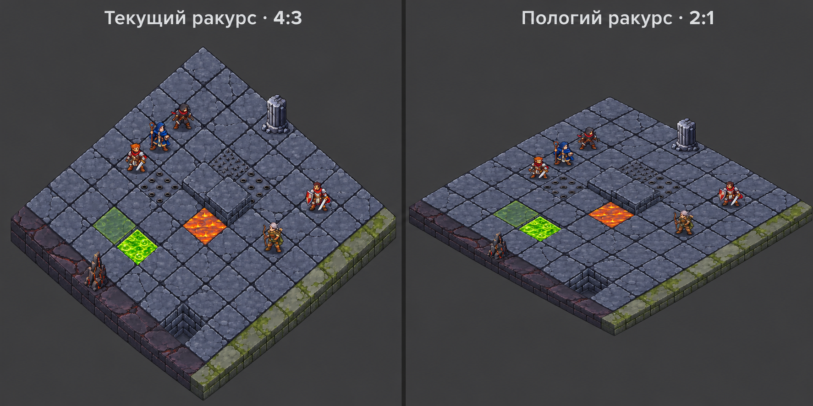

# Более пологая перспектива — 2026-11-22

U: показать тайлы и покрытия с менее сильным наклоном. Затем U уточнил:
предыдущий чат с поиском нового стиля сейчас неактуален; брать прежнюю графику.
База: main, 0f585dcbe68bd1a30e800965e089ebec26f6f946.
Итог — статичный концепт (P); выбор нового ракурса и внедрение открыты.

Слева — реконструкция текущего ракурса 4:3; справа — более пологий 2:1.
Наклон здесь означает угол рёбер ромба относительно горизонтали: высота
верхней грани уменьшается при близкой ширине. Покрытия следуют плоскости поля.
Это интерпретация запроса, не утверждённое решение о новой проекции.

Итог получен встроенным image_gen. Входы:

- [Кадр настоящих игровых сцен с пятью классами](../balance-vitals-20261115/battle-five-classes.png): существующие бойцы, материалы, ловушки и раскладка поля.
- [Реальный каменный тайл](../current-tile-reference-20261103/tile.png): фактура верха, кирпичные боковины и исходная геометрия.

[Полный итоговый промпт](stone-prompt.txt); [метаданные и SHA-256](verification.json).
PNG скопирован без редактирования; исходник генератора сохранён.
Панели — реконструкция, не два скриншота Godot. Меню, полосы и координаты
опущены в эскизе для оценки поля; реальный HUD этим не меняется.

Визуальная проверка: различие наклона заметно, кислота/лава/ловушки следуют
проекции, знакомые пять классов и материалы узнаваемы. Подписи — целевые
отношения, не точное измерение. Ширина полей, детали/масштаб фигур и высота
боковин совпадают приблизительно; одинаковый размер фигур из брифа выдержан
не полностью. При подготовке игрового превью понадобится точная геометрия.
Художественная приёмка и выбор пользователя открыты.

Первая генерация использовала неактуальную основу из чата20261121.
После уточнения U она заменена: [первый лист](attempts/superseded-style-comparison.png)
и [его промпт](attempts/superseded-style-prompt.txt) оставлены только как история,
не как предложение для продолжения. Всего два запроса встроенного image_gen.

Runtime, игровые ассеты и проекция128×96 не изменены. Правки сетки/picking,
геометрии сцен, покрытий и посадки фигур потребуют отдельного поручения.
Проверены PNG, ссылки, diff и побайтный архив HANDOFF. Godot/full/core/F5/
Editor/DPI/performance не запускались для статичного арт-пакета.
Размеры входных документов и сравнение с HEAD — в проверке; меняется только
HANDOFF, остальные стартовые правила/маршруты не редактируются.
