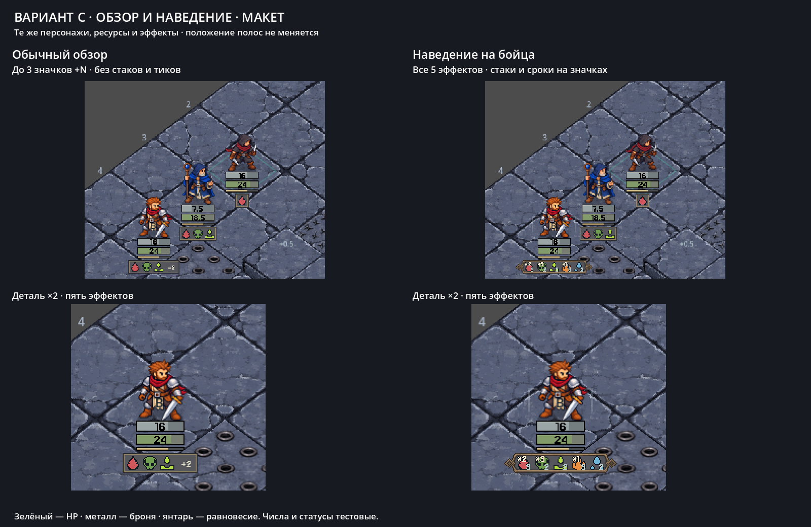

# Компактный статусный HUD C — пример 2026-11-09

База `b642431dcb7ea2a6a3e513d2a45cc1275b82ca21`. По просьбе U показано
предложение C. **Это макет для выбора, в игру не внедрён.** Текущий runtime
по-прежнему скрывает весь ряд значков и подложку без наведения.

| Уровень | Что показывает пример |
|---|---|
| Обычный обзор | Прежние горизонтальные броня, HP и равновесие. Снизу до трёх значков без чисел; `+2` у бойца с пятью эффектами. Небольшая общая серая подложка без бокового орнамента |
| Наведение | Тот же якорь полос; раскрывается ряд из пяти значков на принятой подложке №4. Стаки слева сверху, оставшийся срок справа снизу. Значки стоят рядом без нахлёста |
| Подробности | [Существующая правая карточка](card-100.png) с цветными названиями и описаниями. В примере она открыта программно, а не реальным нажатием ПКМ |

Верх листа — плотная группа с 1/3/5 эффектами; низ — тот же боец с пятью
эффектами без соседних фигур, увеличенный ровно 2× nearest. Ресурсы и эффекты
одинаковы в обоих режимах. Это синтетическое представление, не сыгранный бой.
Фон, спрайты, гамма, цвета полос, шрифты и принятые силуэты не менялись.
Нового арта нет; компактная подложка нарисована средствами Godot.

Это предложение уменьшает число постоянно видимых цифр. Цена: точные стаки
и срок нужно смотреть при наведении; при `+N` часть эффектов скрыта.
Приоритет отбора первых трёх пока не проектировался: здесь порядок тестовых
эффектов. Для реализации потребуется определить приоритеты, устойчивый hover,
переполнение, взаимодействие с соседними HUD и слои над рельефом.
Не заявляется окончательное решение коллизий в плотном строю.

## Кадры и воспроизведение

| Масштаб | Обычный обзор | Наведение |
|---|---|---|
| 100% | [Кадр](compact-100.png) | [Кадр](hover-100.png) |
| 75% | [Кадр](compact-75.png) | [Кадр](hover-75.png) |

[Одиночный компактный вид](compact-detail.png), [раскрытый](hover-detail.png).
Все восемь PNG — оригинальные GPU-кадры/лист Godot, SHA в [manifest](manifest.json).
Сценарий: [probe](probe_compact.gd.txt), [отрисовка](mock_helpers.gd.txt),
[запуск](run_stage.py.txt). Запуск использует существующий workspace helper
`test_reports/status-silhouette-integration-20261108/run_checks.py`; это рецепт
рабочей копии, не автономный инструмент. [Receipt пробы](probe.json).

Godot 4.7.2/D3D12 Forward Mobile, один runner, прогретая isolated-копия,
без root import, фокуса ОС и пользовательских сохранений. Тестовые DTO:
HP 24/32 либо 18.5/32, броня 16/24 либо 7.5/24, равновесие 4/12.
Временный isolated-patch после кадров восстановлен побайтно;
production-файлы игры не менялись. Карточка не сдвинула доску/камеру/руку
и не пересекла область карт в показанном разрешении 1440×900.
Только в макете StatusHud поднят над слоями поля до UI_PREVIEW+1: иначе
нижний ряд закрывают передние плитки. Это также затрагивает прочие маркеры
этого узла; перенос слоя в runtime не выполнен и требует отдельного решения.

Свежая GPU-проба PASS: неизменность core/RNG и якорей между режимами,
шесть кадров поля, карточка и сравнение. Это проверка демонстрации;
не проверены ввод мышью, picking нового ряда, lifecycle, другие размеры окна,
ручные F5/движение/zoom/OS-DPI/performance и full/core. Import/startup и прежние
runtime suites на этом этапе не повторялись. Отчёт:
`test_reports/status-compact-c-20261109/validation.json`.
План [хаба](../../HUB_DESIGN_PLAN.md) остаётся предложением.
