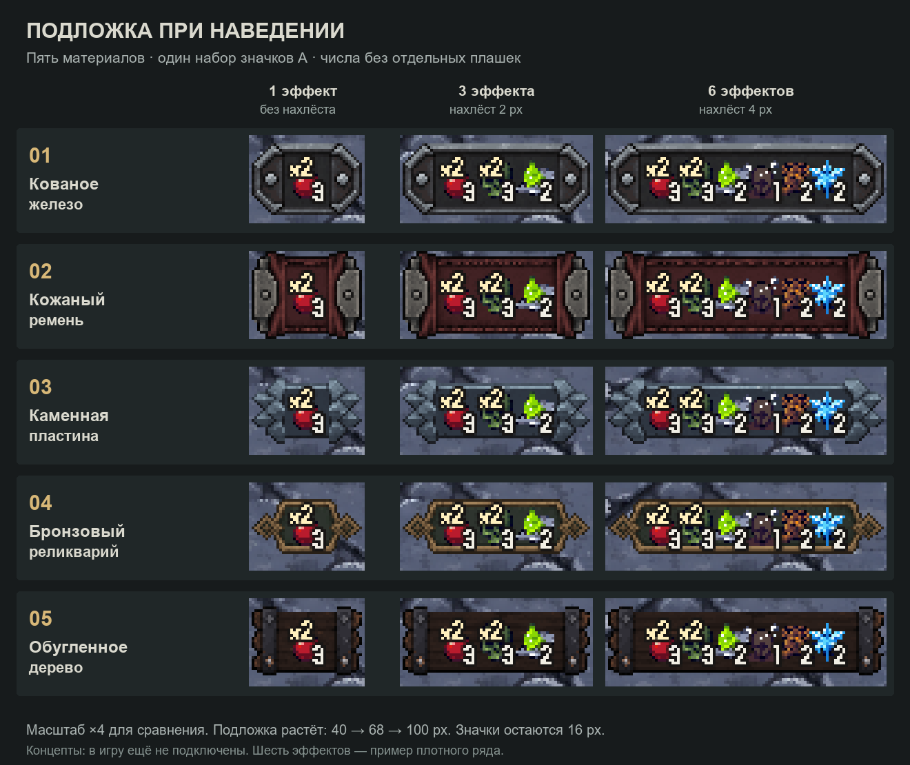
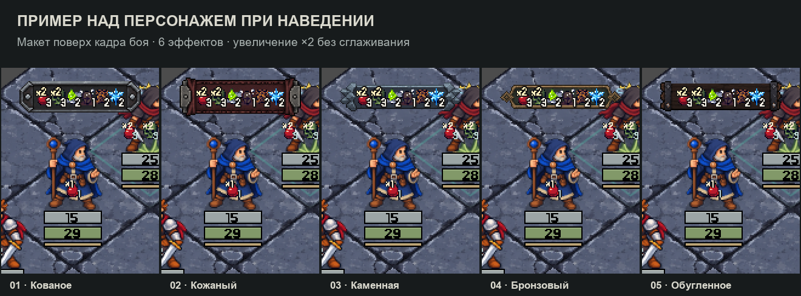

# Пять отдельных подложек при наведении — 2026-11-08

**Исходный лист сравнения до отбора.** Актуальный выбор — в [ART_DIRECTION](../../ART_DIRECTION.md).
Пользователь попросил отдельный рисунок для hover-ряда,
пять вариантов, расширение под число эффектов и более сильный нахлёст при их росте.
Это макеты для выбора; текущий бой и его геометрия не изменены.
Художественный выбор ведётся в [ART_DIRECTION](../../ART_DIRECTION.md).

| № | Материал | Особенность |
|---|---|---|
| 01 | Кованое железо | Контрастный тёмный центр, холодный край и заклёпки |
| 02 | Кожаный ремень | Тёплый бордовый центр, швы и железные окончания |
| 03 | Каменная пластина | Сланец, угловатые сколы, близкая полю палитра |
| 04 | Бронзовый реликварий | Тонкая тусклая окантовка и ромбические окончания |
| 05 | Обугленное дерево | Тихая фактура дуба, железные полосы только по краям |

01 лучше отделяет ряд от плитки; 05 спокойнее по контрасту. Это оценка предложения,
не приёмка. Тёмные мотивы и счётчики требуют отзыва U на выбранной подложке.

Второй лист — механическая композиция поверх прежнего [H1-кадра](../status-icon-frame-20261108/idle-100.png),
увеличенная вдвое nearest. Панель показана над головой мага как предложение размещения,
а не как снятое поведение нового runtime. Исходный кадр/палитра игры не менялись.
Шесть эффектов — искусственный пример плотности; текущий лимит пять с overflow
этим пакетом не изменён. Появление/исчезновение при hover здесь не реализуется.

## Размеры и композиция

Оригинальные мотивы A16 не перерисованы и не перекрашены. Все пять вариантов
имеют одинаковую последовательность: кровотечение, яд, кислота, оглушение, путы,
заморозка. Числа условные: ×2/3, ×2/3, 2, 1, 2, 2; они не заявляют сыгранный бой.
Jersey20/Play10px, без сглаживания, тёмный контур только у глифов.

| Эффектов | Нахлёст рисунков | Шаг | Ширина подложки |
|---|---|---|---|
| 1 | 0 px | 16 px | 40 px |
| 3 | 2 px | 14 px | 68 px |
| 6 | 4 px | 12 px | 100 px |

Формула ширины: `24 + 16 + (n−1) × шаг`. Рост ряда не увеличивает значки.
В макетах два торца по12px сохраняются, середина меняет ширину nearest;
до нарезки удаляются только полностью прозрачные внешние поля исходника.
Высота холста32px; физическая высота материала зависит от рисунка.
Все значки рисуются раньше всех чисел, чтобы следующий рисунок не закрывал счётчик.
Дальнейшее уплотнение выше25% и число больше6 не предлагаются без отдельной проверки.
Это три демонстрационные точки, не готовый алгоритм для всех количеств.

## Происхождение и воспроизведение

PixelLab API v2 `create-image-pro-flash`, пять заданий, без повторных генераций.
Оригиналы128×48 RGBA: `01-forged-iron.png` … `05-timber.png`.
Рядом `*.request.json` — полные запросы без секрета; [receipts.json](receipts.json) —
job IDs, seeds, SHA256 и фактический usage: **5×6 = 30 generations**, USD0.
Оригинальные PNG сохранены побайтно из ответов, края/alpha вручную не исправлялись.

[build_preview.py](build_preview.py) только компонует готовые PNG и текст:
`python docs/art/status-hover-five-concepts-20261108/build_preview.py` из корня.
Нужны Pillow и локальные Arial/Arial Bold Windows для подписей листа.
[layout.json](layout.json) фиксирует геометрию и хеши исходников.
`*-1-effects.png`, `*-3-effects.png`, `*-6-effects.png` — 15 промежуточных композиций
в базовом размере; общий лист увеличен вчетверо без сглаживания.

Проверки/сырые ответы: `test_reports/status-hover-five-concepts-20261108/`.
Проверяются PNG, исходники, воспроизводимость компоновки и сохранность чужих файлов.
Godot/import/full/core/ручной бой для этого пакета не запускались; предыдущие проверки
runtime не объявляются повторёнными. Следующий шаг — выбор U; подключения нет.
