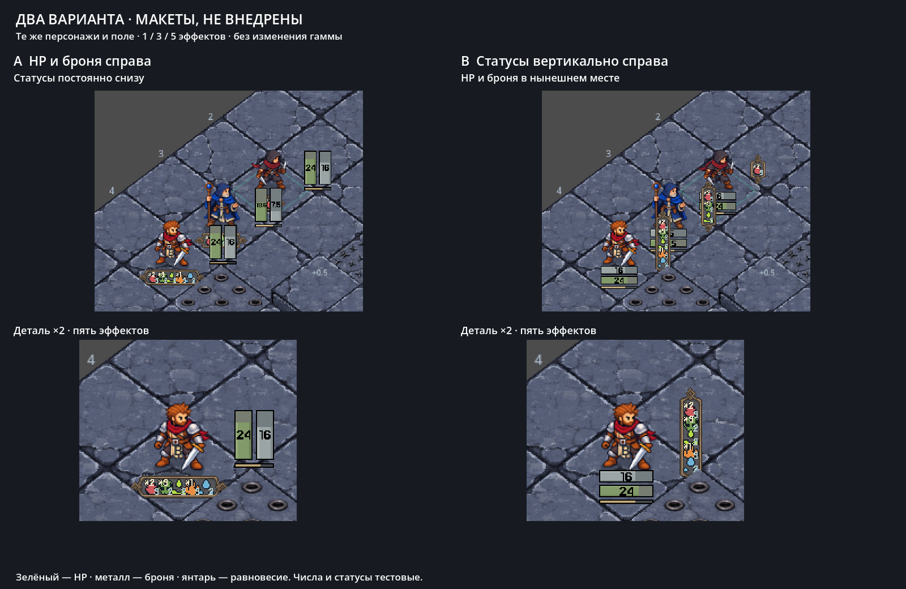

# Видимость статусов и два варианта компоновки — 2026-11-08

База `763e8c76a217d6e8af191063edc0bc7eb5119099`. U уточнил, что без наведения
нужно скрывать значки вместе с подложкой, затем запросил сравнение двух компоновок.

**Внедрено только исправление видимости:** без hover не рисуются подложка,
значки, счётчики и `+N`; selected/inspected сами по себе их не показывают.
Bounds/picking, мгновенная перерисовка при hover, значения, якорь и сортировка прежние.
HP/броня/равновесие, воплощённые эффекты контроля, карточка и осмотр не скрываются.
Владелец поведения — [контракт показа](../../BATTLE_PRESENTATION_REWORK.md#информация-на-поле--состояния-r06r08r09r15).

## Сравнение для выбора U

**Оба варианта ниже — P, не внедрены.** В них статусы показаны постоянно по
запросу U; это предлагаемый альтернативный режим, не поведение внесённого hover-исправления.

| Вариант | Композиция | Компромисс, видимый на макете |
|---|---|---|
| A | HP и броня справа, две вертикальные шкалы16×44, заполнение снизу; числа горизонтально внутри. Равновесие под парой. Статусы горизонтально снизу с общей №4 | Статусы отделены от ресурсов. Дробные числа18.5/7.5 в узкой шкале становятся меньше; боковая пара шире и может накрывать HUD соседа |
| B | Нынешние горизонтальные HP/броня/равновесие снизу; статусы вертикально справа с повёрнутой подложкой№4, сами символы и цифры не вращаются | Привычная ширина чисел сохранена. При5 эффектах ряд высокий и тоже пересекает соседний HUD в плотной диагонали |

Верх сравнения — одна и та же плотная группа с1/3/5 эффектами, обзор вписан в
панель. Низ — тот же боец с5 эффектами без соседних фигур, crop увеличен ровно2×
nearest. Числа/статусы — тестовое представление, не результат сыгранного боя.
Цвета полос, шрифты,24 принятых силуэта, фон/палитра/гамма прежние.
Нахлёст0–4px в A идёт по горизонтали, в B — по вертикали. Подложка B использует
тот же принятый PNG, повёрнут только контейнер. Новые арты не создавались.

Оценка ведущего: **B предпочтительнее для сохранения читаемости чисел**, но перед
внедрением обоим вариантам нужна проверка плотного строя. Макеты специально
оставляют видимыми перекрытия; это не обещание готовой компоновки без коллизий.
Для A потребуется решить длинные дроби/трёхзначные значения; для B — допустимую
высоту, счётчики при вертикальном нахлёсте и правила переполнения.
Ни один вариант не выбран автоматически. Реализация зависит от следующего отзыва U.

## Полные кадры

| Масштаб | Исправленный текущий режим | A | B |
|---|---|---|---|
|100%|[Без hover](current-idle-100.png), [hover бойца с5 эффектами](current-hover-100.png)|[Кадр](A-100.png)|[Кадр](B-100.png)|
|75%|[Без hover](current-idle-75.png), [hover](current-hover-75.png)|[Кадр](A-75.png)|[Кадр](B-75.png)|

Одиночные детали: [A](A-detail.png), [B](B-detail.png).
Все11 PNG оригинальные, SHA — [manifest](manifest.json).

## Метод и проверки

Godot4.7.2/D3D12 Forward Mobile, один runner, прогретая isolated-копия;
без root import, фокуса ОС и пользовательских сохранений.
Проба использует настоящие `HeroHubBattleView`, поле первого боя, принятые спрайты,
шрифты/иконки и синтетические DTO: HP24/32 либо18.5/32, броня16/24 либо7.5/24,
равновесие4/12,1/3/5 эффектов. Состояние core и RNG проверены до/после без изменений.

Исходники пробы: [сценарий](probe_layouts.gd.txt), [рисование A/B](mock_helpers.gd.txt),
[помощник запуска](run_stage.py.txt). Помощник зависит от существующего
`test_reports/status-silhouette-integration-20261108/run_checks.py`; это рецепт
текущего workspace, не автономный публичный runner. Варианты временно добавлены
только в isolated `battle_demo_iso_visual.gd`; после получения кадров восстановлены
исходные байты текущего production-файла. В корне нет переключателя A/B или
изменений размещения. [Probe receipt](probe.json).

Свежие import/startup PASS; GPU: `status_counter_layout`67/0,
`presentation_status`158/0, `battle_condition_icons`442/0, `unit_vital_bars`278/0
(всего945/0). Headless counter18/0 и status96/0 =114/0.
Пиксельные проверки подтверждают полностью прозрачный статусный слой без hover,
в том числе при выборе/осмотре, его появление и повторное скрытие; полосы проверены
отдельно. Изменение комментария после GPU-прогона не меняло код; затем выполнены
headless-прогоны и пробы, source parity повторно сверена.
Логи/валидация: `test_reports/status-hover-layout-20261108/`.

Границы: A/B — только рисунок для оценки, не новая логика picking/прогноза/
переполнения/lifecycle. Воплощённые лёд/путы/оглушение здесь не добавлены в ряд.
Manual F5/движение/zoom/OS-DPI/performance, full/core, старые hub/огонь/шипы/
launcher suites не повторялись. Хаб и его [план](../../HUB_DESIGN_PLAN.md) не менялись.
