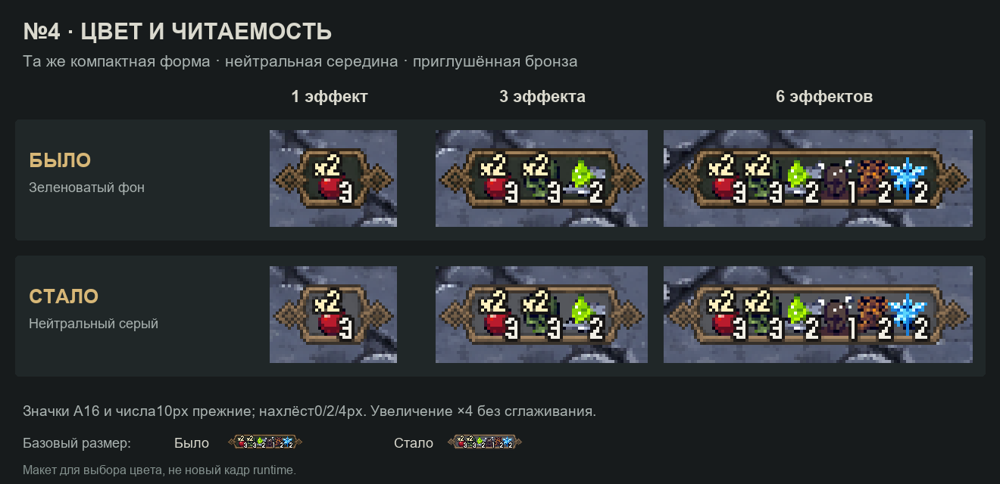
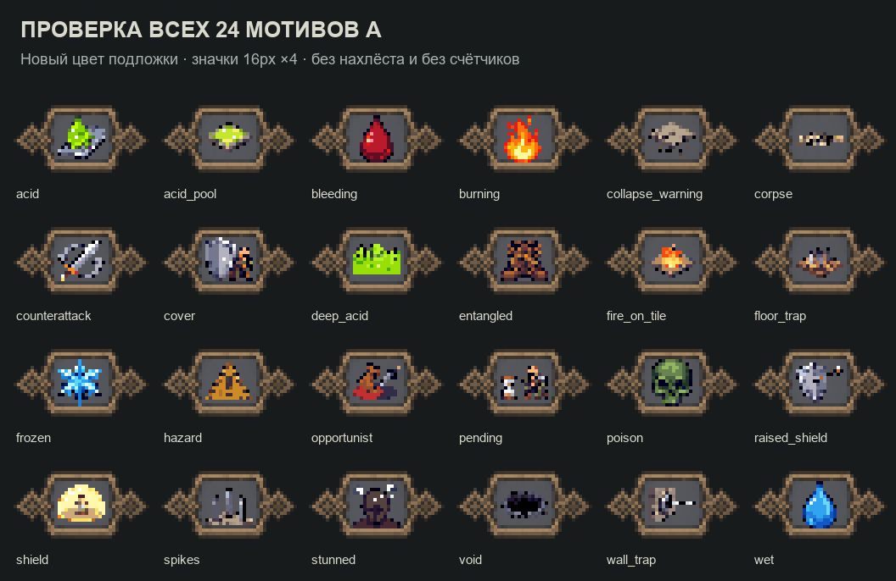
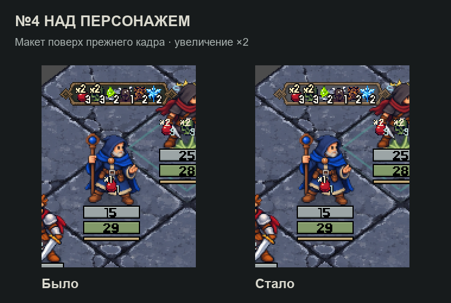

# Компактная подложка №4 — цветовая правка, 2026-11-08

U выбрал компактную форму №4 из [пяти примеров](../status-hover-five-concepts-20261108/README.md)
и попросил проработать цвет для читаемости. Здесь одна цветовая правка PixelLab,
без нового набора форм. Владелец выбора — [ART_DIRECTION](../../ART_DIRECTION.md).
Форма принята U; новая палитра ещё ждёт отзыва. Runtime этим пакетом не меняется.

Зеленоватая середина `#2d332d` заменена нейтральной серой `#55575c`
(значения центрального пикселя исходника128×48). Более светлый спокойный фон
отделяет тёмные яд/путы/оглушение и чёрные контуры; край остаётся приглушённой бронзой.
Цвета рисунков A и чисел не менялись. Свечение, новые детали и фактура не добавлялись.

Каталог показывает все24 прежних A16 без счётчиков и без нахлёста, увеличение×4.
Сравнительный лист показывает1/3/6 с прежними числами10px; снизу есть базовый размер.
Компоновка прежняя: ширина40/68/100px, нахлёст0/2/4px, края12px, значки16px.
Изменение фона не устраняет перекрытие деталей самими числами и соседними значками:
плотный ряд требует визуального отзыва U. Шесть эффектов — синтетический пример,
текущий runtime лимит5+overflow не изменён.

Это композиция на прежнем [H1-кадре](../status-icon-frame-20261108/idle-100.png),
не новый запуск игры. Гамма поля, модель, полосы и механики не менялись.
Размещение над головой и выбранная новая панель в текущий бой ещё не подключены.

## Исходники и воспроизведение

- [before.png](before.png) — побайтная копия исходного №4.
- [after.png](after.png) — неизменённый ответ PixelLab `edit-image-pro-flash`,128×48 RGBA.
- [request.json](request.json) — полный текст запроса, путь и SHA256 входа, без секрета.
- [receipt.json](receipt.json) — job ID, seed110840, SHA256, фактический usage6generations, USD0.

Alpha до/после совпадает побайтно:0 изменённых пикселей. Bounds прежние
`(1,12)–(127,32)`, физическая высота20px; снаружи сохранена прозрачность.
Не было ручной дорисовки, перекрашивания или восстановления маски.

[build_preview.py](build_preview.py) механически компонует готовые PNG, использует
неизменённый компоновщик прежних пяти предложений и сохраняет6 образцов1/3/6.
Запуск: `python docs/art/status-hover04-color-20261108/build_preview.py` из корня.
Нужны Pillow и Windows Arial для подписей. [layout.json](layout.json) хранит
хеши всех24 значков, двух шрифтов, исходников панели, компоновщика и кадра.

Проверки: точные размеры/alpha/исходники, повторная сборка, ссылки/diff/архив HANDOFF,
сохранность33 чужих файлов. Независимое визуальное ревью — в отчёте
`test_reports/status-hover04-color-20261108/validation.json`.
Godot/import/startup/full/core/ручной бой не запускались; прошлые проверки не повторены.
Следующий шаг — отзыв U по цвету; новые пробы или подключение без поручения не начинать.
