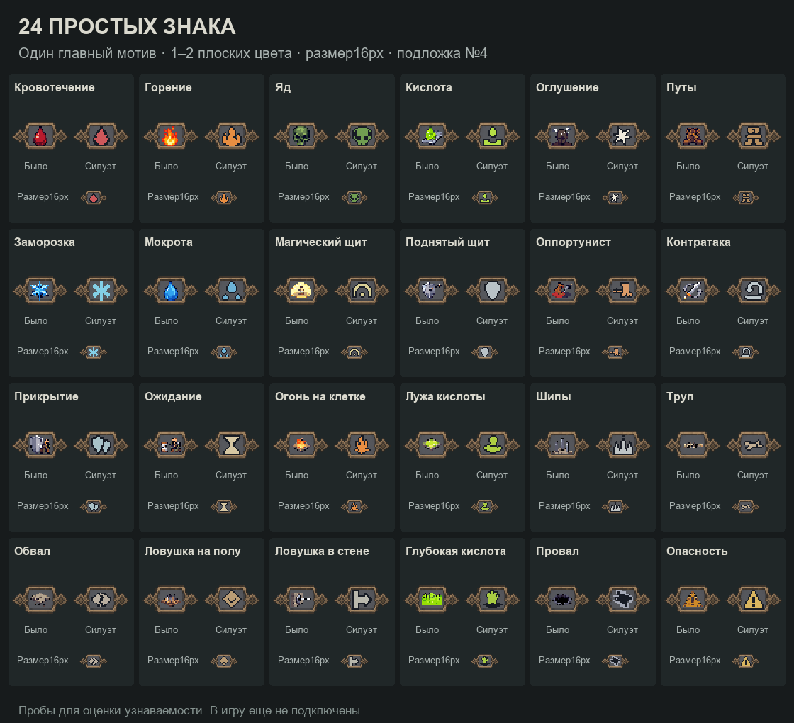
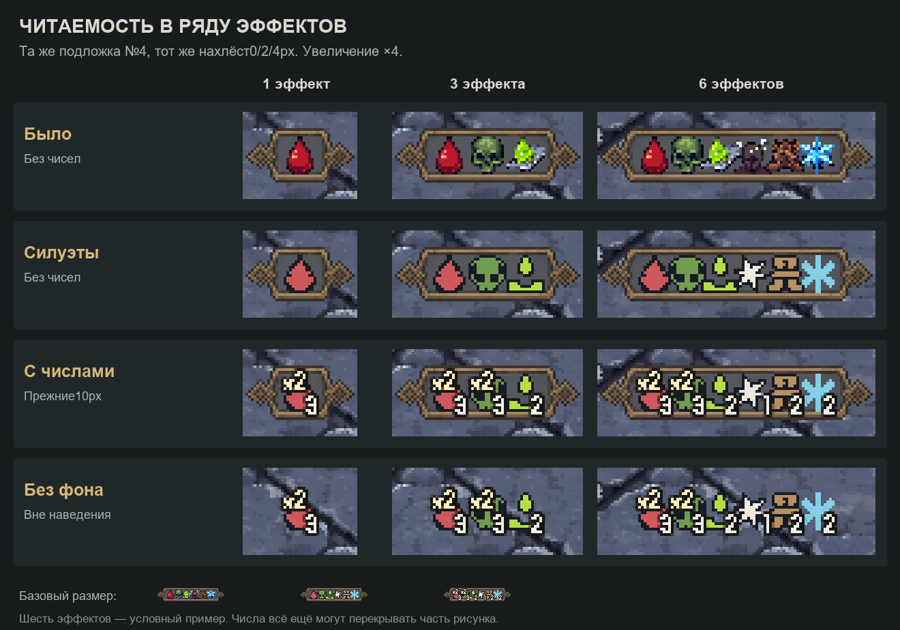
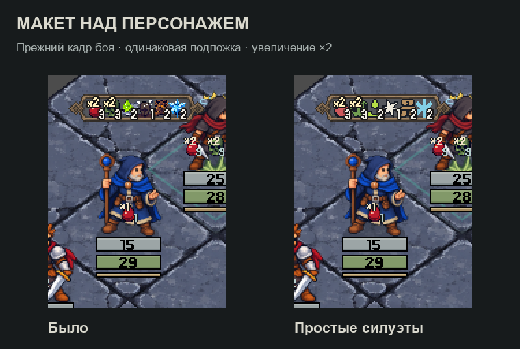

# Простые силуэты состояний — 2026-11-08

U счёл маленькие значки чрезмерно детализированными: нужен минимум деталей,
чтобы смысл читался по силуэту. Здесь новый **P-набор для всех24 существующих ID**,
без подключения в runtime. Художественный выбор — [ART_DIRECTION](../../ART_DIRECTION.md).



Один главный мотив,1–2 плоских непрозрачных цвета, крупный контур и только смысловые
вырезы. Фактура, блики, отражения, мелкие зубы/заклёпки/грани исключены.
Кровь — одиночная капля; мокрота — три капли; яд — череп; труп — лежащее тело.
Кислота — капля над разъеденным краем; лужа — низкое пятно с пузырём;
глубокая кислота — тонущая рука. Магический щит — купол, поднятый — обычный щит,
прикрытие — двойной щит. Ожидание — песочные часы. Цвет дополняет форму.

Это гипотезы узнаваемости, не доказательство чтения без слов. В первую очередь
нужен отзыв U по путам, оппортунисту, контратаке, прикрытию и глубокой кислоте:
абстрактный знак при16px может требовать знакомства с игрой/подписи осмотра.
Пиктограммы не вводят наручники, тонущего бойца или иные новые механики.



На листе ряды1/3/6: старые A без чисел, новые без чисел, новые с прежними числами10px,
новые с числами вне подложки. Рядом базовый размер; большие ряды увеличены×4 nearest.
Подложка — выбранная форма №4 в [последней цветовой пробе](../status-hover04-color-20261108/README.md),
чья палитра ещё не принята U. Прежние ширины40/68/100px и нахлёст0/2/4px сохранены.
Числа и соседние рисунки по-прежнему могут закрывать часть формы; их компоновка
этим пакетом не меняется. Шесть эффектов условны, реальный лимит5+overflow прежний.



Композиция на прежнем [H1-кадре](../status-icon-frame-20261108/idle-100.png), не новый
runtime-снимок. Гамма поля, модели, полосы, игровые механики и approved A не менялись.

## Происхождение и размеры

PixelLab `create-image-pro-flash`:24 отдельных исходника16×16, по одному на ID.
Две адресные коррекции: у frozen убраны мелкие ответвления; у hazard возвращён
пропущенный знак «!». Всего26 завершённых заданий, **130 generations**, USD0.
Первая отправка pending была явно отклонена лимитом10 параллельных заданий;
после завершения очереди она отправлена один раз успешно. Неизвестные POST не повторялись.

- `requests/` — полные24 запроса без секретов; `repairs/` — два корректирующих запроса.
- `raw/` —26 неизменённых ответов PNG, включая первые frozen/hazard.
- `16/` —24 подготовленных PNG16²: прозрачное поле минимум1px, рисунок внутри14².
- [receipts.json](receipts.json) — все job IDs/seeds/usage, выбор исходника, размеры/цвета/alpha/SHA256.
- [symbols.json](symbols.json) —24 ID, названия, палитры и мотивы первой подачи;
  окончательные уточнения frozen/hazard находятся в соответствующих `repairs/`.

Подготовка только механическая: crop прозрачного поля, вписывание в14² nearest
без увеличения, центрирование на16². Семь исходников превышали14px по одной оси
и уменьшены; остальные только размещены. Цвета и alpha не дорисовывались/не подменялись.
В результате23 значка имеют2 цвета, frozen —1; alpha только0/255 у всех24.

Воспроизведение из корня (Pillow; для подписей листов Windows Arial):

```powershell
python docs/art/status-icons-silhouette-20261108/build_assets.py
python docs/art/status-icons-silhouette-20261108/build_preview.py
```

[build_assets.py](build_assets.py) проверяет исходные/выходные SHA;
[build_preview.py](build_preview.py) компонует готовые PNG/текст,
[layout.json](layout.json) фиксирует хеши прежних A, новых значков, подложки, шрифтов и кадра.
Отчёт: `test_reports/status-icons-silhouette-20261108/validation.json`.
PNG/поля/палитры/хеши/повторная сборка и независимое визуальное ревью не заменяют
отзыв U и проверку в реальном бою/при75%. Godot/import/full/core/F5 не запускались.
Следующий шаг — отзыв U по упрощённому стилю; новой серии или подключения без поручения нет.
