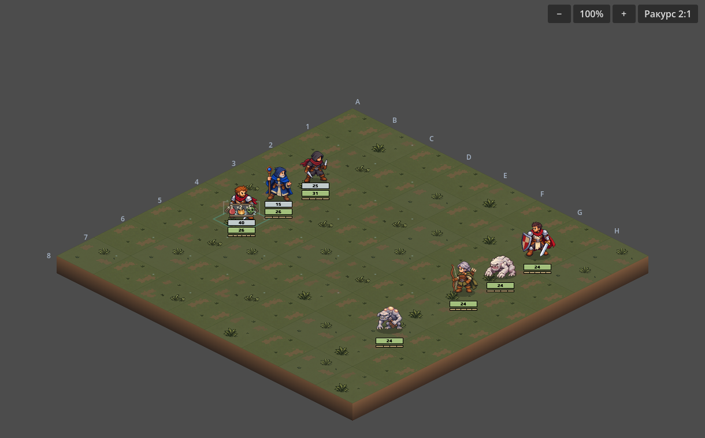

# Значки статусов и глубина полос — 2026-11-23

По уточнению U изменены именно цифры статусов, не HP/броня/боевые числа.
Правила и геометрия — [контракт показа](../../BATTLE_PRESENTATION_REWORK.md).

- Значки уменьшены с20 до18 базовых px внутри прежних20px слотов.
- Стаки, оставшийся срок и `+N` используют частный Play Bold с grayscale AA.
- Все полосы остаются над тайлами. У обычных вырезаются участки в экранных
  границах видимых моделей; выбор снимает маску. Наведение атаки не считается выбором.

Полный кадр — [статусы](status-selected-100.png),
[наведение атаки](attack-target-100.png), [смена выбора](selection-switched-100.png).
Вырезки поля без изменения масштаба; камера100%, обычная сцена HeroHubBattleView
и текущие рисунки персонажей. Для показа счётчиков добавлены только визуальные
записи bleeding/burning/poison: runtime эффектов не выдавался.

`capture_field.gd` проверяет настоящий маршрут set_attack_mode → _hover:
цель получает прогноз, selected_id остаётся прежним, маска её HUD сохраняется.
Выбор другого союзника переносит исключение из маски; state/RNG/counters/revision
остаются побайтно эквивалентными снимками — [результат](field-check.json).

Первые адресные GPU gates обнаружили ошибки новых проверок: несуществующий
Godot API в depth-probe оставлял её незавершённой, контрольная подложка отличалась
фильтром, старые assertions искали только сплошной цвет глифа. Первые логи
сохранены в test_reports/demo-3f611e19abc344c892fea442dd235026/.
Проба локальной глубины отклонена U: передние тайлы срезали шкалы. Итоговый
материал маскирует только рисунки фигур, не меняя сортировку мира. Прозрачные поля
анимационных AtlasTexture учитываются так же, как у still. Геометрия/шрифты
проверяются при раскрытых выбором полосах; отдельные проверки снимают выбор и
измеряют перекрытие своей/соседней моделью и отсутствие перекрытия рельефом.
Границы консервативные: внутренние просветы силуэта отдельно не вырезаются.
При более64 границах хвост объединяется в последний защитный прямоугольник.
Окончательный [отчёт](verification.json): fresh isolated import/startup PASS;
status_counter64/0, unit_vitals1618/0, unit_visual45/0, pointer_pick13/0.
Foundation141/2: оба отказа дословно воспроизведены на baseline6566f055
(без сохранения PNG:130/2); исходники в isolated после сравнения восстановлены.
Полевой capture: семь полных HP-рамок над тайлами и0 отказов; state/RNG неизменны.
1685 runtime-файлов совпали с manifest,21 защищённый источник не изменён.
Независимый game_reviewer просмотрел финальные код/логи/кадр: APPROVE.
Первый отвергнутый кадр сохранён в test_reports/demo-3f611e19abc344c892fea442dd235026/rejected-field-v1/.
Адресные пиксельные пробы — [обычная](probes/unit-vitals-sort-front-unselected-crop.png),
[выбранная](probes/unit-vitals-sort-selected-crop.png), [над рельефом](probes/unit-vitals-over-terrain-crop.png).

Shader сохраняет входной COLOR без повторного умножения на текстуру, включая
font AA; семантика сверена с [документацией Godot](https://docs.godotengine.org/en/stable/tutorials/shaders/shader_reference/canvas_item_shader.html#color-and-texture).

Воспроизведение: из корня запустить `python tools/demo/isolate.py --render-check
--only status_counter_layout unit_vital_bars unit_visual_contract --keep-project
--godot <Godot4.7.2.exe> --screen 0`. Затем `python
docs/art/status-icons-vitals-order-20261123/run_capture.py --project
<test_reports/demo-ID/project> --godot <Godot4.7.2.exe>`.
Один изолированный процесс за раз, свой APPDATA; корневой проект не импортируется.

Full/core, ручные F5/Editor/DPI, длительная игра и окончательная художественная
приёмка не выполнялись. Выбранные полосы рисуются целиком, обычные могут быть
частично скрыты границами моделей. Костями занимается отдельная
[примерка20вариантов](../bones-field-comparison-20261123/README.md), выбор открыт.
